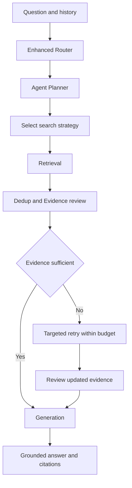
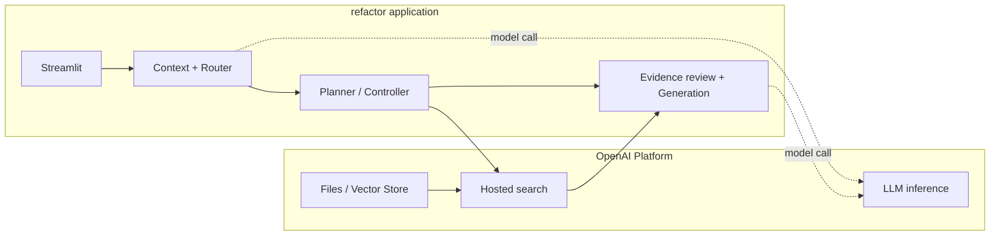

# Bounded Adaptive Agentic RAG

> [!abstract] Гол зорилго
> **OpenAI-hosted Vector Store**-ийг хэвээр ашиглаж, `refactor` application дотор асуултад тохирсон retrieval strategy сонгох, evidence шалгах, шаардлагатай бол хязгаартай retry хийх. Энэ нь **нэг bounded workflow**, олон agent process биш.

## Main Architecture

Доорх existing main architecture diagram-ийн дараалал болон component boundary-г хадгалав.

> [!note] Mermaid navigation
> Diagram дахь node-ийн нэр нь component note-той таарна. Obsidian-ийн Mermaid click behavior хувилбараас хамаарч болно. `class ... internal-link` нь Graph View-д wiki-link үүсгэдэггүй; доорх component холбоосууд үндсэн navigation болно.

## High-level Input → Processing → Output

| | Урсгал |
|---|---|
| **Input** | Хэрэглэгчийн асуулт, bounded conversation context |
| **Processing** | Router → Planner proposal → deterministic strategy selection → OpenAI Vector Store retrieval → evidence review → шаардлагатай бол хязгаартай corrective retry → grounded generation |
| **Output** | Grounded answer, citations, `answered` / `partially_answered` / `insufficient` зэрэг status |

Question taxonomy нь relationship, intent/policy, question structure, retrieval planning-ийг тусдаа хэмжээс гэж авч үзнэ. Эхний гурвыг [[Enhanced Router]], retrieval information needs болон capability-г [[Agent Planner]], харин executable strategy-г [[Select search strategy]] хариуцна. Shared taxonomy нь компонентын дотоод тайлбар хэвээр байна.

## System Boundary

- **Ingestion:** upload → parsing → chunking → embedding → indexing нь OpenAI Platform-ийн hosted урсгал; одоогийн documentation migration-ийн scope биш.
- **Retrieval:** query orchestration, OpenAI Vector Store search, боломжит multi-query aggregation болон evidence selection нь application orchestration.
- **Generation:** батлагдах боломжтой passage-д тулгуурласан хариулт, partial/insufficient status, citation validation.
- **RAG Admin:** энэ Obsidian design нь тусдаа `refactor` төслийн тухай; RAG Admin-ийн код, database, schema-г өөрчлөх ажил биш.

## Main Component Navigation

Зөвхөн үндсэн component hub-ууд руу шууд navigation өгнө.

| Component | Үүрэг | Одоогийн төлөвийн товч зураг |
|---|---|---|
| [[Question and history]] | Original question болон bounded history/context бэлтгэх | Design Complete; implementation/validation тусдаа |
| [[Enhanced Router]] | Relationship, intent/policy, structure ба resolved question | Design Complete; implementation/validation pending |
| [[Agent Planner]] | Required facts, information needs, retrieval capabilities санал болгох | Design Complete; implementation pending |
| [[Select search strategy]] | Registry matching, budget/fallback шалгах, SearchPlan гаргах | V1 Design Complete; implementation pending |
| [[Retrieval]] | SearchPlan query-г OpenAI Vector Store-д ажиллуулах | Одоогийн нэг-query search; orchestration extension proposed |
| [[Dedup and Evidence review]] | Passage-уудыг deduplicate хийж evidence review хийх | Review одоо бий; merge enhancement proposed |
| [[Targeted retry within budget]] | Дутуу evidence-д bounded retry хийх | Одоогийн retry-г хязгаартай удирдах design |
| [[Generation]] | Evidence-д grounded answer үүсгэх | Одоогийн generation behavior-ийг хадгалах |

Generation урсгалын нэмэлт stage-ууд нь diagram-д харагдана: **Evidence sufficient** нь coverage/stopping нөхцөлөө нарийвчлах, **Review updated evidence** нь retry дараах review, **Grounded answer and citations** нь output contract болон citation safety-г тодорхойлно. Эдгээрийн дэлгэрэнгүй note-ууд main component navigation-ийн дэд түвшинд байна.

## Core Constraints

1. **LLM proposes; code enforces.** Router semantic ангилал болон Planner information needs/capability санал болгож болно; ID/access validation, deterministic Strategy Selector, budget, stop condition-ийг code мөрдүүлнэ.
2. **No unnecessary rewrite.** Одоогийн `classify_intent`, `review_evidence`, `generate_answer`, `search_documents` behavior-ийг шаардлагагүйгээр солихгүй.
3. **No fabricated facts.** Өмнөх assistant answer policy source биш; шинэ evidence review эх сурвалжийг дахин шалгана.
4. **Bounded work.** Search call, query, retry, хугацаа, token budget хязгаартай. Тоон утгууд нь initial configuration candidates; батлагдсан optimum биш.
5. **Per-request isolation.** Multi-intent дотор R1/R2/R3 тус тусдаа restriction, context, evidence, status-тай.
6. **Regression first.** Өмнөх сайн behavior-ийг алдуулахгүй; өмнө төлөвлөсөн 10 асуултын regression нь parity шалгах development зорилго болохоос том benchmark эсвэл production баталгаа биш.

## Downstream Stage Status

| Stage | Одоогийн тэмдэглэл |
|---|---|
| Evidence sufficient | Coverage/stopping нөхцөл нарийвчлах |
| Review updated evidence | Retry дараах review-г дахин ашиглах |
| Grounded answer and citations | Output contract, citation safety |

Эдгээр stage-ийн source note-уудыг энэ migration-д өөрчлөөгүй.

## Unresolved Items

- `related_turn_ids`-ийн live accuracy, session дотор хуучин candidate олох coverage.
- Multi-query budget болон fusion-ийн бодит latency/cost.
- Батлагдсан answer quality-г agentic extension өөрчилж байгаа эсэх.

> [!info] Өмнөх documentation status
> Эх hub-д дараагийн шат нь [[Enhanced Router]]-ийн input/output contract-ийг батлах гэж тэмдэглэсэн байсан. Энэ component-ийн note-ууд одоо hub/subnote бүтэцтэй болсон; migration дууссаны дараах дараагийн component нь **Retrieval** байна. Retrieval-ийн алгоритм/implementation энэ ажлын хүрээнд өөрчлөгдөөгүй.
