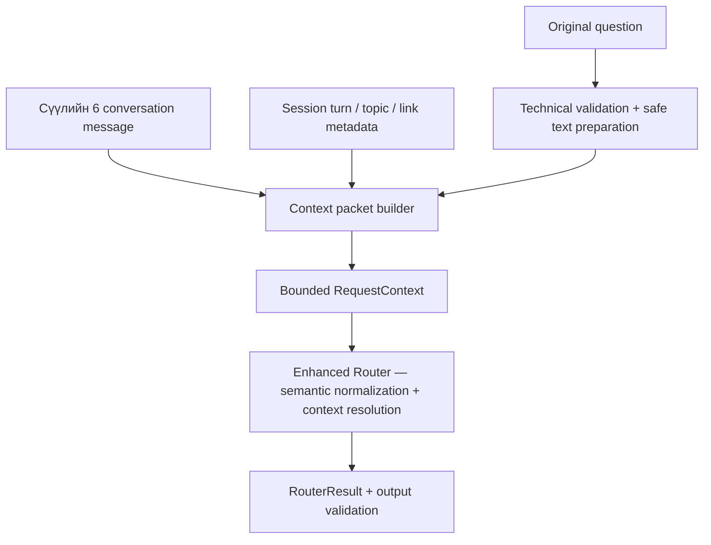
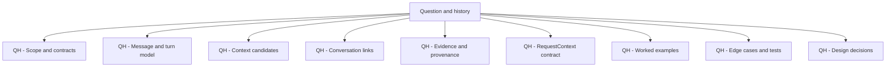
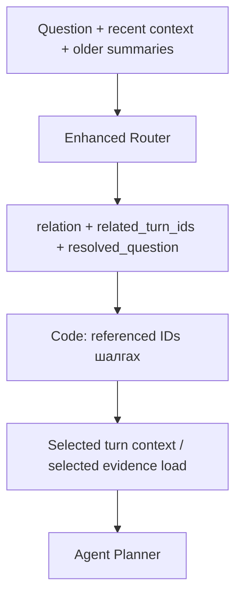

# Question and history

> [!success] Шийдвэр
> Энэ component-ийн **архитектурын дизайн шийдэгдсэн**. `refactor` дээр бүх өөрчлөлт хэрэгжиж, тестээр батлагдсан гэсэн үг биш. Technical validation ба safe text preparation нь Question and History-д; semantic normalization ба contextualization нь [[Enhanced Router]]-т хамаарна.

## 1. Ямар асуудлыг шийдэх вэ?

Хэрэглэгчийн одоогийн асуултыг **анхны хэлбэрээр нь** хадгалж, өмнөх ярианы *хамааралтай байж болох* хэсгийг хязгаартай metadata/context болгон бэлдэж, [[Enhanced Router]]-т өгөх.

Жишээ:

- A: `3 tsagiin chuluu yaj avah ve?`
- B: `hen zovshooroh ve?` → A-ийн follow-up
- C: `Ёс зүйн зөрчил гэж юу вэ?` → шинэ сэдэв
- D: `Шийдвэрийг давж заалдах уу?` → C-ийн follow-up
- E: `tegeed manager baihgui bol?` → **D биш, B/A-тай холбоотой байж болно**

Сүүлийн асуултад E-г яг аль turn-тай холбохыг **энэ component шийдэхгүй**; [[Enhanced Router]]-ийн LLM reference resolution шийднэ. Энэ component тухайн шийдвэрт хэрэгтэй candidate context-ийг бэлдэнэ.

Энэ component-ийн input нь дөрвөн өөр хэмжээсийн ангиллаас тусдаа. Хэмжээсүүдийн заагийг [[Question taxonomy]]-оос харна.

## 2. Input → Processing → Output

| | Contract |
|---|---|
| **Input** | `current_question`, `session_id`, recent user/assistant messages, session-level turn metadata, боломжтой бол өмнөх evidence reference |
| **Processing — target** | Input type/хоосон утга/хэмжээ шалгах; safe Unicode NFC ба whitespace боловсруулалт; history structure, role, order, ID шалгах; context budget-д багтаах |
| **Output — target** | `RequestContext`: original болон optional prepared question, bounded history/candidates/evidence references, budget |
| **Not here** | Translation, typo correction, semantic rewrite, follow-up шийдвэр, intent/policy, `resolved_question`, retrieval strategy, retrieval, answer generation |

Энэ хүснэгтийн technical preprocessing нь **зорилтот contract**. Одоогийн `answer_question()` нь тусдаа empty/type/NFC validation алхамгүй; UI нь chat input-оос string авч Core руу дамжуулдаг. Одоогийн `classify_intent()` semantic normalization-ийг LLM prompt дотор хийдэг.

## 3. Validation ба normalization-ийн зааг

| Давхарга | Эзэмшигч | Юу хийдэг | Юу хийхгүй |
|---|---|---|---|
| Technical validation + safe text preparation | Question and History; deterministic Python | Input/history structure, хэмжээ, identifiers, context budget шалгах; утга өөрчлөхгүй NFC/аюулгүй whitespace боловсруулах | Translation, typo засах, intent/follow-up ангилах |
| Semantic normalization + contextualization | Enhanced Router; existing structured LLM call | Кирилл/Latin/English/mixed хэлний утгыг тайлбарлах, холбоотой context-оор standalone асуулт үүсгэх | Шинэ fact зохиох, final search strategy сонгох |

`original_question` яг ирсэн эхээрээ хадгалагдана. Хэрэв technical preprocessing-ийн дараах утга хэрэгтэй бол `prepared_question` optional field байна; энэ нь эхийг орлохгүй. Whitespace боловсруулалт code block, quoted text, document ID зэрэг exact string-ийг гэмтээж болохгүй.

## 4. Энэ component доторх тэмдэглэлүүд

### Унших дараалал

1. [[QH - Scope and contracts]] — boundary, одоогийн vs зорилтот behavior.
2. [[QH - Message and turn model]] — `message_id`, `turn_id`, `session_id`, `request_id`.
3. [[QH - Context candidates]] — сүүлийн 6-аас цаадах A/B-г хэрхэн candidate-д оруулах.
4. [[QH - Conversation links]] — `topic_id`, `related_turn_ids`, parent/ancestor.
5. [[QH - Evidence and provenance]] — raw passage vs selected evidence, citation ID.
6. [[QH - RequestContext contract]] — Router-д илгээх JSON-төст structure.
7. [[QH - Worked examples]] — бодит хэрэглээний урсгал.
8. [[QH - Edge cases and tests]] — алдаа, edge case, acceptance checks.
9. [[QH - Design decisions]] — баталсан шийдвэр, дараа хийх ажлууд.

## 5. Баталсан гол зарчмууд

- **Original question-ийг хадгална.** Latin Mongolian, English, mixed, typo-г technical шатанд semantic rewrite хийхгүй; semantic normalization-ийг [[Enhanced Router]] хариуцна.
- Unicode NFC болон хязгаартай whitespace normalization нь technical preparation-ийн зорилтот behavior; одоогийн code-д хэрэгжсэн гэж үзэхгүй.
- **Одоогийн `MAX_HISTORY_MESSAGES=6` хэвээр.** Энэ нь 6 *мессеж* буюу ердийн үед 3 user/assistant pair. Зорилтот загварт энэ тоо нь Router руу явуулах **дэлгэрэнгүй recent message context**-ийн limit; session-д хадгалах бүх turn-ийн тоо биш.
- Одоогийн UI бүх conversation message-ийг session-д хадгалж харуулна; Core/Router руу өгөх context сүүлийн 6 message-ээр хязгаарлагдана.
- **Older turns**-ийг шаардлагатай үед session-ийн *товч metadata*-аар candidate болгоно. Энэ нь 6 message limit-ийг зөрчиж, хуучин бүх answer/passage-ийг хавсаргана гэсэн үг биш.
- **Candidate previous turn** гэдэг нь recent зургаан message-ээс гадуур боловч current асуултад хамаарч болох тухайн session-ийн turn-ийн богино summary/metadata. Candidate байх нь холбоо тогтоосон гэсэн үг биш.
- `related_turn_ids` нь Router сонгосон context turn-уудын ID, `topic_id` нь session доторх сэдвийн бүлгийг илэрхийлэх design proposal. Хамгийн сүүлийн turn-аас өмнөх хуучин turn-тэй холбогдохыг candidate discovery + Router resolution гэж загварчилна.
- **Raw passage ≠ selected evidence.** Өмнөх answer-д хамааралгүй result-ийг history evidence гэж үзэхгүй.
- **Link ≠ evidence.** Хуучин turn ID нь reference, харин бодлого/журам батлах эх сурвалж биш.
- **Per-request linking.** Олон intent-тэй turn-ийн R1/R2/R3 тус тусдаа context link агуулж болно.
- **Session boundary.** Өөр хүний эсвэл өөр session-ийн message ID-г холбохгүй.

## 6. Хоёр шаттай context loading

**Яагаад?** Хуучин 50 turn-ийн бүх answer, passage-ийг Router-д урьдчилан өгөх нь token ихтэй, төөрөгдөл үүсгэнэ. Эхлээд хязгаартай summary; сонгосон turn-ийн дэлгэрэнгүй context-ийг дараа нь load хийнэ.

> [!warning] Шинэчлэлтийн зааг
> Одоогийн `refactor` нь сүүлийн зургаан мессежээр router ажиллуулж, follow-up үед **хамгийн сүүлийн assistant turn-ийн raw passages**-ийг дахин авч review хийдэг. `related_turn_ids`, older candidates, selected evidence reuse нь одоогоор **зорилтот дизайн**, хэрэгжсэн гэж үзэхгүй.

Одоогийн UI raw `result["passages"]`-ийг bounded хэмжээгээр history-д хадгалж байна; reviewer-аар шүүсэн `result["evidence"]`-ийг биш. Дэлгэрэнгүй: [[QH - Evidence and provenance]].

## Related

- Ангиллын хэмжээсүүд: [[Question taxonomy]]
- Өмнөх шат: [[Bounded Adaptive Agentic RAG]]
- Дараагийн шат: [[Enhanced Router]] → [[Agent Planner]]
- Өгөгдлийн contract: [[QH - RequestContext contract]]
- Алдааны шалгуур: [[QH - Edge cases and tests]]
