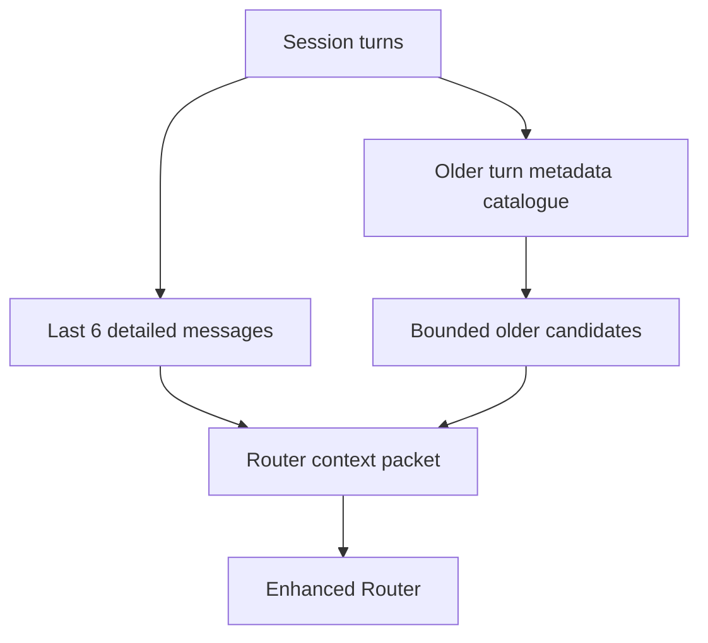

# QH - Context candidates

## Асуудал

`MAX_HISTORY_MESSAGES=6` гэдэг нь **сүүлийн 6 message**, ойролцоогоор 3 бүтэн turn. Харин шинэ E асуулт нь хамгийн сүүлийн D биш, өмнөх B асуултад эргэж очиж болно. Тиймээс **recent context** болон **older candidate catalogue**-ийг салгана. Runtime энэ салгалтыг хэрэгжүүлсэн: recent зургаан message, recent window-ээс гаднах хамгийн сүүлийн найман user-question summary.

Runtime catalogue нь зөвхөн `turn_id` ба 240 тэмдэгт хүртэлх `question_summary` агуулна; topic, timestamp, answer summary болон semantic shortlist байхгүй. Ангиллын үндсэн ойлголтууд: [[Question taxonomy]].

## Candidate assembly — том алгоритм

1. **Recent window**: сүүлийн 6 message-ийг role/content/turn ID-тай авах.
2. **Older catalogue**: одоогийн session-ийн хуучин turn бүрээс товч `turn_id`, `topic_id`, question summary, optional answer summary, parent link авах.
3. **Bounded shortlist**: recent дотор байхгүй бөгөөд session-д хүчинтэй, давхардалгүй хэдхэн older candidate-ийг нэмэх.
4. **Resolver**: LLM шинэ асуултыг хараад candidate-уудаас `related_turn_ids` сонгоно; *энэ сонголт нь дараагийн* [[Enhanced Router]] *шатны ажил*.
5. **Expand on selection**: ID code validation хийсний дараа зөвхөн сонгосон turn-ийн detailed answer/selected evidence-г load хийнэ.

## Хуучин candidate-г яаж сонгох вэ?

### A/B/C/D/E жишээ

| Turn | Агуулга |
|---|---|
| A | 3 цагийн чөлөө авах журам |
| B | Хэн зөвшөөрөх вэ? — A-ийн follow-up |
| C | Ёс зүйн зөрчил гэж юу вэ? — шинэ сэдэв |
| D | Шийдвэрийг давж заалдах уу? — C-ийн follow-up |
| E | Менежер эзгүй бол яах вэ? — B/A-тай холбоотой байж болно |

E нь дарааллаар D-ийн дараа ирсэн ч утгын хувьд B, шаардлагатай бол A-ийн context-ийг зааж болно. Candidate discovery нь B/A-г shortlist-д оруулах ажил; LLM reference resolution нь shortlist-оос `related_turn_ids` сонгох тусдаа ажил.

Candidate бүр тухайн session-д харьяалагдсан valid turn ID-тэй байх ёстой. Сонгосон ID-г backend дахин шалгаж, өөр session/user-ийн ID-г хүлээн авахгүй. `topic_id` нь shortlist гаргахад тусалж болох ч дангаараа follow-up шийдвэр биш. Link-ийн contract: [[QH - Conversation links]].

Эхний prototype-д **хөнгөн session-level topic catalogue** ашиглаж болно:

- Сэдэв бүрийн сүүлийн холбоотой turn болон анхны anchor turn-ийн summary.
- Recent window-д байгаа turn-ийн parent/ancestor ID-ууд.
- Session жижиг үед хязгаарт багтах хуучин turn summary-ууд.

> [!caution] Хязгаар
> Хуучин B turn candidate-ийн багцад **ороогүй** бол LLM B-тэй холбоог найдвартай тогтоож чадахгүй. `topic_id` нь туслах metadata болохоос бүх reference-ийг автоматаар олдог шийдэл биш. Том session-д нэмэлт semantic candidate search хэрэг болж магадгүй, гэхдээ эхний дизайн тусдаа vector store шаарддаггүй.

## Design knobs (батлагдсан тохиргоо биш)

| Параметр | Эхний санал | Яагаад |
|---|---|---|
| `MAX_HISTORY_MESSAGES` | 6 | Одоогийн behavior хадгална |
| `MAX_OLDER_CANDIDATES` | 6–10 товч summary | Context өсөлтийг хязгаарлах |
| `MAX_LINK_DEPTH` | 2–3 | Parent chain-ийг хэт урт болгохгүй |
| `MAX_CANDIDATE_TEXT` | Нэг turn-д богино summary | Long answer / raw passages хуулахгүй |

## Candidate ordering

Candidate-ийг **хуучин → шинэ** chronological sequence-ээр харуулна; runtime-д `turn_id` болон question summary байна. Timestamp, topic label нэмэх нь цаашдын design. Шинэ асуултад topic нэр таарсан гэх нэг шалтгаанаар relation шууд тогтоохгүй.

## Implementation status (as built)

- Status: partial. `build_router_history_context()` нь role/content/turn ID-тай сүүлийн 6 usable message, recent window-д ороогүй хамгийн сүүлийн 8 user turn-ийн summaryг chronological дарааллаар гаргана.
- Verified: summary 240 тэмдэгтээс хэтрэхгүй, allowed ID багц зөвхөн recent messages ба candidate catalogue-д орсон turn-үүдийг агуулна (`tests.test_routing.ClassifyIntentTests.test_older_candidate_catalogue_is_chronological_and_bounded`). Legacy history-д ID байхгүй бол request-local `legacy-turn-{index}` ID онооно.
- Limits: candidate discovery зөвхөн chronology дээр тулгуурлана; 8-аас хуучин turn сонгогдохгүй. Session identity тусдаа баталгаажихгүй, candidate coverage/semantic choice чанар live эсвэл label-тэй evaluation-аар шалгагдаагүй.

## Related

[[Question taxonomy]] · [[QH - Conversation links]] · [[QH - RequestContext contract]] · [[QH - Edge cases and tests]] · [[Enhanced Router]]
