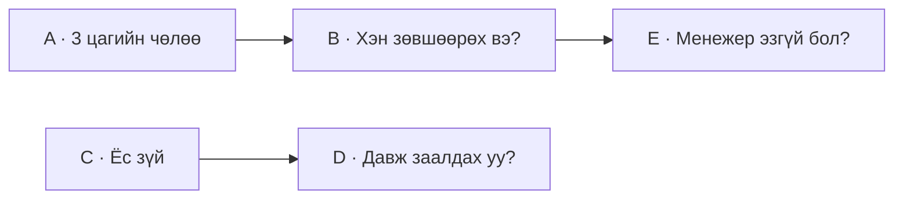
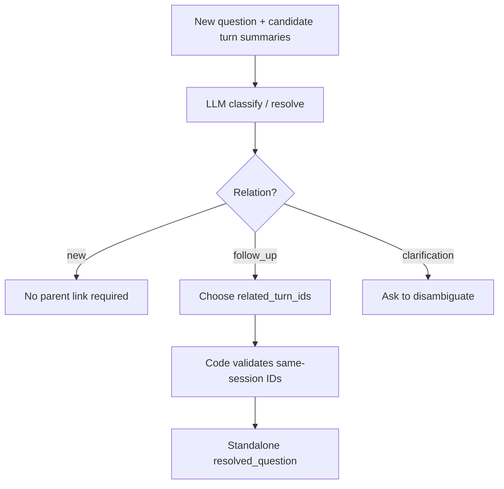

# QH - Conversation links

## Яагаад холбоос хэрэгтэй вэ?

Chronological history: `A, B, C, D, E`. Гэхдээ semantic холбоо нь `B → A`, `D → C`, `E → B` байж болно. Follow-up үргэлж хамгийн сүүлийн turn-тай холбогддоггүй.

## Conceptual relationship төрлүүд

| Төрөл | Утга | Жишээ |
|---|---|---|
| `new` | Шинэ бие даасан асуулт | Сахилгын шийтгэл гэж юу вэ? |
| `same_topic` | Өмнөх answer шаардлагагүй ч ижил сэдэв | Ээлжийн амралт хэд хоног вэ? |
| `follow_up` | Өмнөх context хэрэгтэй | Тэгвэл менежер байхгүй бол? |
| `correction` | Өмнөх утгыг засах | 4 биш 3 цаг байсан. |
| `cross_reference` | Хэд хэдэн өмнөх turn-ийг хамтад нь заах | Өмнөх хоёр журмын ялгаа юу вэ? |
| `ambiguous` | Context/referent тодорхойгүй | Тэр хүсэлтийг яах вэ? |

Эдгээр нь conceptual ялгаа бөгөөд бүгдийг runtime enum болгох шаардлагагүй. `ambiguous` нь тусдаа relationship гэхээсээ илүү clarification шаардсан төлөв байж болно. Ангиллын бусад хэмжээс: [[Question taxonomy]].

## Relationship-ийн хоёр түвшин

1. **`topic_id`**: `leave_01`, `ethics_01` гэх сэдэв/хэлэлцүүлгийн бүлэг. Ижил topic ID гэдэг нь заавал referent гэсэн үг **биш**.
2. **`related_turn_ids`**: E-ийн context-ийг бүрэн болгоход үнэхээр хэрэглэсэн өмнөх `turn_id`-үүд (жишээ: `B`, шаардлагатай бол `A`).

## Одоогийн runtime ба санал болгож буй detail

Одоогийн `refactor` router-ийн үндсэн output нь `new`, `follow_up`, `clarification`. Үүнийг хадгална. Нарийн ялгааг шаардлагатай үед optional `relation_detail` болгох нь proposal:

- `same_topic_independent`: нэг сэдэвтэй боловч `follow_up` биш байж болно.
- `immediate_follow_up`: хамгийн ойрын parent-тай холбоотой.
- `older_turn_follow_up`: хэдэн turn алгасаж буцсан.
- `correction`: өмнөх асуултын утгыг засна (4 цаг биш 3 цаг).
- `cross_reference`: хэд хэдэн өмнөх turn-ийг зэрэг дурдсан.
- `ambiguous_reference`: referent олон, тодруулах шаардлагатай (effective route: `clarification`).

**Эдгээр нарийн type нь metadata**; заавал 6 шинэ `relationship` enum нэмэх шаардлагагүй.

## Router-ийн хийх шийдвэр

**QH component зөвхөн candidate-г бэлдэнэ; Router-оос ирсэн шийдвэрийг хадгалах, valid эсэхийг шалгах нь pipeline/controller-ийн ажил.** Candidate turn-уудыг олох болон LLM-ээр аль referent болохыг шийдэх хоёр өөр алхам юм.

## Link-ийн найдвартай байдлын дүрэм

- LLM зөвхөн **candidate жагсаалтад байсан** turn ID-ийг сонгож болно.
- ID нь тухайн session-д байна, current turn-ээс өмнөх байна гэдгийг код шалгана.
- Direct parent алдаатай бол downstream chain бүхэлдээ алдаж болно. Link-ийг absolute truth гэж үзэхгүй.
- Parent record устсан/хандах эрхгүй болсон бол link-ийг ашиглахгүй, шаардлагатай бол clarification.
- Нэг шинэ message олон request-тэй бол `related_turn_ids`-ийг **request бүрд** хадгална.

## Related

[[Question taxonomy]] · [[QH - Context candidates]] · [[QH - Message and turn model]] · [[QH - Worked examples]] · [[Enhanced Router]]
