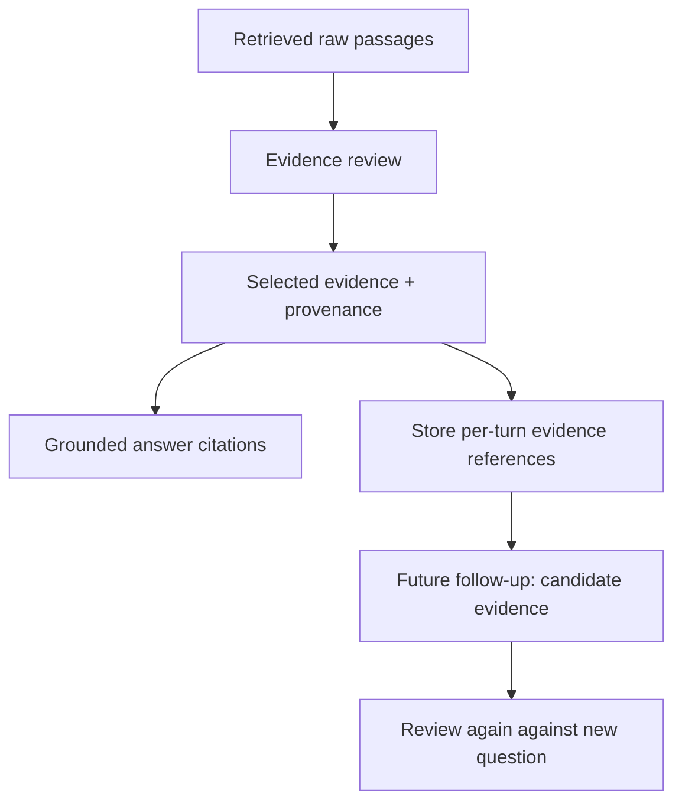

# QH - Evidence and provenance

## Асуудал: Raw passages vs selected evidence

Одоогийн Streamlit замд `result["passages"][:5]` history-д хадгалагдаж байгаа. Гэтэл pipeline review хийсэн `result["evidence"]` талбар гаргадаг. Raw Top-5 дотор хамгийн өндөр score-той **IT change management** passage ч чөлөөний асуултад орж ирсэн жишээ байгаа.

**Target design:** өмнөх turn-ээс **review-д хамааралтай гэж сонгогдсон evidence**-ийг source identity-тай нь хадгалах. Хариултад cited болсон эсэхийг тусдаа тэмдэглэнэ.

| Field | Зорилго |
|---|---|
| `file_id` | OpenAI-д байгаа file identity |
| `filename` | UI-д харагдах нэр; identity-д дангаар найдахгүй |
| `document_version` | Боломжтой бол version/effective metadata |
| `chunk_id` эсвэл `text_fingerprint` | Chunk identity / exact dedup-д |
| `text` | Reviewer-д дахин өгөх боломжтой evidence |
| `reviewed_relevance` | Relevant эсэх / ямар fact дэмжсэн |
| `cited_in_answer` | Эцсийн answer-д ашигласан эсэх |
| `request_id` | R1/R2/R3 аль хүсэлтэд хамаарах |

## Citation display ID ≠ permanent identity

`[D1]`, `[D2]` нь тухайн generation turn-д оноогдох **түр identifier** байж болно. Follow-up storage-д `[D1]`-ийг байнгын chunk key болгож болохгүй. `file_id + stable chunk identity + version` зэрэг таних мэдээлэл хэрэгтэй.

## Яагаад дахин review хийх вэ?

- Өмнөх answer буруу байж болно; answer текст policy source биш.
- Хуучин evidence шинэ асуултад тохирохгүй байж болно.
- Баримтын хувилбар солигдсон бол хуучин content obsolete байж болно.
- Citation зөв ID-тай байлаа ч өгүүлбэрийг агуулгын хувьд батлахгүй байж болно.

## Loading policy

Router `related_turn_ids` сонгосны дараа код зөвхөн тэр turn-ийн selected evidence-ийг context candidate хэлбэрээр авч болно. **Шууд generation-д баталгаатай гэж оруулахгүй;** шинэ retrieval-ийн evidence-тэй хамт reviewer-т өгнө.

Multi-intent message дээр evidence record бүр `request_id`-тай; restricted R3-ийн source-ийг allowed R1-ийн context-д оруулахгүй.

## Related

[[Question and history]] · [[QH - RequestContext contract]] · [[Dedup and Evidence review]] · [[Grounded answer and citations]]
