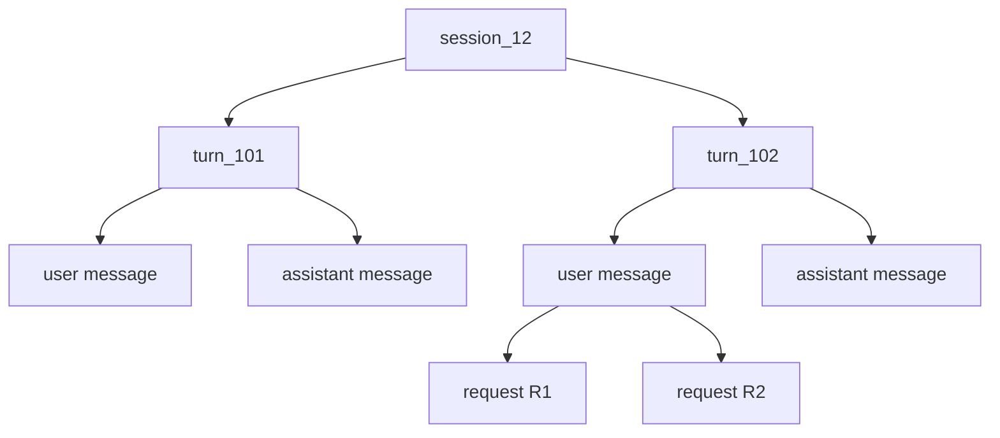

# QH - Message and turn model

## `message` vs `turn` vs `request`

Нэг session дотор олон **turn** байна. Нэг turn-ийг user-ийн асуулт болон түүнд өгсөн assistant-ийн хариулт гэж үзэж болно. Нэг user message нь олон independent **request** (R1, R2, R3) агуулж болно.



| ID / Field | Үүрэг | Тэмдэглэл |
|---|---|---|
| `session_id` | Хэлэлцүүлгийн хүрээ | Нэг session-ээс нөгөөг fetch хийхгүй |
| `turn_id` | Нэг user turn-ийн тогтвортой ID | History link-ийн үндсэн anchor |
| `message_id` | User/assistant message-ийн ID | Дэлгэцийн дараалал, role |
| `request_id` | Turn доторх R1/R2/R3 | Multi-intent isolation |
| `topic_id` | Ерөнхий сэдвийн бүлэг | Ижил topic = заавал follow-up биш |
| `related_turn_ids` | Өмнөх turn-тай холбоо | Router санал; код verify хийнэ |
| `original_question` | Хэрэглэгчийн яг бичсэн текст | Rewrite хийхгүй |
| `resolved_question` | Context-оор бүрэн болгосон асуулт | Router-ийн output |
| `answer` / `evidence_refs` | Өмнөх result ба provenance | Хариулт нь authoritative source биш |

## Жишээ: нэг turn → олон request

```json
{
  "session_id": "s12",
  "turn_id": "t105",
  "user_message_id": "m207",
  "question": "Цалин хэзээ буудаг, чөлөө яаж авдаг вэ?",
  "requests": [
    {"request_id": "R1", "intent": "payday", "related_turn_ids": []},
    {"request_id": "R2", "intent": "leave_procedure", "related_turn_ids": ["t101"]}
  ]
}
```

`requests[].related_turn_ids` нь нэг turn-ийн бүх sub-request-ийг ижил history-д хүчээр холбоход хүргэхгүй.

## Хадгалалтын түвшин

- `refactor`: эхлээд Streamlit `session_state`-ийн turn records, **DB шаардлагагүй**.
- Production систем: хэзээ нэгтгэхээр шийдвэл өмнөх existing AskLog/session-ийн ID дээр концепцоор mapping хийж болно. **Одоогийн RAG Admin-д schema эсвэл код өөрчлөхгүй**.
- ID-г зөвхөн local session-ийн namespace-д тогтвортой ашиглах; ID-г асуултын текстээс тооцохгүй.

## Implementation status (as built)

- Status: partial. Streamlit user message-д `uuid4().hex` turn ID үүсгэж, тухайн assistant message-д ижил ID өгнө. `answer_question()`-д шууд хуучин format history өгсөн бол QH түр `legacy-turn-{index}` ID оноож context validation-д хэрэглэнэ.
- Runtime-д `session_id`, `message_id`, `request_id`, `topic_id` тусдаа field хэлбэрээр хадгалагдахгүй. `request_id` нь downstream multi-request result-д байдаг ч turn model-д persistent ID биш.
- Verified: `tests.test_streamlit_ui.StreamlitUiTests.test_streamlit_passes_full_history_with_stable_turn_ids_to_pipeline` олон turn-ийн ID тогтвортой, pair бүр ижил ID-тай дамжиж байгааг шалгана.
- Limits: Streamlit session state-ээс гадуурх persistence болон caller history-ийн ownership validation байхгүй.

## Related

[[Question and history]] · [[QH - Conversation links]] · [[QH - RequestContext contract]]
