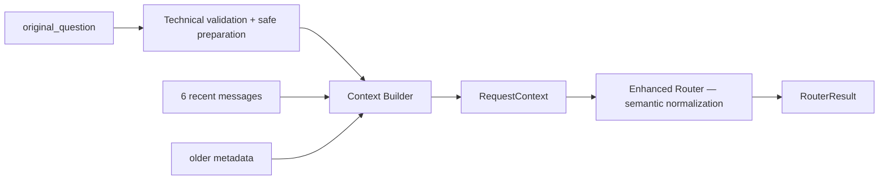

# QH - RequestContext contract

## Зорилго

[[Question and history]]-оос [[Enhanced Router]]-т дамжуулах **structured input**. Энэ нь хэрэгжүүлсэн Python class биш, interface-ийн санал. RequestContext нь input validation болон safe technical preparation-ийн дараа, semantic normalization-оос **өмнө** үүснэ.

Энэ contract нь [[Question taxonomy]]-ийн relationship, intent/policy, structure, strategy-г урьдчилан шийдэхгүй. Question and History зөвхөн шийдвэрт хэрэгтэй input, candidate болон provenance-ийг бэлдэнэ.

## Input → Processing → Output



Recent context нь `MAX_HISTORY_MESSAGES=6`; үүнээс гадна хамгийн ихдээ найман older user-question summary candidate Router input-д орно. Бүх session message Router руу орохгүй. `RequestContext` class байхгүй; runtime plain JSON dictionary ашиглана. `related_turn_ids` нь Router output-д per-request орж, Python allowlist-аар шалгадаг.

## Logical `RequestContext` fields

| Field | Утга |
|---|---|
| `original_question` | Хэрэглэгчийн яг илгээсэн текст; immutable эх сурвалж |
| `prepared_question` | Optional technical-only NFC/аюулгүй whitespace боловсруулалт; semantic rewrite биш |
| `recent_messages` | Role, дараалалтай bounded recent conversation |
| `candidate_turns` | Сонгож болох prior turn-ийн хязгаартай metadata |
| `previous_evidence` | Provenance-тай, bounded prior evidence reference/content |
| `context_budget` | Жишээ нь `max_history_messages`; context-ийн хязгаар |

Эдгээр нь **logical contract**, бодит runtime schema-тай яг таарсан эсвэл бүгд хэрэгжсэн гэсэн үг биш. Runtime input нь `history_context` (turn_id, role, content бүхий 6 хүртэл message), `older_candidates` (turn_id, question_summary), `current_question` JSON key-тэй; тусдаа `RequestContext` объект ашигладаггүй.

## Жишээ `RequestContext`

```json
{
  "session_id": "s12",
  "current": {
    "turn_id": "t105",
    "original_question": "tegeed manager baihgui bol hen approve hiih ve?",
    "prepared_question": "tegeed manager baihgui bol hen approve hiih ve?"
  },
  "recent_messages": [
    {
      "message_id": "m205",
      "turn_id": "t104",
      "role": "user",
      "content": "Шийдвэрийг давж заалдаж болох уу?"
    },
    {
      "message_id": "m206",
      "turn_id": "t104",
      "role": "assistant",
      "content": "Өгөгдсөн баримтаас хугацааг баталж чадсангүй."
    }
  ],
  "older_candidates": [
    {
      "turn_id": "t101",
      "topic_id": "leave_01",
      "question_summary": "3 цагийн чөлөө авах журам"
    },
    {
      "turn_id": "t102",
      "topic_id": "leave_01",
      "question_summary": "Чөлөөг хэн зөвшөөрөх вэ?",
      "parent_turn_ids": ["t101"]
    }
  ],
  "previous_evidence": [],
  "context_budget": {
    "max_recent_messages": 6,
    "max_older_candidates": 8
  }
}
```

`recent_messages` дээр 2 message л үзүүлсэн нь жишээг товчлох зорилготой; бодит үед **6 хүртэл** байна. `max_older_candidates=8` нь саналын эхний тохиргоо, тогтоосон стандарт биш. `prepared_question` нь optional бөгөөд яг жишээнд NFC/whitespace өөрчлөлт гараагүй.

## Router-ийн output-ийг энд хийж болохгүй

`relationship`, `related_turn_ids`, `resolved_question`, `search_query` нь **Router шийдвэрлэсний дараах** output. Эдгээрийг Question + History input-д урьдчилан бөглөхгүй. Router-ийн structured output дараа deterministic code schema/value validation хийнэ; schema хүчинтэй байх нь semantic утга зөв гэсэн баталгаа биш.

Target RouterResult нь жишээлбэл:

```json
{
  "relationship": "follow_up",
  "related_turn_ids": ["t102"],
  "resolved_question": "3 цагийн чөлөө авахад хэлтсийн менежер эзгүй бол хэн орлон зөвшөөрөх вэ?",
  "route": "retrieval"
}
```

## Дараа нь яах вэ?

1. Backend `t102` нь `s12`-т хамаарах valid prior turn мөн эсэхийг шалгана.
2. `t102`-ын relevant answer context, selected evidence reference-ийг load хийнэ.
3. [[Agent Planner]] `resolved_question` дээр single/multi-query strategy шийднэ.
4. [[Dedup and Evidence review]] өмнөх evidence-ийг дахин шалгана.

## Implementation status (as built)

- Status: partial. Одоогийн plain dictionary contract нь original current question, bounded recent message array, older question candidates агуулна. `classify_intent()` энэ багцыг existing single structured LLM call-д дамжуулж, `requests[].related_turn_ids` буцаана.
- Verified: routing тестүүд input JSON shape, six-message cap, eight-candidate cap, candidate summary cap болон ID allowlist шалгалтыг offline батална (`tests.test_routing`: 7 passed).
- Limits: `RequestContext`, `session_id`, `prepared_question`, `previous_evidence`, token budget object байхгүй. Selected turn raw passages pipeline-д reviewer-т дахин өгөгдөх боловч provenance-тай evidence contract хэрэгжээгүй.

## Related

[[Question taxonomy]] · [[QH - Message and turn model]] · [[QH - Context candidates]] · [[Enhanced Router]] · [[Agent Planner]]
