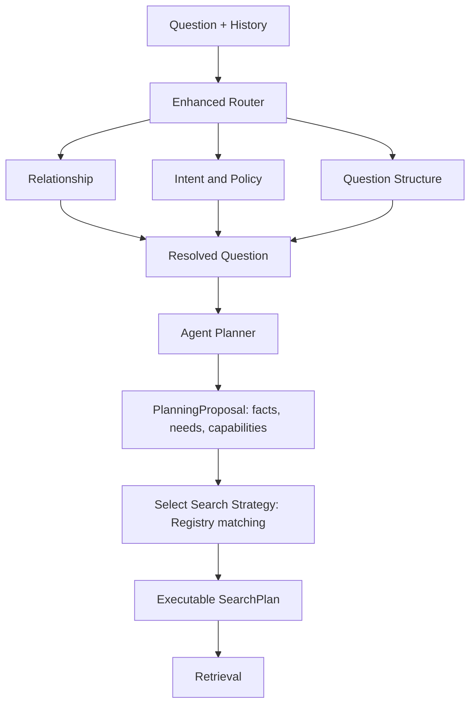

# Question taxonomy

## Зорилго

Нэг асуултыг ганц `question_type` утгаар тайлбарлахын оронд харилцан хамааралгүй дөрвөн хэмжээсээр дүрслэнэ. Энэ нь одоогийн runtime enum-үүдийн өөрчлөлт биш; **архитектурын ангилал** юм.

| Хэмжээс | Асуулт | Хариуцах компонент |
|---|---|---|
| A. Relationship | Өмнөх яриатай ямар холбоотой вэ? | [[Enhanced Router]] |
| B. Intent / Policy | Юу хүсэж байна, хариулахыг зөвшөөрөх үү? | [[Enhanced Router]] |
| C. Structure | Нэг эсвэл хэд хэдэн шаардлага/хүсэлт үү? | [[Enhanced Router]] |
| D. Retrieval Strategy | Ямар хайлтын аргаар шаардлагатай evidence-г олох вэ? | [[Agent Planner]] |

[[Question and history]] нь одоогийн асуулт, хязгаартай history, боломжит context болон provenance-ийг бэлтгэнэ. Энэ component эдгээр хэмжээсийн утгыг өөрөө ангилахгүй. Router A/B/C-г шийдэж, Planner D-г сонгоно.

Router нь relationship, intent/policy, structure-г нэг ангилалтын call-аар хамтад нь гаргаж болно. Диаграм дахь тусдаа node-ууд нь тусдаа LLM call гэсэн үг биш. `Enhanced Router`-ийн note руу wiki-link хийсэн; бусад node бол conceptual хэмжээ.

## A — Conversation Relationship

| Төрөл | Тайлбар | Жишээ | Одоогийн runtime |
|---|---|---|---|
| `new` | Шинэ, бие даасан асуулт | “Сахилгын шийтгэл гэж юу вэ?” | Relationship output |
| `same_topic` | Ижил сэдэвтэй ч өмнөх хариугүйгээр ойлгогдоно | “Ээлжийн амралт хэд хоног вэ?” | Тусдаа output биш; `new`-тэй хамт гарах боломжтой concept |
| `follow_up` | Өмнөх context шаардлагатай | “Тэгвэл менежер байхгүй бол?” | Relationship output; одоогоор хамгийн сүүлийн assistant turn-ийг ашиглана |
| `correction` | Өмнөх асуултын утгыг засна | “Үгүй ээ, 4 биш 3 цагийн чөлөө” | Одоогийн тусдаа output биш |
| `cross_reference` | Хэд хэдэн өмнөх turn-ийг зэрэг заана | “Өмнөх хоёр журмын ялгаа юу вэ?” | Одоогийн тусдаа output биш |
| `ambiguous` | Аль context/referent-ийг тогтоох боломжгүй | “Тэр хүсэлтийг яах вэ?” | Тодруулах шаардлагатай бол `clarification` |

Одоогийн router-ийн relationship утга зөвхөн `new`, `follow_up`, `clarification`. `same_topic`, `correction`, `cross_reference` нь ирээдүйн `relation_detail`-ийн concept байж болно. `ambiguous` нь заавал relationship enum байх албагүй; тодорхойгүй байдал `clarification`-д хүргэж болно.

`topic_id` нь нэг сэдвийн turn-уудыг бүлэглэх санал. Ижил topic гэдэг нь follow-up батлагдсан гэсэн үг биш. `related_turn_ids` нь context-д ашигласан тодорхой turn-уудыг заах proposal бөгөөд одоогийн code-д гарахгүй. Дэлгэрэнгүй: [[QH - Conversation links]].

## B — Intent / Policy

Intent нь хэрэглэгчийн зорилгыг, policy decision нь тухайн зорилгод хариулж болох эсэхийг хэлнэ. Эдгээр нь нэг ангилал биш.

| Practical intent | Router-ийн боломжит үйлдэл |
|---|---|
| Greeting | Шууд мэндлэх; retrieval хийхгүй |
| Company policy question | Асуулт зөвшөөрөгдсөн хүрээнд байвал retrieval |
| HR / Operations | Холбогдох баримтаас retrieval |
| Definition / Explanation | Дотоод журамтай холбоотой бол retrieval |
| Procedure / How-to | Алхам, шаардлагатай үйлдлийг retrieval-ээр шалгах |
| Approval / Responsibility | Албан тушаал, эрх олголтыг баримтаас шалгах |
| Deadline / Eligibility / Exception | Хугацаа, хамрах ба үл хамаарах нөхцөлийг шалгах |
| Summary / Comparison | Холбогдох context болон баримтуудаас retrieval |
| Restricted information | Restriction policy хэрэглэж, хязгаарласан хүсэлтэд хариу өгөхгүй |
| Out-of-scope | Retrieval хийхгүй; хамрах хүрээг тайлбарлах |
| Unclear request | Таамаглахгүй; шаардлагатай үед clarification хүсэх |

Энэ нь байгууллагын RAG-д хэрэгтэй practical ангилал болохоос intent-ийн бүх боломжит стандарт биш.

Жишээ:

- “Цалин хэдний өдөр буудаг вэ?” → payroll intent, зөвшөөрөгдсөн журам.
- “Миний цалин яг хэд вэ?” → payroll-той холбоотой ч хувь хүний дүн restricted.
- “Цалин хэзээ буудаг, миний цалин хэд вэ?” → хоёр хүсэлт; нэг нь зөвшөөрөгдсөн, нөгөө нь restricted. Restricted sub-request бусдыг автоматаар хаах ёсгүй.

Одоогийн `classify_intent()` нь intent-ийг request бүрт гаргаж, pipeline restriction-ийг request бүрээр шалгана. Энэ нь бүх хүсэлт бүрэн хамрагдана гэсэн чанарын баталгаа биш.

## C — Question Structure

| Төрөл | Тайлбар | Жишээ |
|---|---|---|
| `single` | Нэг үндсэн шаардлага | “Цалин хэдний өдөр буудаг вэ?” |
| `multi_part` | Нэг сэдэв, хэд хэдэн зайлшгүй fact | “3 цагийн чөлөөг хэн зөвшөөрөх, хэдэн цагийн өмнө мэдэгдэх вэ?” |
| `multi_intent` | Бие даан боловсруулах хэд хэдэн хүсэлт | “Цалин хэзээ буудаг, чөлөө хэд хоног байдаг, миний цалин хэд вэ?” |
| `multi_hop` | Хэд хэдэн нөхцөл/заалтыг холбох шаардлагатай | “Менежер эзгүй үед орлох хүн хэн бэ, тэр хүн чөлөө зөвшөөрөх эрхтэй юу?” |

`multi_hop` нь олон LLM agent хэрэгтэй гэсэн үг биш. `multi_part` ба `multi_hop` нэг асуултад зэрэг байж болно; эдгээрийг нэг сонголттой enum болгох шаардлагагүй. Одоогийн код нийлмэл асуултыг request болгон салгадаг ч эдгээр structure шошгыг буцаадаггүй.

## D — Retrieval planning ба strategy selection

Retrieval-ийн шийдвэрийг нэг хэмжээс болгон хутгахгүй. [[Agent Planner]] нь ямар information need, required fact, capability шаардлагатайг санал болгоно. [[Select search strategy]] нь capability болон provider/budget constraints-ийг шалгаад бүртгэлтэй executable strategy сонгож `SearchPlan` гаргана.

### A. Question characteristics

Эдгээр бүтэц нь ямар information need байгааг тодорхойлоход тусална; өөрсдөө strategy implementation биш.

- `single`
- `multi_part`
- `multi_intent`
- `multi_hop`
- `comparison`
- `exact_reference_oriented`

### B. Retrieval capabilities

Эдгээр нь Planner-ийн тодорхойлох **retrieval requirements**:

- `focused_lookup`
- `multi_angle_coverage`
- `exact_reference_focus`
- `comparison_coverage`
- `dependency_aware_search`
- `metadata_scoping`

Тайлбар, хязгаарлалт, жишээ нь [[Retrieval capabilities]] canonical note-д байна. Registry эсвэл provider capability батлаагүй бол эдгээрийг implemented гэж үзэхгүй.

### C. Strategy implementations

Эдгээр нь Selector-ийн Registry-д бүртгэлтэй **ажиллуулж болох арга**:

- `single_query`
- `multi_query`
- Future strategy implementations

Initial practical candidate-ууд хоёр strategy байж болох ч architecture үүгээр хязгаарлагдахгүй. Capability нэг strategy-тай 1:1 харгалзахгүй; нэг strategy олон capability дэмжиж, нэг capabilityг олон strategy хэрэгжүүлж болно.

### Гол ялгаа

- `multi_intent` ≠ `multi_query`: нэг нь question structure, нөгөө нь strategy implementation.
- `multi_hop` ≠ заавал `stepwise`: dependency нь strategy-г шаардаж магадгүй ч нэрээс шууд дүгнэхгүй.
- `exact_reference_focus` ≠ exact match guarantee.
- `capability` ≠ `strategy implementation`.
- `corrective_retry` нь initial strategy selection биш; evidence review-ийн дараах corrective action.

`direct` нь retrieval хийхгүй routing outcome; `decomposed` нь бие даасан request-үүдийг тусад нь боловсруулах явц байж болохоос strategy capability-тэй адил ангилал биш. Relationship болон policy classification [[Enhanced Router]]-т хэвээр үлдэнэ.

OpenAI Vector Store нь hosted file storage, parsing, chunking, embedding, indexing, vector search-ийг хариуцна. Python application нь query orchestration, deduplication, evidence review болон хязгаартай retry-г зохицуулна. Retry болон нийт search budget нь [[Select search strategy]]/controller-ийн enforcement асуудал.

Одоогийн implementation-д Planner, capability catalog matching, Strategy Registry, `SearchPlan` байхгүй. `pipeline` нэг search query ашиглаж, reviewer шинэ retry query өгсөн бол нэг targeted retry оролддог. Multi-intent request-үүд тус тусдаа боловсруулагдана.

## Нэг follow-up-ийг дөрвөн хэмжээсээр

Өмнөх яриа гурван цагийн чөлөөний тухай байсан гэж үзье. Одоогийн асуулт: “tegeed manager baihgui bol hen approve hiih ve?”

| Хэмжээс | Утга |
|---|---|
| Relationship | `follow_up`; хуучин turn ID-г сонгох нь одоогоор хэрэгжээгүй |
| Intent / Policy | Approval / responsibility; баримтаар зөвшөөрөгдсөн хүрээнд шалгана |
| Structure | `single` |
| Retrieval Strategy | Design-д `single_query`; Planner сонгох нь proposal |
| Resolved question | “3 цагийн чөлөө авахад менежер байхгүй бол хэн зөвшөөрөх вэ?” гэх мэт standalone хэлбэр |

Follow-up гэдэг нь multi-query гэсэн үг биш. Multi-intent нь follow-up гэсэн үг биш. Restricted нь relationship биш. Evidence insufficient нь intent биш.

## Implementation status

| Одоо кодод байгаа | Зөвхөн design / proposal |
|---|---|
| `classify_intent()` нь LLM-ээр `new / follow_up / clarification`, intent, `search_query`, `resolved_question` гаргана | `same_topic`, `correction`, `cross_reference` гэх relation detail |
| Нэг message-ийн request-үүдийг дээд тал нь 3 болгон боловсруулах оролдлого бий | `related_turn_ids`, хуучин turn candidate сонгох, `topic_id` |
| UI бүх яриаг session-д харуулж/хадгална; Core руу сүүлийн 6 message дамжуулна | RequestContext, Agent Planner-аар strategy сонгох |
| Follow-up үед хамгийн сүүлийн assistant turn-ийн raw `passages`-ийг дахин review хийнэ | History-д зөвхөн selected/cited evidence хадгалж, сонгосон хуучин turn-уудтай холбох |
| Reviewer дутуу evidence-д нэг targeted retry санал болгож болно | Budget-д суурилсан adaptive `multi_query` / `decomposed` planning |

Одоогийн UI raw `result["passages"]`-ийг history-д хадгалдаг, `result["evidence"]`-ийг биш. Энэ ялгааг ирээдүйн design-д засах ёстой гэж тэмдэглэж байгаа болохоос одоо implemented гэж үзэхгүй.

## Холбогдох тэмдэглэл

- [[Question and history]] — context бэлтгэх зааг.
- [[Enhanced Router]] — A/B/C хэмжээсүүд.
- [[Agent Planner]] — D хэмжээс.
- [[Retrieval capabilities]] — D-ийн capability contract ба catalog.
- [[Select search strategy]] — стратегийн санал ба budget.
- [[QH - Conversation links]] — relation, turn link.
- [[QH - Context candidates]] — candidate discovery.
- [[QH - RequestContext contract]] — router input contract.
