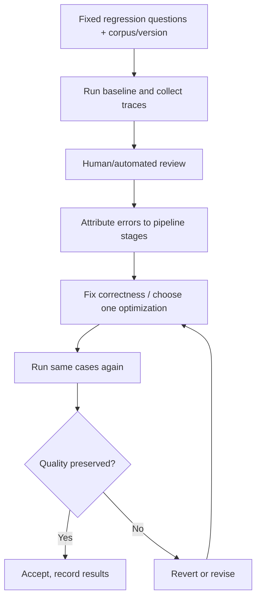

---
tags:
  - rag
  - refactor
  - workflow
  - evaluation
  - optimization
status: workflow-approved
implementation: pending
scope: refactor-only
---

# RAG - Evaluation and optimization

> [!important] Scope
> Энэ бол **`refactor` standalone RAG** төслийн measurement/evaluation workflow. `RAG Admin`-ийг өөрчлөхгүй. Шинэ benchmark, provider, ingestion pipeline, evaluation framework шууд нэвтрүүлэхгүй. Одоогийн 10 асуултын regression set болон өмнөх LangChain pipeline-ийн ажиллаж байсан behavior-ийг эхний reference болгоно.

## 1. Зорилго

**Quality-гаа алдалгүй correctness → observability → measurement → simplification → optimization → regression** гэсэн дарааллаар ажиллах.

Энэ note нь:
- **Юуг** хэмжих (quality, token, latency, cost, stage correctness),
- **Хаана** хэмжилт цуглуулах,
- **Яаж** baseline ба дараах өөрчлөлтийг харьцуулах,
- **Хэзээ** optimization-ийг accept/revert хийх,
- **Юуг** documentation-д буцааж бичих
гэсэн асуултад хариулна.

**Architecture Design Complete ≠ Implementation Complete ≠ Quality Verified.**

## 2. Input → Processing → Output



| Input | Processing | Output |
|---|---|---|
| Existing 10-question set, document/store versions, current and old behavior | Stage trace + answer review + paired comparison | Evaluation report, failure attribution, accept/revert decision |

## 3. Evaluation хаана хийгдэх вэ?

**Code and tests:** зөвхөн `refactor` repository дотор.

**Design documentation:** Obsidian vault дахь `Stages/*.md` нь target behavior-ийн specification. Эдгээрийг шууд code paths гэж үзэхгүй.

**Suggested locations (repo-г шалгаад final болго):**

| Purpose | Suggested location | Rule |
|---|---|---|
| Existing regression questions | `tests/fixtures/` дотор одоо байгаа fixture | Нэр болон schema-г repo-оос ол; шинээр давхар dataset үүсгэхгүй |
| Stage-level offline tests | `tests/` | Mocked OpenAI; no paid calls by default |
| Small evaluation runner, if needed | `evaluation/run_regression.py` **эсвэл existing test runner** | Зөвхөн хэрэгтэй бол шинэ файл нэм |
| Individual run reports | `evaluation/runs/<run-id>/` | Ignore from git if sensitive; no raw company documents by default |
| Current baseline summary | Энэ note-ийн `Latest baseline` хэсэг | Date, revision, verified values only |
| Current implementation/code map | `[[RAG - Implementation playbook]]` | Actual paths after inspection |

Vault болон repository тусдаа бол agent-д **хоёуланд нь access** өг. Vault note-уудыг Codex автоматаар уншина гэж бүү таамагла.

## 4. Эхний regression set — зөвхөн байгаа өгөгдөл

Одоогийн **10 existing question**-ийг reference set болгон reuse хийнэ. Тэдгээрийг шинэ project-ийн шинэ benchmark болгож тэлэхгүй.

Case бүрд байгаа metadata-г шалгаж шаардлагатай минимумыг тэмдэглэ:
- `case_id` / original question / language form (Cyrillic, Latin, English, mixed),
- allowed / restricted / mixed multi-intent expectation,
- required facts эсвэл expected answer characteristics (байгаа бол),
- expected source/section **зөвхөн verified үед**,
- previous LangChain reference result / human review (байгаа бол),
- source document versions.

**Expected answer зохиохгүй.** Ground truth байхгүй бол `needs_human_review` гэж тэмдэглэ. Зарим case-ийн хувьд өмнөх сайн хариулт нь behavior reference болохоос өөрөө заавал ground truth биш.

Coverage шалгах үед case-үүдэд боломжтой бол дараах шинжүүд байгаа эсэхийг тэмдэглэ: simple fact, procedure, multi-part, mixed-language, restricted, follow-up, partial/no-evidence, citation. Байгаа 10 case-д байхгүй category-г шууд том dataset болгон өргөжүүлэхгүй; coverage gap гэж тэмдэглэ.

## 5. Reproducible run бүрийн metadata

Run бүрд дараах мэдээллийг хадгал:

| Field | Why |
|---|---|
| `run_id`, timestamp, Git commit/hash | Яг аль version-ийг шалгасныг мэдэх |
| `case_id`, `request_id`, independent subrequest IDs | Multi-intent isolation |
| Model IDs, prompt version/hash, relevant parameters | Prompt/model drift |
| Vector Store ID **alias**, document/index version (боломжтой бол) | Corpus drift |
| SearchPlan, query count, retry count, search operation budget | Retrieval behavior |
| Component start/end/duration, status/errors | Bottleneck ба failure |
| Input/output token usage *per LLM call*, if supplied | Cost/efficiency |
| Source file IDs, passage IDs, source/version references | Evidence provenance |
| Final outcome and human review | Quality |

Production secrets, API keys, employee personal details, unredacted restricted contents болон бүтэн confidential passages-ийг trace/report-д default-аар хадгалахгүй. Хэрэв audit-д текст зайлшгүй бол тусдаа approved retention/access policy шаардлагатай. User-facing citation-д ашиглах trusted metadata-г runtime-д хадгалах нь evaluation log-д raw text хадгалахаас өөр асуудал.

### Minimal trace example (illustrative)

```json
{
  "run_id": "local-001",
  "case_id": "Q-01",
  "request_id": "R1",
  "stage": "evidence_review",
  "status": "success",
  "latency_ms": 1234,
  "model": "<actual-model-id>",
  "input_tokens": null,
  "output_tokens": null,
  "details": {"supported_facts": 1, "partial_facts": 1, "missing_facts": 0}
}
```

Values are placeholders. `null` = unavailable, not zero. Do not fabricate token counts, runtime timings or API costs.

## 6. Stage-by-stage evaluation matrix

| Stage | Check | Example failure signal |
|---|---|---|
| Question and History | Valid input/history, correct scoped turn references | Wrong turn linked / information lost |
| Enhanced Router | Cyrillic normalization, intent, policy, multi-intent separation | Restricted route allowed / meaning changed |
| Agent Planner | Required facts and information needs | One part of question omitted |
| Select Search Strategy | SearchPlan matches required capabilities and budget | Unsupported plan / wrong query allocation |
| Retrieval | Results, source provenance, empty vs error, elapsed time | Relevant source never retrieved |
| Deduplication | Exact duplicates removed without losing provenance | Different versions accidentally merged |
| Evidence Review | Per-fact support, missing detail, conflict handling | Irrelevant chunk marked supported |
| Evidence sufficient? | Deterministic yes/no and IDs | Partial wrongly routed to full answer |
| Targeted Retry | Only unresolved allowed requests, max one, budget | Re-searches supported/restricted request |
| Review updated evidence | Old + new evidence reviewed together; no loop | Conflict missed / evidence discarded |
| Generation | Mongolian clarity, supported claims, outcome, advice | Invented procedure/name; unsupported step |
| Grounded answer and citations | Claim-to-source IDs, citation validity, rendering | Fake citation / wrong request source |

### Failure attribution

Нэг final error олон stage-оор дамжиж болох тул **анхны шалтгаан** болон downstream symptom-ийг ялга.

Жишээ: Retrieval wrong chunk → reviewer `supported` гэж андуурсан → generation буруу answer → final citation нь ID-valid боловч семантик утгаар буруу. Энэ тохиолдолд зөвхөн citation renderer-ийг буруутгаж болохгүй.

Run report-д `first_known_failure_stage`, `observed_symptom`, `confidence`, `evidence_reference` ашиглаж болно. Unknown бол unknown гэж бич.

## 7. Хэмжих хэмжүүрүүд

### Correctness / Quality (үндсэн gate)

- **Policy safety:** restricted subrequest retrieval/answer-д ороогүй эсэх.
- **Required fact coverage:** required facts-ийн хэдэд grounded support хүрсэн; incomplete case-д partial гэдгээ зөв илэрхийлсэн эсэх.
- **Groundedness:** factual claim нь cited passage-ээр үнэхээр батлагдах эсэх (human review эсвэл verified gold, **ID validation дангаараа хангалтгүй**).
- **Citation validity:** fabricated/cross-request evidence ID, unsupported locator, invalid URL байхгүй эсэх.
- **Answer usefulness:** natural Mongolian, clear, concise, right format, appropriate `Зөвлөмж`.
- **Conflict handling:** inconsistent document versions/clauses-ийг таамгаар шийдээгүй эсэх.
- **No-evidence handling:** provider failure-г no policy гэж буруу тайлбарлаагүй эсэх.

### Efficiency (quality-ийн дараа)

- End-to-end latency: median / p95 **sample хангалттай үед**; 10 run-тай бол per-case values бас харуул.
- Stage latency (LLM/network vs local functions боломжтой хэмжээнд).
- Number of LLM calls, search operations, retry count.
- Input/output tokens and total, including router/planner/review/generation and retry review.
- API cost: only actual usage + relevant model price snapshot батлагдсан үед; unavailable бол unknown.
- Retry success: өмнө unresolved байсан fact-д шинээр grounded coverage нэмэгдсэн эсэх.

Raw retrieval score-г өөр query-үүдийн хооронд шууд comparable accuracy metric гэж үзэхгүй.

## 8. Manual review rubric — жижиг, хэрэглэхэд хялбар

Case бүрээр:

| Item | Mark |
|---|---|
| Question intent/constraints preserved | Pass / Fail / Unclear |
| All allowed required facts accounted for | Pass / Partial / Fail / Unclear |
| Each factual claim supported by source | Pass / Fail / Unclear |
| Restricted content not leaked | Pass / Fail |
| Citations real and relevant | Pass / Fail / N/A |
| Natural Mongolian / appropriate formatting | Pass / Needs improvement |
| Appropriate limitation and advice | Pass / Needs improvement / N/A |

`Unclear` = human verification required. Неизвестное/unclear-г pass гэж тооцохгүй. Review хийх хүнээр баримтын context/version-ийг шалгуулна.

## 9. Baseline → Change → Compare cycle

1. **Baseline:** одоогийн `refactor` implementation ажиллаж байгаа хэмжээнд эхний 10 case-ийг ажиллуул; previous LangChain result-тай боломжтой үед paired comparison хий.
2. **Diagnose:** failing cases болон хамгийн зардалтай stage-ийг trace-аас тодорхойл.
3. **Correctness first:** behavior bug зас; targeted offline tests + same case set.
4. **One optimization at a time:** нэг stage эсвэл нэг LLM call-ийн шаардлагыг өөрчил; бусдыг тогтмол байлгахыг хичээ.
5. **Repeat:** ижил cases, ижил corpus snapshot, recorded model/prompt configuration дээр дахин ажиллуул.
6. **Compare:** quality non-regression → latency/tokens/cost improvements → code complexity.
7. **Accept/revert:** quality сулрах бол revert/revise; metric шууд харьцуулах боломжгүй бол дүгнэлт хийхгүй.
8. **Record:** шинэ run report, affected stage implementation status, decision rationale шинэчил.

Model randomness болон API variability-тай тул шаардлагатай үед нэг case-ийг хэд хэдэн удаа repeat хийж тэмдэглэ. Fixed seed буюу deterministic output-г provider батлаагүй бол run-ууд яг ижил гарна гэж амлахгүй.

### Quality gate (V1)

- Restricted leakage, invalid citation, invented mandatory procedure зэрэг **critical regressions = accept хийхгүй**.
- Verified formerly-passing cases санаандгүй fail болсон бол optimization-ийг accept хийхгүй.
- Quality unclear бол `needs_review`; improvement гэж зарлахгүй.
- Hard latency/token threshold-ийг эхний baseline хэмжихээс өмнө зохиохгүй.

## 10. Retry/optimization experiments — дараа

V1 baseline-ийн дараа туршиж болох hypotheses:
- Simple question-д Planner LLM call skip хийх нь чанарыг хадгалах уу?
- Query planning call-уудыг нэгтгэх нь multi-intent accuracy-г бууруулах уу?
- Evidence Reviewer context багасгахад fact support correctness буурах уу?
- Retry-ийн added cost нь coverage improvement-тэй дүйх үү?
- Structured output schema-г богиносговол citation correctness хадгалагдах уу?

Эдгээр нь **хийхээр шийдсэн feature биш**, хэмжилтээр шалгах hypothesis-ууд юм. Эхний implementation-ээс өмнө architecture-г optimize хийж солихгүй.

## 11. Report template

```markdown
# Evaluation run — <run-id>

- Date / Git revision / model / prompt version:
- Corpus or Vector Store snapshot:
- Cases: existing 10-question set (actual count):
- Baseline or candidate:
- Live API or offline mock:

## Quality
| Case ID | Expected/verified behavior | Actual outcome | Grounding | Citation | Human review |
|---|---|---|---|---|---|

## Efficiency
| Case ID | Total ms | Router ms | Planner ms | Retrieval ms | Review ms | Generation ms | Input tokens | Output tokens | Search ops |
|---|---:|---:|---:|---:|---:|---:|---:|---:|---:|

## Failures and attribution
- First known failing stage:
- Evidence from trace:
- Fix candidate:

## Decision
- Accept / Revert / Needs review:
- Quality changed:
- Latency/token change:
- Affected component note updates:
```

Missing measurements = `N/A`, not zero. Хүснэгт нь тайлангийн template, benchmark results биш.

## 12. Documentation update policy

- **Workflow note:** энэ файлын `Latest baseline` болон `Decisions` хэсгийг verified run мэдээллээр шинэчил.
- **Component note:** stage implementation-аар батлагдсан behavior, actual code paths, test evidence, limitations-ийг `Implementation status / Verified behavior` хэсэгт нэм.
- **Architecture contract:** design/behavior discrepancy гарвал шууд дизайн чимээгүй өөрчилж болохгүй; `Deviation / Decision needed` гэж тэмдэглэж owner-оор шийдүүл.
- **Implementation playbook:** actual code map, phase completion, remaining tasks-ийг шинэчил.
- **Run artifacts:** raw traces/report-ийн хадгалах байршил болон retention policy-г тогтоож мөрд.

### Latest baseline

- Status: **Not yet captured for this V1 architecture**.
- Run ID: —
- Git revision: —
- Cases: existing 10-question regression set (verify location and actual count).
- Verified quality: —
- Per-stage latency/tokens: —

### Decisions

- V1 design first, implementation second, measurement third, then evidence-driven optimization.
- No optimization accepted solely on lower latency/tokens if grounding, restrictions or citations regress.
- Do not alter RAG Admin.

## 13. Acceptance checklist

- [ ] Regression fixture found/reused without fabricated expected answers.
- [ ] Before/after runs use comparable corpus, model and prompt metadata.
- [ ] Per-stage timing, status, and model-token usage captured where available.
- [ ] Independent requests and retry traceable within a multi-intent message.
- [ ] Grounding/citation/policy manually verified where automated checks cannot prove correctness.
- [ ] Failures attributed with evidence, not guesses.
- [ ] Accepted optimizations have quality non-regression evidence.
- [ ] Component notes and implementation status updated.

## Related

- [[RAG_Implementation_Playbook]]
- [[Bounded Adaptive Agentic RAG]]
