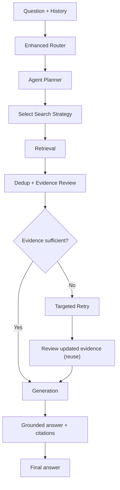

---
tags:
  - rag
  - refactor
  - workflow
  - implementation
  - agent-instructions
status: workflow-approved
implementation: in-progress
scope: refactor-only
---

# RAG - Implementation playbook

> [!important] Agent entry point
> Энэ файл нь Codex / code agent / хөгжүүлэгчид зориулсан **implementation operating contract**. Эхлээд repo-г шалга, архитектурын note-уудыг унш, бодит кодын inventory гарга, gap analysis хий; дараа нь **нэг phase-аар** код өөрчил. Энэ Markdown байгаа нь код хэрэгжсэн гэсэн үг биш.

## 1. Mission and non-goals

**Mission:** Standalone `refactor` RAG-ийг Obsidian-д баталсан V1 архитектурт **behavior-preserving** байдлаар нийцүүлэх. Хуучин LangChain RAG-ийн сайн ажиллаж байсан prompt/algorithm/answer behavior-ийг reference болгон ашиглах, шинээр том product эсвэл research project эхлүүлэхгүй.

**Priorities:** correctness → traceability → minimal implementation → small regression → measurement → later optimization.

**Non-goals / hard restrictions:**
- `RAG Admin` project-ийн code, config, migrations, adapters, documentation **өөрчлөхгүй**.
- New ingestion pipeline, local vector index, provider switch хийхгүй. Existing OpenAI Vector Store reuse.
- Multi-agent architecture, multiple rerankers, plugin/framework inflation, unnecessary abstraction нэмэхгүй.
- Шинэ benchmark байгуулж өргөжүүлэхгүй. Existing 10-question regression set reuse.
- Design-ийг илүү том болгох эсвэл үндэслэлгүйгээр LLM call-уудыг implementation-ээс өмнө устгахгүй.
- Vault/Markdown-д бичсэн 'design-complete' гэдгийг 'already implemented' гэж таамаглахгүй.

## 2. How an agent must begin

### Prerequisites

1. **Actual repository root** болон **actual Obsidian vault root**-ийг ол. Эдгээр нь өөр folder байж болно.
2. `git status` болон existing user changes-г шалга. Бусдын өөрчлөлтийг discard/overwrite хийж болохгүй.
3. Main architecture hub-ийг олж унш: `Bounded Adaptive Agentic RAG.md` (байрлал/name-г filesystem-аар баталгаажуул).
4. Дараах stage note-уудыг pipeline order-оор унш. Хэрэв нэр/path өөр байвал үнэн зөв path-ийг тогтоо. Байхгүй file-ийг зохиохгүй.
5. Энэ playbook болон `[[RAG - Evaluation and optimization]]`-ийг унш.
6. Source code, tests, configuration, prompts, model adapters, existing endpoints/UI, old LangChain reference code-ийг **read-only inspect** хийж actual implementation behavior-г тодорхойл.
7. **Gap analysis + smallest viable change plan** гаргаад л implementation эхлүүл.

### Architecture reading order

| Order | Stage note |
|---:|---|
| 1 | `Stages/Question and history.md` |
| 2 | `Stages/Enhanced Router.md` |
| 3 | `Stages/Agent Planner.md` |
| 4 | `Stages/Select search strategy.md` |
| 5 | `Stages/Retrieval.md` |
| 6 | `Stages/Dedup and Evidence review.md` (+ existing `DE-*` subnotes) |
| 7 | `Stages/Evidence sufficient.md` |
| 8 | `Stages/Targeted retry within budget.md` (**Review updated evidence** section энд байгаа; тусдаа stage file үүсгэхгүй) |
| 9 | `Stages/Generation.md` |
| 10 | `Stages/Grounded answer and citations.md` |

**Source of truth distinctions:**
- **Design intent:** current agreed Obsidian stage notes.
- **Actual running behavior:** inspected code and verified execution.
- **Old behavior reference:** previous LangChain pipeline (read-only).
- **Observed quality:** trace + regression + human review.

Discrepancy илэрвэл code эсвэл spec-ийг чимээгүй солихгүй. `Deviation / Decision needed` гэж тэмдэглэж, behavior-preserving minimum change санал болго.

## 3. Architecture → implementation data flow



**Logical stage count ≠ Python file/class/LLM-agent count.** Multiple small deterministic stages may live in one module if responsibilities are clear. `Review updated evidence` reuses existing dedup/review, not a new service.

### Minimal conceptual contracts

`RequestContext → RouterResult → PlanningProposal → SearchPlan → RetrievedPassages → UniquePassages → EvidenceAssessment → EvidenceDecision → [RetryOutcome + updated EvidenceAssessment] → AnswerDraft → FinalAnswer`

- Keep existing working data classes/Pydantic models/dicts wherever possible.
- Introduce a new schema only when it fixes a concrete boundary or validation need.
- Never silently drop request/fact/evidence IDs, source provenance, or error/partial status.
- No need to create 11 Python model classes merely because docs show 11 names.

## 4. Where to put code — inspect first

**The following paths come from previously discussed `refactor` structure, not a fresh repository inspection. Confirm all before editing.**

| Candidate path | Intended owner | Guidance |
|---|---|---|
| `app.py` | Streamlit app entrypoint | Keep minimal; start UI only |
| `ui/streamlit_ui.py` | User input and rendering | No policy/retrieval/LLM orchestration inside UI |
| `rag/pipeline.py` | Request orchestration, stage coordination, budget, deterministic decision flow | Favor reuse; avoid huge God function by small helpers |
| `rag/routing.py` | Semantic routing and standalone question resolution, **if existing** | Preserve old routing behavior; do not recreate regex system |
| `rag/retrieval.py` | OpenAI Vector Store call and response normalization | Reuse existing `search_documents()` where it fits; never rebuild hosted indexing |
| `rag/generation.py` | One LLM generation call → structured `AnswerDraft` | Reuse existing structured-output model/prompt when possible |
| `tests/` | Mocked unit tests and small regression | Use existing test conventions and fixtures |
| `evaluation/` | Optional baseline runner/report artifacts | Add only if existing tools cannot collect comparison data |

**Possible new files, only if existing modules become unwieldy:** e.g. `rag/evidence.py` for one structured Reviewer and validation; `rag/answer_output.py` for citation resolution if not suitable in existing module. These are *candidates*, not mandatory files. New module proposal must state why an existing module is unsuitable.

### Code owner map — fill only after repo inspection

| Stage | Confirmed function/class | Actual file path | Design parity | Tests | Notes |
|---|---|---|---|---|---|
| Question and History | `answer_question`, `prepare_history`, `build_router_history_context` | `ui/streamlit_ui.py`, `rag/routing.py`, `rag/pipeline.py` | Partial | `tests.test_routing`; focused pipeline suite (86); focused `tests.test_streamlit_ui` history case | Offline guard/original-text tests passed. Live C21 now exercises history through `answer_question()` and reaches follow-up retrieval. No live invalid-input case; no RequestContext/session ownership or reviewed evidence storage |
| Enhanced Router | `classify_intent`, `get_policy_and_route`, `_process_request` | `rag/routing.py`, `rag/pipeline.py` | Partial | `tests.test_routing`; focused pipeline suite (86); C01/C07/C21 live smoke; offline greeting + 3 substantive request regression | C01 workplace/new, C21 workplace/follow_up, C07 Latin workplace/new. Mixed-message greeting is a preamble outside the 3 substantive-request cap; deterministic restriction remains per request. C07 initial retrieval used Router `search_query`; semantic correctness and referent/provenance quality remain unverified |
| Agent Planner | `plan_requests` | `rag/planning.py`, `rag/pipeline.py::answer_question` | Partial: pipeline-integrated | `tests.test_planning`; focused pipeline suite (86); C01/C07/C21 live smoke | One structured batch call per message for allowed requests; real Router output produced one validated proposal per case, consumed by Selector. Facts/needs were not source-reviewed; live multi-request batch not exercised |
| Select Search Strategy | `select_search_plans` | `rag/selection.py`, `rag/pipeline.py::answer_question` | Partial: pipeline-integrated | `tests.test_selection`; focused pipeline suite (86); C01/C07/C21 live smoke | Deterministic plans use normalized Router `search_query` (fallback: `resolved_question`). Pipeline supplies `3 × allowed proposal count` shared budget for up to 2 initial + 1 retry per request; no fixed four-call cap. Live used `single_query`; multi-query only offline-tested |
| Retrieval | `execute_search_plan`, `search_documents` | `rag/retrieval.py`, `rag/pipeline.py::answer_question` | Partial: pipeline-integrated | `tests.test_retrieval` (10); focused pipeline suite (86); C01/C07/C21 live smoke | Live initial retrieval returned 5/5/4 passages with query/fact associations; each case then made one retry. Retrieval errors stop review/generation and preserve query status/passages in offline tests. Relevance, grounding, and citations were not human-reviewed |
| Dedup and Evidence Review | `deduplicate_passages`, `review_evidence`, `_process_request` | `rag/retrieval.py`, `rag/generation.py`, `rag/pipeline.py` | Partial: integrated | `tests.test_pipeline` + `tests.test_generation.ReviewEvidenceTests` (47 passed); full suite (114 tests, 5 Generation/UI assertion failures) | Exact dedup preserves query/rank/score/target/source provenance. Reviewer validates per-fact support, evidence/conflict IDs and retrieval status; overall sufficiency is now owned by EvidenceDecision. No live semantic review or explicit reviewer token cap |
| Evidence sufficient? | `decide_evidence_sufficiency` | `rag/pipeline.py` | Partial: pipeline-integrated and offline verified | `tests.test_pipeline` + `tests.test_generation.ReviewEvidenceTests` (47 passed); full suite (114 tests, 109 passed, 5 known Generation/UI assertion failures) | Deterministically validates assessment against each Planner fact map; emits supported/unresolved fact IDs, selected evidence IDs, and reason codes. `partial_error` forces No with `retrieval_incomplete`; no LLM/retrieval call. No live semantic validation |
| Targeted Retry + updated review | `_targeted_retry`, `_process_request`, `_search_passages` | `rag/pipeline.py` | Partial: deterministic targeting offline verified; one live retry/re-review runtime smoke passed; semantic quality pending | Focused suite: 97 passed; full suite: 119 tests, 114 passed, 5 Generation/UI assertion failures. Live C21: 1 initial search + 1 `RQ1` retry; 2 Reviewer calls; 1 Generation call; no uncaught error | Live C21 retry targeted `F1`, returned 4 new unique passages, and second review selected both initial and retry evidence IDs. The trace does not record passage-level query/fact associations and has a `review_status` logging mismatch; no quality/citation claim |
| Generation | `generate_answer` | `rag/generation.py`, `rag/pipeline.py::_process_request` | Partial: one structured AnswerDraft call receives validated facts/final assessment; semantic quality unverified | Full suite: 130 passed; `compileall -q rag ui evaluation`; live C05/C01/C21 smoke | C05: one supported fact, one Generation call, five P references; C01: no selected support, no Generation LLM call, `insufficient`; C21: one Generation call, partial draft with zero evidence references. No human claim/citation review. At most one Generation call per allowed request with selected evidence; 0 with none | Manually review C05's claims against its cited passages, then run end-to-end parity |
| Grounded answer and citations | `ground_answer`, `renumber_multi_request_citations` | `rag/answer_output.py`, `rag/pipeline.py`, `ui/streamlit_ui.py` | Partial: pipeline-integrated; offline and citation metadata smoke verified; semantic correctness unverified | `tests.test_answer_output`, pipeline/UI tests; full suite 130 passed; `compileall` and `git diff --check`; live C05/C01/C21 smoke | Validates AnswerDraft refs and outcomes, resolves only trusted file metadata, emits ordered labels and preserves request isolation; public `answer_question()` signature and `answer/citations/status` remain. C05 returned five citations with passage/file/name fields; references were not human-checked for relevance. 0 additional LLM/vector calls. Evaluation metrics unchanged | Manually review citations and source support; then run end-to-end parity |
| Evaluation harness | `_load_question_set`, `_append_session_history`, `main` | `evaluation/run_live.py`, `evaluation/README.md` | Partial: supports the existing 30-case fixture and external session-aware question sets | `tests.test_live_evaluation` (12 passed); 40-question external live execution | External rows retain session order and use prior live answers as follow-up history; separate ignored trace/review files; cumulative `$15` stop. The Langchain set has descriptive intent labels only, so answer quality and semantic intent accuracy remain unverified |

**Do not fill `Implemented` from note status.** Only inspected code/tests support that label.

## 5. Agent workflow — plan one phase, implement one phase

### Mode A — `plan_only` (default for first run)

No code edits. Agent must:
1. Read main architecture and all relevant docs.
2. Inspect current refactor code and old LangChain behavior reference (read-only).
3. Produce **Architecture ↔ Code Map** with actual file names, function names and gaps.
4. Classify each stage: `present / partial / missing / unverified`.
5. Identify smallest next **vertical slice** and touched files.
6. State tests, observed risks, anticipated LLM/search calls, impact on existing behavior.
7. Provide implementation order and one ready-to-run `implement_phase` prompt.
8. Do **not** implement unless the user asks for implementation mode.

### Mode B — `implement_phase`

Implement **one agreed phase only**, not entire architecture in one autonomous pass:
1. Re-read target component note(s) and relevant existing code.
2. Write a short phase plan: scope, input/output, exact files/functions, tests, rollback.
3. Implement minimal changes using existing code first.
4. Add/update focused offline tests; avoid repeated full-suite runs during every edit.
5. Run targeted tests and report command/result.
6. Run live OpenAI smoke **only if explicitly authorized and environment allows**; distinguish live-tested vs mocked.
7. Update `Code owner map`, affected component note implementation status, and workflow progress.
8. Output Mongolian handoff: done, not done, tests, defects, code paths, design deviations, next phase + exact next prompt.

### Never

- Claim success without executing tests.
- Claim current document code path exists without locating it.
- Overwrite users' uncommitted work.
- Secretly update design contracts to match buggy code.
- Add an unrelated feature because it might help someday.

## 6. Suggested implementation sequence (adjust after gap analysis)

| Phase | Focus | Target result | Tests |
|---|---|---|---|
| **0. Audit + baseline** | Actual files, old behavior, refactor 30-case fixture, external Langchain 40-question set, existing usage/logging | Verified code map, known gaps, execution baseline where runnable | Existing focused tests; source-grounded human review before any quality baseline |
| **1. Request + Router** | Context/history, semantic normalization, policy/multi-intent | Typed/validated RouterResult per request | Cyrillic, Latin, mixed, typo, follow-up, restricted |
| **2. Planner + Selector** | Required facts, capabilities, single/multi query, budget | Valid SearchPlan without provider call during planning | Simple, multi-part, limited budget, fallback |
| **3. Retrieval** | Reuse OpenAI VS, status/metadata, query associations | RetrievedPassages with empty/error distinction | Mock success, empty, partial error, provenance |
| **4. Evidence + decision** | Deterministic dedup, one structured review, per-fact support, Yes/No | Validated EvidenceAssessment/Decision | Duplicate/version, partial, conflict, invalid IDs |
| **5. Bounded retry** | Only unresolved allowed fact, one retry, review reuse | Updated assessment or explicit skipped/failed | Multi-intent R1 sufficient/R2 partial/R3 restricted |
| **6. Generation + citations** | Preserve old answer clarity, structured draft, deterministic claim citation | Natural grounded FinalAnswer | Steps, bullets, partial/advice, fake ID prevention |
| **7. End-to-end parity** | Refactor 30-case fixture and optional external 40-question set, manual review, stage trace | Comparable baseline and gap-closure evidence | Focused + full regression once at milestone; source/claim review for answers |

**Important:** Энэ хүснэгт нь proposed rollout order. Existing code аль хэдийн хийсэн ажлыг дахин эхнээс нь бичих тушаал биш. Phase-уудыг actual gap-аас хамаарч merge/skip хийж болно.

## 7. Design rules that must survive implementation

1. **Question and History:** Preserve original question; technical validation only; do not add a separate normalization LLM call.
2. **Enhanced Router:** One structured semantic call for normalization, follow-up resolution, policy/multi-intent decomposition; validate references/IDs.
3. **Planner:** Model required facts and information needs; not a retrieval execution step.
4. **Select Search Strategy:** Python registry/constraints; V1 single or multi query; do not add strategies prematurely.
5. **Retrieval:** Existing OpenAI Vector Store, 1/2 logical queries, Top-5 per query initial; preserve query/source association and empty/error states.
6. **Dedup + Evidence Review:** Deterministic exact dedup; one structured per-fact LLM review; `supported/partial/missing`, separate conflicts, Python ID validation.
7. **Evidence sufficient?:** Deterministic decision. Invalid assessment ≠ ordinary insufficient evidence.
8. **Targeted Retry:** One retry per independent allowed request if budget/eligibility allows; only unresolved facts; one shared search-call budget (initial candidate 4/message); no loop.
9. **Review updated evidence:** Merge old/new passages; dedup and review with existing functions; no new component/agent.
10. **Generation:** One structured LLM call, Mongolian natural output, optional advice, claim-level IDs; no invented procedures or contacts.
11. **Grounded answer and citations:** Python validates IDs, resolves trusted metadata, formats paragraphs/bullets/steps; no fabricated URL/page/section; fail closed on invalid factual citation.
12. **Multi-intent:** independent request IDs; sufficient request not retried, insufficient allowed request may retry, restricted request never retrieved.

Settings are **candidate V1 defaults**, not measured production-optimal constants. Make them central/configurable only when the repository's existing pattern benefits; avoid extra environment flags for every branch.

## 8. Observability requirements — lightweight from day one

For **each request and stage**, capture when available:

`trace_id`, `request_id`, stage name, status, latency_ms, model, prompt version/hash, input/output token usage, actual search operations, retry count, selected evidence IDs, error category.

- Search usage: per-message cap and per-request attempts recorded.
- No API keys, raw employee salary, unapproved confidential passages or full unredacted prompts in default logs.
- A single simple trace record type / Python logger may suffice; do not create a new tracing platform.
- Missing token usage ≠ zero. Mark not available.
- See `[[RAG - Evaluation and optimization]]` for baseline and comparison.

## 9. Testing policy

### Focused offline tests first

- Use mock OpenAI client/model responses for Router, Planner, Retriever, Reviewer, Generator.
- Validate schema, malformed outputs, unknown evidence IDs, cross-request citations, empty/error distinction, retry bound.
- Ensure source provenance survives dedup/retry/render.
- Tests must not require live Vector Store unless explicitly marked integration smoke.

### Regression at milestones

- Reuse existing 10-question regression set; do not fabricate expected answers.
- Compare old LangChain behavior where known, current `refactor` baseline, changed `refactor` candidate.
- Human-review semantic support and answer quality where automated assertions cannot judge it.
- No 'production verified' claim from mock tests or a single good response.

### Simple run instructions (discover commands)

Agent should inspect `README`, `requirements`, actual test conventions and environment before choosing commands. Possible existing forms (verify before running):

```text
python -m unittest discover -s tests -v
python -m pytest tests/<target_test>.py -q
streamlit run app.py
```

Do not assume pytest is installed or exact test filenames exist. Prefer one focused test run per phase, then broader run when integration milestone reached. Do not print API keys.

## 10. What to update in existing Markdown notes

### A. Stage note — add a small `Implementation status (as built)` section

Do **not** overwrite design, previous explanations, Mermaid diagrams or examples. Update an existing status section if present; avoid creating duplicate headings.

```markdown
## Implementation status (as built)
- Status: pending / partial / implemented-offline / live-verified
- Last checked: YYYY-MM-DD
- Git revision: <actual commit or working-tree state>
- Code owners: `rag/<actual_module>.py::<actual_function>`
- Behavior verified: <specific observations>
- Tests executed: <commands + actual counts/results>
- Limitations and remaining gaps: <specific>
- Architecture deviations: none / <documented deviation>
- Next implementation step: <specific>
```

**Status must be evidence-based:** test passed doesn't prove live API works; architecture design-complete doesn't prove implementation; live smoke doesn't prove quality.

### B. This Implementation playbook

Update `Code owner map`, `Phase progress`, `Decisions / deviations`, `Next action` after each implementation phase. Keep concise, current, and traceable.

### C. Evaluation note

Update latest baseline/run ID/quality/latency/tokens only from actually observed runs. Keep raw run reports outside main Obsidian note if large or sensitive.

### D. Main architecture hub

Keep diagram order and Main Hub → Component Hub navigation. **Do not add every source file/test/run as a main-hub link.** Only change a main hub note if navigation is broken or the user approves an architecture decision.

### E. If design vs implementation disagree

Record a `Deviation / Decision needed` entry; don't silently rewrite the frozen design. Fix code to match agreed behavior, or explicitly ask for a design change if infeasible.

## 11. Phase progress — update only after verification

| Phase | State | Evidence / run / commit | Next action |
|---|---|---|---|
| 0. Audit + baseline | Partial: code/evaluation paths inspected and 40-question execution captured; quality baseline pending | Refactor offline fixture: 30 cases, 24 development/6 holdout, zero source-verified answer labels. External Langchain set: 40 questions run live; runtime/follow-up handoff verified, but expected answers and Vector Store snapshot are not verified. See `RAG_Evaluation_and_Optimization.md` and ignored `evaluation/runs/questions_live_results.json` | Verify corpus snapshot; human-review representative source/claim/citation cases; then decide whether a comparable quality baseline is possible |
| 1. Request + Router | Partial | Focused pipeline/AP/SSS/QH/ER suite: 86 passed. Latest full offline suite: 132 passed. Offline regression: greeting + three substantive requests retains order, gives the salary-amount request its deterministic restriction, and executes only the two allowed retrieval requests. Live C01 workplace/new, C21 workplace/follow_up through `answer_question()` with history, and C07 Latin input. C07's initial retrieval query matched Router's normalized `search_query`; this does not establish translation correctness | Review context provenance and semantic relationship/normalization quality; preserve guard tests |
| 2. Planner + Selector | Partial (integrated into `answer_question`) | Same focused suite: 86 passed. C01/C07/C21 each produced one Planner proposal and one `single_query` SearchPlan. Pipeline shares a derived `3 × allowed proposal count` budget between up to two initial plan queries and one retry per request. Multi-query + retry and failure preservation have offline integration tests; no live multi-query | Complete Dedup and Evidence Review contract/handoff; then evaluate multi-query live when evidence review is ready |
| 3. Retrieval | Partial (pipeline-integrated; offline and live-smoke verified) | `tests.test_retrieval` and focused pipeline/AP/SSS/QH/ER suite previously passed (86 combined). C01/C07/C21 integrated smokes: initial passage counts 5/5/4, one retry each; 15 model calls and 6 Vector Store calls across two ignored traces; no uncaught errors, all usage records available, answers all `partially_answered`. C01/C21 had equal Router `search_query` and `resolved_question`; C07 used distinct values and verifies the normalized query mapping added afterward. No human source/claim/citation review. Current full suite: 110 tests, 5 Generation/UI assertion failures, no errors; no pre-change baseline | Human-review retrieval/evidence and citation behavior; then address evidence sufficiency/retry contracts |
| 4. Evidence + decision | Partial: Dedup and Evidence Review and EvidenceDecision integrated; offline verified | `tests.test_pipeline` + `tests.test_generation.ReviewEvidenceTests`: 47 passed. Full suite: 114 tests, 109 passed, 5 Generation/UI assertion failures, no errors. EvidenceDecision adds no model/vector calls; `partial_error` is a distinct No reason. No live Reviewer/Decision or semantic evaluation | Phase 5 now targets unresolved facts offline; validate the integrated retry/re-review path with bounded live cases |
| 5. Bounded retry | Partial: targeted Python path integrated; offline and one live runtime smoke verified | Focused suite (pipeline, routing, planning, selection, retrieval, reviewer): 97 passed. Full suite: 119 tests, 114 passed, 5 assertion failures matching the five recorded before this phase; no clean pre-change baseline. Live C21 follow-up: one retry targeting `F1`, second review included old/new evidence IDs, `partially_answered`; 5 model calls + 2 Vector Store searches, no uncaught error | Manually inspect C21 evidence/citations; optionally verify one live sufficient/no-retry case; then begin the Generation phase |
| 6. Generation + citations | Partial: AnswerDraft, deterministic citation validation/rendering, and pipeline/UI handoff integrated; semantic answer/citation quality unverified | 2026-11-16: full offline suite `unittest discover -s tests -q` — 130 passed; `compileall -q rag ui evaluation` and `git diff --check` passed. Live C05: `answered`, one supported fact, one Generation call, five ordered citations with passage/file/name metadata, one search, no retry. C01: final `insufficient`, missing fact, no Generation LLM call or citation; a prior valid insufficient draft exposed an over-strict renderer rule, corrected and re-run successfully. C21: partial, one Generation call but zero draft references/citations. Run_live now reads `review_status` and labels historical missing statuses `unrecorded`; no Evaluation metrics changed. No source/claim human review or clean pre-change baseline | Manually compare C05 claims/citations to source passages; then run end-to-end parity on the existing regression cases |
| 7. End-to-end parity | Partial: 40 external questions executed live; answer-quality parity not verified | `questions-40-7041af77b9d4`: 40/40 request-count checks, 40/40 relationship checks, 8/8 follow-up history handoffs, 71 Vector Store searches, 181 model calls. Outcomes: 15 answered, 4 partial, 10 insufficient, 11 error (9 Grounding & citations rejections, 1 Evidence Review error, 1 Generation API error). Estimated spend upper bound `$0.311955`; usage missing for one model call. Intent labels are not mapped to Router taxonomy; corpus snapshot and human source/claim review are absent | Review Grounding & citations failures and establish same-corpus source-grounded review before any old-vs-new quality claim |

This table is a workflow baseline, not a claim that existing `refactor` code has zero implementation.

Phase 1 — Question and History input-guard verification:

```powershell
.venv312\Scripts\python.exe -m unittest tests.test_pipeline.AnswerQuestionTests.test_non_text_question_returns_error_without_routing tests.test_pipeline.AnswerQuestionTests.test_empty_or_whitespace_question_returns_clarification_without_routing tests.test_pipeline.AnswerQuestionTests.test_valid_question_is_passed_to_router_unchanged tests.test_routing.ClassifyIntentTests.test_sends_only_bounded_recent_history_in_one_router_call
```

Result: 4 tests passed. The full module was not run. An earlier check found a stale expectation in `test_retrieves_then_generates_and_returns_passages`; its current working-tree expectation includes `model=None, api_key=None` and passed in the Enhanced Router focused run below.

Enhanced Router follow-up guard verification (2026-11-16):

```powershell
.venv312\Scripts\python.exe -m unittest tests.test_routing
.venv312\Scripts\python.exe -m unittest `
  tests.test_pipeline.AnswerQuestionTests.test_unresolved_follow_up_returns_clarification_without_search `
  tests.test_pipeline.AnswerQuestionTests.test_allowed_and_restricted_requests_are_enforced_independently `
  tests.test_pipeline.AnswerQuestionTests.test_more_than_three_or_uncertain_requests_returns_clarification_without_calls `
  tests.test_pipeline.AnswerQuestionTests.test_follow_up_uses_resolved_context_for_search_and_generation `
  tests.test_pipeline.AnswerQuestionTests.test_non_text_question_returns_error_without_routing `
  tests.test_pipeline.AnswerQuestionTests.test_empty_or_whitespace_question_returns_clarification_without_routing `
  tests.test_pipeline.AnswerQuestionTests.test_valid_question_is_passed_to_router_unchanged `
  tests.test_pipeline.AnswerQuestionTests.test_llm_route_policy_suggestions_cannot_override_restriction `
  tests.test_pipeline.AnswerQuestionTests.test_retrieves_then_generates_and_returns_passages
```

Result: 5 routing tests and 9 focused pipeline tests passed offline. The follow-up pipeline test had stale mock-call expectations; they were corrected to include the existing `model=None, api_key=None` kwargs for router and generator calls. No production pipeline behavior changed. `test_retrieves_then_generates_and_returns_passages` already had the corrected expectations in the current working tree and passed in this run.

## 12. Required agent handoff format (Mongolian)

Every phase:

1. **Summary:** юу хийсэн / юу хийгээгүй.
2. **Input → Processing → Output:** component-ийн actual flow.
3. **Changed files:** exact repository relative paths + functions; doc changes separately.
4. **Before → After:** actual behavior difference.
5. **Verification:** commands, passed/failed/skipped, offline vs live.
6. **Latency/tokens/cost:** actually measured or `not measured`; no estimates presented as facts.
7. **Architecture parity/deviations:** doc contract зөрчсөн эсэх.
8. **Known limitations:** risk/error/unsupported behavior.
9. **Next smallest phase:** what/why/tests.
10. **Ready-to-run next agent prompt:** exact scoped request; do not start it without request.

Do not ask the user to review a fabricated result. If a tool, source file or vault note is inaccessible, state blocker and what was inspected; do not fake successful implementation.

## 13. Agent bootstrap prompt (copy/paste)

```text
You are working ONLY on the standalone `refactor` RAG repository.
Mode: PLAN_ONLY. Do not change code yet.

1. Locate and read `Workflows/RAG - Implementation playbook.md` and
   `Workflows/RAG - Evaluation and optimization.md` in my Obsidian vault.
2. Locate the architecture main hub and read the ten Stages notes in order.
   `Review updated evidence` is a section in the Targeted Retry note,
   not a separate implementation component.
3. Inspect the actual `refactor` repository, existing tests/configuration,
   and the previous LangChain behavior reference READ-ONLY.
4. Produce a verified architecture-to-code map with exact paths/functions.
5. Show present/partial/missing/unverified implementation gaps, and identify
   the smallest behavior-preserving next phase. Keep existing OpenAI Vector Store.
6. Propose changed files and focused test commands; use existing structures
   and the existing 10-question regression set. Do not invent ground truth.
7. Show where and how you will update implementation/evaluation Markdown notes.
8. Report in Mongolian. End with a ready-to-run IMPLEMENT_PHASE prompt.

Hard restrictions: no RAG Admin changes, no new framework or service,
no massive benchmark, no unnecessary LLM calls, no code edits in PLAN_ONLY.
If the vault/repository cannot be accessed, report the exact blocker.
```

## 14. Implementation-phase prompt template

```text
Mode: IMPLEMENT_PHASE. Scope: <specific approved phase only>.

Read the relevant stage notes, the Implementation playbook, Evaluation note,
current code owners and tests. Preserve existing behavior where possible.

Before editing: state Input → Processing → Output, exact touched files,
contract/architecture differences, targeted tests and rollback plan.

Implement the smallest working change. Do not modify RAG Admin, unrelated
modules, main architecture design, ingestion, provider, or evaluation scope.
Use mocked offline tests first; perform paid/live calls only if authorized.
Update affected `Stages/` implementation status (as built), this playbook's
code map/progress, and evaluation notes only for verified measurements.

Report in Mongolian: done/next, exact file paths, actual tests/results,
remaining limitations, architecture deviations, and next scoped prompt.
```

## 15. Decisions and future optimization

- V1 architecture is **frozen as design baseline**, not optimized for minimum calls yet.
- Record measurable bottlenecks and first-known correctness failures.
- Post-implementation optimization must preserve groundedness, policy restrictions, and citation correctness; compare before/after on identical existing questions.
- Do not add a second reviewer agent for `Review updated evidence`.
- Token/time-based dynamic retry tuning is a **future experiment**, not V1 requirement.
- Keep code maintainable with as few moving parts as needed, not as few stages in a diagram as possible.
- SSS multi-query keeps the complete `resolved_question` text in each query and appends that need's focus to preserve literal constraints. Search relevance of this longer query form remains unverified; do not treat the offline plan tests as a quality result.
- 2026-11-16 C01/C21 live smoke: `answer_question` and the standalone Router → Planner → Selector → Retrieval chain were tested separately; the sanitized trace is `evaluation/runs/live-smoke-2026-11-16-qh-to-retrieval.json` (local/ignored). No evaluation metrics were changed. An earlier `evaluation.run_live` attempt stopped before provider calls because `tracked_router` lacked `model`/`api_key`; the current wrapper accepts both, and the later C21 targeted-retry smoke completed through `evaluation.run_live` (see Phase 5). That smoke verifies runtime flow only; the runner still records Reviewer `status` as null because it reads `status` instead of `review_status`.

## Related

- [[RAG_Evaluation_and_Optimization]]
- [[Bounded Adaptive Agentic RAG]]
