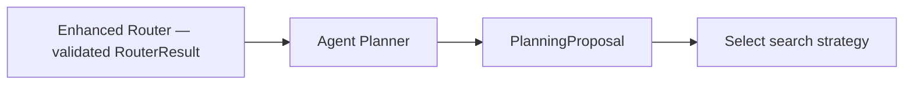
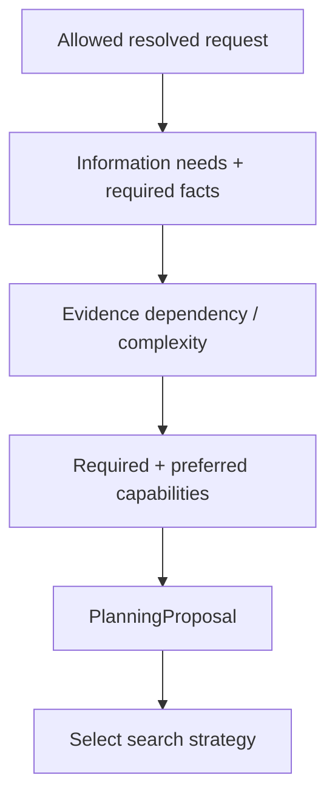

# Agent Planner

> [!note] Төлөв
> Design Complete / Implementation Pending. Planner-ийн хариуцлага, contract, алгоритмын дэлгэрэнгүйг доорх subnote-ууд хадгална.

## Purpose

Agent Planner нь Enhanced Router-ийн validated allowed request-д тулгуурлан ямар evidence хэрэгтэйг тодорхойлж `PlanningProposal` гаргана. Strategy implementation нэрийг шууд сонгохгүй; retrieval capability шаардлагыг санал болгоно.

## Architecture Position

## Input

- Validated `RouterResult` болон allowed retrieval request.
- Request-ийн `resolved_question`.
- Шаардлагатай үед related context metadata.
- [[Retrieval capabilities]] дэх canonical capability contract, read-only constraints.

## Processing

Information needs, required facts, evidence dependencies болон request complexity-г тодорхойлж; required/preferred capability санал болгон structured `PlanningProposal` гаргана.

## Output

`request_id`, `required_facts`, `information_needs`, `required_capabilities`, `preferred_capabilities` бүхий `PlanningProposal`. Энэ нь хайлтын шаардлагын санал болохоос executable `SearchPlan` биш.

## Responsibilities and Boundaries

Planner intent/follow-up/policy дахин ангилахгүй, strategy ID сонгохгүй, budget enforce хийхгүй, Vector Store search/review хийхгүй, эцсийн хариулт үүсгэхгүй. Structured LLM planning call ашиглах эсэх болон энгийн асуултад deterministic default хэрэглэх нь implementation option хэвээр; хэрэгжсэн гэж үзэхгүй.

## Algorithm Overview

## Detailed Documentation

- [[AP - Information needs and facts]]
- [[AP - Capability planning]]
- [[AP - PlanningProposal contract]]

## Current Status

Agent Planner одоогийн `refactor` runtime-д байхгүй. Одоогийн pipeline нь router-ийн `search_query`-г шууд ашигладаг. Planner болон Selector-ийн integration implementation pending.

## Related Components

[[Enhanced Router]] · [[Select search strategy]] · [[Retrieval capabilities]] · [[Question taxonomy]]
