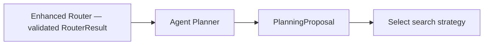
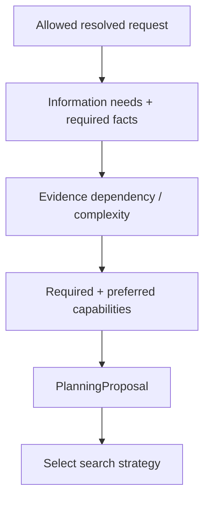

# Agent Planner

> [!note] Төлөв
> Design Complete / Implementation Partial. Planner-ийн хариуцлага, contract, алгоритмын дэлгэрэнгүйг доорх subnote-ууд хадгална.

## Purpose

Agent Planner нь Enhanced Router-ийн validated allowed request-д тулгуурлан ямар evidence хэрэгтэйг тодорхойлж `PlanningProposal` гаргана. Strategy implementation нэрийг шууд сонгохгүй; retrieval capability шаардлагыг санал болгоно.

## Architecture Position

## Input

- Validated Router `requests[]` болон allowed retrieval request. Одоогийн кодод тусдаа `RouterResult` class байхгүй.
- Request-ийн `resolved_question`.
- Одоогийн implementation `related_turn_ids`-ийг Planner input-д дамжуулахгүй. Ирээдүйд context metadata хэрэглэвэл үүнийг зөвхөн untrusted context гэж үзнэ; evidence эсвэл retrieval authorization биш.
- [[Retrieval capabilities]] дэх canonical capability contract, read-only constraints.

## Processing

Нэг user message-ийн allowed retrieval request-үүдийг нэг structured Planner call-д багцлан, request тус бүрийн information needs, required facts болон required/preferred capability-г тодорхойлж `PlanningProposal[]` гаргана. Python request бүрд ID оноож, proposal-уудыг Selector-д өгөхөөс өмнө шалгана.

## Output

`request_id`, `required_facts`, `information_needs`, `required_capabilities`, `preferred_capabilities` бүхий `PlanningProposal`. Энэ нь хайлтын шаардлагын санал болохоос executable `SearchPlan` биш.

## Responsibilities and Boundaries

Planner intent/follow-up/policy дахин ангилахгүй, strategy ID сонгохгүй, budget enforce хийхгүй, Vector Store search/review хийхгүй, эцсийн хариулт үүсгэхгүй. Одоогийн callable нэг batch structured LLM call ашиглана; allowed retrieval request байхгүй үед call алгасна. Энэ нь pipeline-д холбогдоогүй тул `answer_question()`-ийн одоогийн search behavior өөрчлөгдөөгүй.

## Algorithm Overview

## Detailed Documentation

- [[AP - Information needs and facts]]
- [[AP - Capability planning]]
- [[AP - PlanningProposal contract]]

## Implementation status (as built)

- Status: partial
- Code owner: `rag/planning.py::plan_requests`
- Behavior verified: Router requests-ээс Python policy/route-г дахин бодож, зөвхөн allowed retrieval request-үүдийг сонгоно. Python `R1`/`R2`/`R3` ID-г эх request-ийн дарааллаар оноож, нэг structured call-д бүгдийг багцална. Fact/need ID, target холбоос, capability болон request identity-г Python шалгана.
- Call bound: `plan_requests()` invocation бүрд хамгийн ихдээ нэг Planner call; Router-ийн дээд талын 3 request-ээс илүүг хүлээж авахгүй. Энэ callable-ийг pipeline одоогоор дуудахгүй.
- Tests: `tests.test_planning` (6 passed, mocked/offline); QH/ER routing 7 and pipeline 33 passed; focused QH history UI test passed. 2026-11-16 live smoke (`gpt-6-luna`): нэг structured batch-д хоёр synthetic allowed request proposal авч, restricted R3-г хассан; ID/target/capability contract valid.
- Limitations: Selector/runtime consumer байхгүй тул PlanningProposal нь pipeline-д ашиглагдаагүй. Capability catalog нь proposal vocabulary болохоос enabled strategy-ийн баталгаа биш. Live smoke нь schema/functionality-г шалгасан болохоос fact decomposition-ийн semantic correctness-ийг эх сурвалжаар батлаагүй.
- Next: Selector phase-д энэ callable-ийн validated proposals-ийг хэрэглэж, executable query төлөвлөгөөтэй холбох.

## Related Components

[[Enhanced Router]] · [[Select search strategy]] · [[Retrieval capabilities]] · [[Question taxonomy]]
