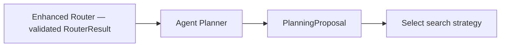
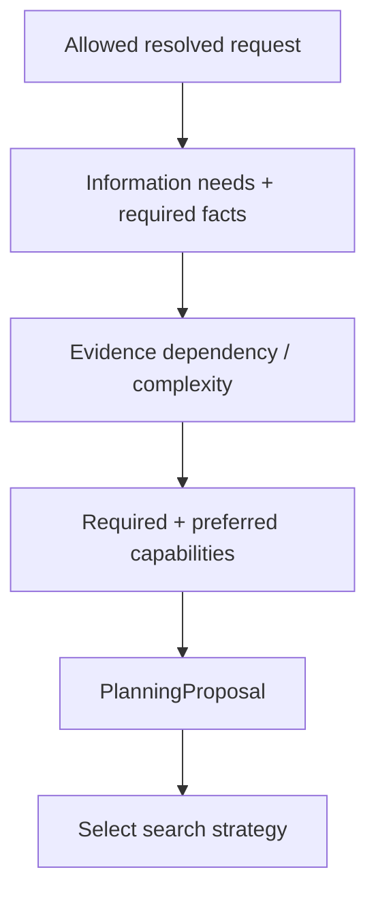

# Agent Planner

> [!note] Төлөв
> Design Complete / Implementation Partial. Planner-ийн хариуцлага, contract, алгоритмын дэлгэрэнгүйг доорх subnote-ууд хадгална.

## Purpose

Agent Planner нь Enhanced Router-ийн validated allowed request-д тулгуурлан ямар evidence хэрэгтэйг тодорхойлж `PlanningProposal` гаргана. Strategy implementation нэрийг шууд сонгохгүй; retrieval capability шаардлагыг санал болгоно.

## Architecture Position

## Input

- Validated Router `requests[]` болон allowed retrieval request. Одоогийн кодод тусдаа `RouterResult` class байхгүй.
- Request-ийн `resolved_question`.
- Одоогийн implementation `related_turn_ids`-ийг Planner input-д дамжуулахгүй. Ирээдүйд context metadata хэрэглэвэл үүнийг зөвхөн untrusted context гэж үзнэ; evidence эсвэл retrieval authorization биш.
- [[Retrieval capabilities]] дэх canonical capability contract, read-only constraints.

## Processing

Нэг user message-ийн allowed retrieval request-үүдийг нэг structured Planner call-д багцлан, request тус бүрийн information needs, required facts болон required/preferred capability-г тодорхойлж `PlanningProposal[]` гаргана. Python request бүрд ID оноож, proposal-уудыг Selector-д өгөхөөс өмнө шалгана.

## Output

`request_id`, `required_facts`, `information_needs`, `required_capabilities`, `preferred_capabilities` бүхий `PlanningProposal`. Энэ нь хайлтын шаардлагын санал болохоос executable `SearchPlan` биш.

## Responsibilities and Boundaries

Planner intent/follow-up/policy дахин ангилахгүй, strategy ID сонгохгүй, budget enforce хийхгүй, Vector Store search/review хийхгүй, эцсийн хариулт үүсгэхгүй. Pipeline нь Router-ийн deterministic policy check-ийн дараа `plan_requests()`-ийг нэг удаа дуудаж, allowed retrieval request-үүдийн `PlanningProposal[]`-г Selector-д дамжуулна. Allowed request байхгүй үед Planner model call алгасна.

## Algorithm Overview

## Detailed Documentation

- [[AP - Information needs and facts]]
- [[AP - Capability planning]]
- [[AP - PlanningProposal contract]]

## Implementation status (as built)

- Status: partial
- Code owner: `rag/planning.py::plan_requests`
- Behavior verified: `answer_question()` Router-оос баталгаажсан request-үүдийг `plan_requests()`-д нэг удаа batch-аар өгнө. Python policy/route-г дахин тооцож, зөвхөн allowed retrieval request-үүдэд эх request-ийн дарааллын `R1`/`R2`/`R3` ID онооно. Fact/need ID, target холбоос, capability болон request identity-г Python шалгаад Selector-д дамжуулна.
- Call bound: Нэг user message-д хамгийн ихдээ нэг structured Planner call; нэгээс гурван routed request-ийг нэг batch-д боловсруулна. Allowed retrieval request байхгүй бол model call хийхгүй. Proposal-ийг public answer result-д нэмэхгүй.
- Tests: `.venv312\Scripts\python.exe -m unittest tests.test_pipeline.AnswerQuestionTests tests.test_retrieval tests.test_planning tests.test_selection tests.test_routing tests.test_live_evaluation -q` — 86 passed offline. 2026-11-16 live integrated smoke (`gpt-6-luna`): C01/C07/C21 тус бүр нэг Router request-ээс нэг validated proposal (1 fact, 1 need) гаргаж, downstream Selector/Retrieval-д дамжсан.
- Limitations: Capability catalog нь Planner vocabulary болохоос бүх capability-г Selector дэмждэг гэсэн баталгаа биш; unsupported required capability limitation болно. Live smoke fact decomposition-ийн semantic correctness-ийг эх сурвалжаар батлаагүй; multi-request Planner batch pipeline-ээр live шалгагдаагүй.
- Next: Dedup and Evidence Review contract-ийг query/fact association болон Retrieval status-тай хэрхэн холбохыг хэрэгжүүлж, шалгах.

## Related Components

[[Enhanced Router]] · [[Select search strategy]] · [[Retrieval capabilities]] · [[Question taxonomy]]
