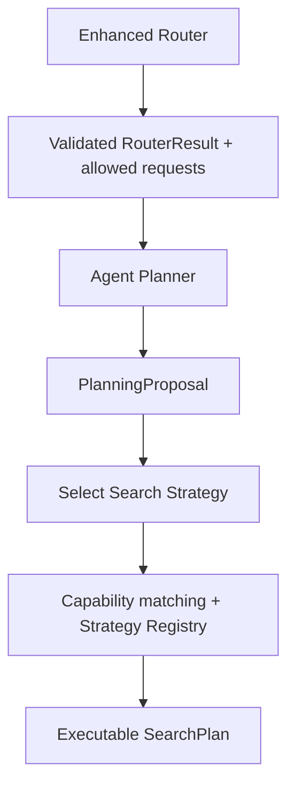

# AP - Capability planning

> [!note] Migration
> Доорх хэсгүүдийг өмнөх component hub-ээс бүрэн шилжүүлэв. Source section-ийн тайлбар, жишээ, хүснэгт, diagram болон status-ийг хадгалсан.

## Purpose

Required/preferred retrieval capability санал болгох, Planner ба Selector-ийн зааг.


## Байрлал



Энэ нь [[Agent Planner]]-ийн одоогийн component дарааллыг дэлгэрүүлсэн дотоод boundary; тусдаа top-level pipeline биш.

## Planner юу хийхгүй вэ?

- Intent, relationship, follow-up эсвэл policy restriction дахин ангилахгүй.
- Restriction override хийхгүй, Strategy Registry-г өөрчлөхгүй.
- `single_query`/`multi_query` зэрэг strategy implementation шууд сонгохгүй.
- Search budget enforce хийхгүй, Vector Store search хийхгүй.
- Retrieved evidence review хийхгүй, final answer үүсгэхгүй.

## LLM ба deterministic planning

Одоогийн implementation нь нэг user message-ийн allowed retrieval request-үүдийг **нэг structured Planner call**-д багцална; нэг request тутамд call нэмэхгүй. Allowed retrieval request байхгүй үед call хийхгүй. Энэ нь Router-ийн normalization/intent call-аас тусдаа, bounded AP call юм.

## Required ба preferred capability

- **Required capability**: request-ийг төлөвлөсөн байдлаар боловсруулахад зайлшгүй. Selector ямар ч strategy бүх required capability-г хангахгүй бол биелүүлсэн мэт downgrade хийхгүй, limitation буцаана.
- **Preferred capability**: coverage/үр ашгийг нэмэгдүүлж болох ч заавал хангахгүй. Selector тухайн capability байхгүй үед required-ийг хангадаг зөвшөөрөгдсөн strategy сонгож, limitation-ийг trace-д тэмдэглэж болно.

Жишээ:

```json
{
  "required_capabilities": ["focused_lookup"],
  "preferred_capabilities": ["multi_angle_coverage"]
}
```

Энэ нь `multi_query` strategy шууд сонгосон гэсэн үг биш. [[Retrieval capabilities]] нь capability ID болон утгын canonical тайлбар. Planner-д өгөгдөх available capability set нь тухайн runtime-ийн enabled Registry/provider нөхцөлтэй нийцсэн байх ёстой; catalog-д байгаа бүх conceptual capability-г боломжтой гэж үзэхгүй.

## Capability plan бэлтгэх

- Capability-г мэдээллийн хэрэгцээнээс гаргана, strategy нэрээс биш.
- `focused_lookup` нь нэг тодорхой need; `multi_angle_coverage` нь ялгаатай evidence angle-уудыг хамруулах хэрэгцээ.
- `exact_reference_focus`, `comparison_coverage`, `dependency_aware_search`, `metadata_scoping` зэрэг бусад capability нь canonical catalog-д байгаа боловч V1 strategy-аар заавал хэрэгждэггүй.
- Хайлтын зорилгыг information target/search intent хэлбэрээр илэрхийлнэ. Эцсийн query текст үүсгэх, strategy-specific query construction хийх нь Planner-ийн зайлшгүй үүрэг биш; Selector-ийн strategy implementation хариуцаж болно.
- Multi-intent хүсэлтүүдийг R1/R2 зэрэг тус тусын proposal болгон тусгаарлана; нэг request-ийн policy/evidence requirement нөгөөд шилжихгүй.

## Current vs proposed

`rag/planning.py` capability ID-уудыг structured proposal vocabulary болгон ашиглаж, шаардлагатай/preferred жагсаалтыг validate хийнэ. Capability нь enabled strategy байгаа гэсэн үг биш; `rag/selection.py` дахь V1 Registry л `focused_lookup` болон `multi_angle_coverage`-ийг дэмждэг. `answer_question()` Planner proposal-уудыг Selector-д дамжуулна.

## Implementation status (as built)

- Status: partial. `CAPABILITY_DESCRIPTIONS` нь note-ийн зургаан capability ID-г canonical Planner vocabulary болгон өгч, structured output болон Python validation-д ашиглана.
- Model capability ID-г зөвхөн catalog-аас сонгоно. Python unknown/duplicate болон нэгэн зэрэг required/preferred болсон ID-г reject хийнэ.
- Limits: `dependency_aware_search`, `metadata_scoping` зэрэг supported strategy-гүй required capability нь хайлтыг эхлүүлэхгүй, explicit planning limitation болно. C01/C07/C21 live smoke зөвхөн `focused_lookup`-ийг шалгасан; multi-angle live quality батлагдаагүй.
- Verification: `tests.test_planning` болон `tests.test_selection` focused suite-д pipeline integration-ийг оруулсан 86 test pass; 2026-11-16 integrated C01/C07/C21 live smoke-д Planner-ийн capability proposal Selector/Retrieval хүртэл дамжсан.

## Navigation

[[Agent Planner]] · [[Retrieval capabilities]] · [[Select search strategy]]
