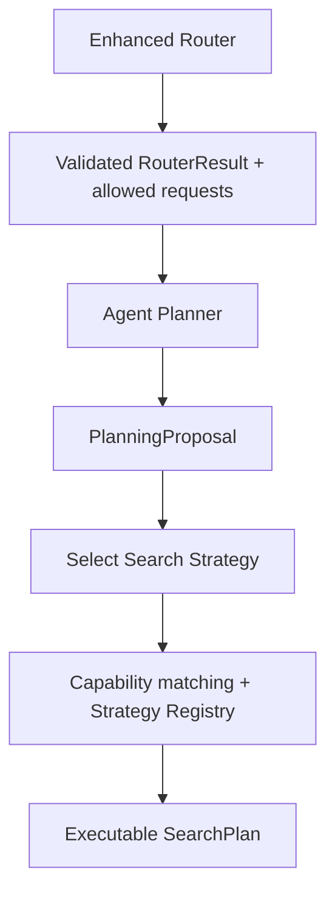

# AP - Capability planning

> [!note] Migration
> Доорх хэсгүүдийг өмнөх component hub-ээс бүрэн шилжүүлэв. Source section-ийн тайлбар, жишээ, хүснэгт, diagram болон status-ийг хадгалсан.

## Purpose

Required/preferred retrieval capability санал болгох, Planner ба Selector-ийн зааг.


## Байрлал



Энэ нь [[Agent Planner]]-ийн одоогийн component дарааллыг дэлгэрүүлсэн дотоод boundary; тусдаа top-level pipeline биш.

## Planner юу хийхгүй вэ?

- Intent, relationship, follow-up эсвэл policy restriction дахин ангилахгүй.
- Restriction override хийхгүй, Strategy Registry-г өөрчлөхгүй.
- `single_query`/`multi_query` зэрэг strategy implementation шууд сонгохгүй.
- Search budget enforce хийхгүй, Vector Store search хийхгүй.
- Retrieved evidence review хийхгүй, final answer үүсгэхгүй.

## LLM ба deterministic planning

Complex request-д Planner нэг structured LLM planning call ашиглаж болох архитектурын боломжтой. Энгийн request-д deterministic default planning боломжтой. Эдгээр нь design option; аль нь ч implemented гэж үзэхгүй. Normalization болон Router ангилалд зориулсан нэмэлт LLM call энд үүсгэхгүй.

## Required ба preferred capability

- **Required capability**: request-ийг төлөвлөсөн байдлаар боловсруулахад зайлшгүй. Selector ямар ч strategy бүх required capability-г хангахгүй бол биелүүлсэн мэт downgrade хийхгүй, limitation буцаана.
- **Preferred capability**: coverage/үр ашгийг нэмэгдүүлж болох ч заавал хангахгүй. Selector тухайн capability байхгүй үед required-ийг хангадаг зөвшөөрөгдсөн strategy сонгож, limitation-ийг trace-д тэмдэглэж болно.

Жишээ:

```json
{
  "required_capabilities": ["focused_lookup"],
  "preferred_capabilities": ["multi_angle_coverage"]
}
```

Энэ нь `multi_query` strategy шууд сонгосон гэсэн үг биш. [[Retrieval capabilities]] нь capability ID болон утгын canonical тайлбар. Planner-д өгөгдөх available capability set нь тухайн runtime-ийн enabled Registry/provider нөхцөлтэй нийцсэн байх ёстой; catalog-д байгаа бүх conceptual capability-г боломжтой гэж үзэхгүй.

## Capability plan бэлтгэх

- Capability-г мэдээллийн хэрэгцээнээс гаргана, strategy нэрээс биш.
- `focused_lookup` нь нэг тодорхой need; `multi_angle_coverage` нь ялгаатай evidence angle-уудыг хамруулах хэрэгцээ.
- `exact_reference_focus`, `comparison_coverage`, `dependency_aware_search`, `metadata_scoping` зэрэг бусад capability нь canonical catalog-д байгаа боловч V1 strategy-аар заавал хэрэгждэггүй.
- Хайлтын зорилгыг information target/search intent хэлбэрээр илэрхийлнэ. Эцсийн query текст үүсгэх, strategy-specific query construction хийх нь Planner-ийн зайлшгүй үүрэг биш; Selector-ийн strategy implementation хариуцаж болно.
- Multi-intent хүсэлтүүдийг R1/R2 зэрэг тус тусын proposal болгон тусгаарлана; нэг request-ийн policy/evidence requirement нөгөөд шилжихгүй.

## Current vs proposed

Одоогийн runtime-д Agent Planner болон capability planning байхгүй; router-ийн `search_query`-г pipeline шууд ашигладаг. Capability-д суурилсан proposal, planning LLM/deterministic default-ийн аль аль нь proposed design хэвээр.

## Navigation

[[Agent Planner]] · [[Retrieval capabilities]] · [[Select search strategy]]
