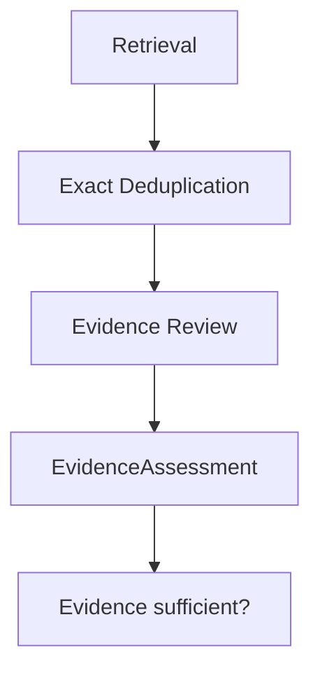
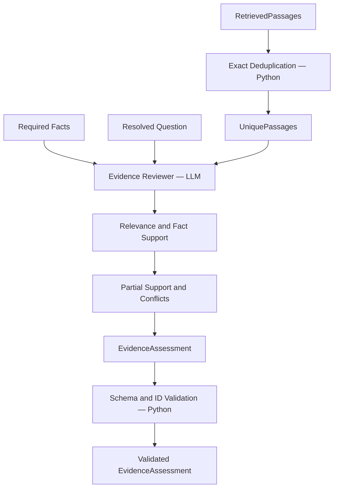

---
tags:
  - rag
  - agentic-rag
  - architecture
  - evidence
status: design-complete
implementation: partial
validation: partial
---

# Dedup and Evidence review

## Purpose

Энэ component нь [[Retrieval]]-ээс ирсэн passages-ийг давхардлаас цэвэрлэж, хэрэглэгчийн асуултад шаардлагатай facts-ийг батлах evidence байгаа эсэхийг үнэлнэ.

**Гол зорилго: RetrievedPassages → UniquePassages → EvidenceAssessment.**

Энэ component хоёр logical operation-той:

1. **Deduplication** — ижил passage давхар ирсэн бол нэгтгэнэ.
2. **Evidence Review** — passage-ууд ямар required fact-ийг баталж байгааг үнэлнэ.

## Architecture Position

Энэ component нь [[Retrieval]] болон дараагийн evidence sufficiency decision-ийн хооронд байрлана.

## Input → Processing → Output

| Stage | Input | Processing | Output |
|---|---|---|---|
| Deduplication | `RetrievedPassages` | Exact duplicate detection | `UniquePassages` |
| Evidence Review | Unique passages + required facts + resolved question + retrieval status | Structured LLM evaluation | `EvidenceAssessment` |
| Validation | `EvidenceAssessment` | Schema, IDs, references | Validated assessment |

## 1. Deduplication

Давхардсан passage-уудыг нэгтгэж, original text, file provenance, query associations болон retrieval scores хадгална.

V1-д:

- Deterministic Python.
- Exact passage deduplication.
- Semantic deduplication хийхгүй.
- Document version deduplication хийхгүй.
- Өөр file/version-ийн passages-ийг автоматаар нэгтгэхгүй.

Дэлгэрэнгүй: [[DE - Deduplication]]

## 2. Evidence Review

Нэг structured LLM call ашиглана.

Үндсэн шалгалтууд:

1. Passage relevance.
2. Required-fact support.
3. Partial болон missing evidence.
4. Evidence conflicts.
5. Evidence selection.
6. Structured output validation.

Fact support:

- `supported`
- `partial`
- `missing`

Contradiction нь тусдаа `conflicts` field-д хадгалагдана.

Дэлгэрэнгүй: [[DE - Evidence review]]

## 3. Important Design Decisions

- Retrieval score нь evidence correctness-ийн баталгаа биш.
- Relevant passage нь required fact-ийг заавал батлахгүй.
- Required fact бүрийг тусад нь үнэлнэ.
- Нэг LLM call ашиглаж relevance болон fact coverage-г шалгана.
- LLM-ийн evidence ID-уудыг Python validate хийнэ.
- Partial evidence-ийг баталгаатай full answer гэж ашиглахгүй.
- Conflicting evidence-ийг чимээгүй нэг талд шийдэхгүй.
- Original passage text болон provenance-г хадгална.
- Additional reranker эсвэл multiple grader agents нэмэхгүй.
- Reviewer final answer үүсгэхгүй.

## 4. V1 Contract and Current Code

Энэ note болон хоёр subnote нь зорилтот V1 design-ийг тодорхойлно. Одоогийн Python behavior бүрэн хэрэгжсэн гэсэн үг биш.

| Behavior | V1 design | Одоогийн код |
|---|---|---|
| Exact deduplication | Нэг file/version-ийн ижил passage identity-г нэгтгэж, бүх association хадгална | `rag/retrieval.py::deduplicate_passages` file ID, боломжтой version/location metadata, whitespace-normalized text fingerprint ашиглана; өөр file/version/location-ийг салгаж, query matches болон source attributes-ийг нэгтгэнэ |
| Fact review | Fact бүр `supported / partial / missing` үнэлгээтэй | `rag/generation.py::review_evidence` validated required facts болон information needs-ийг нэг structured call-д өгч, fact бүрт evidence IDs буцаана |
| Retrieval status | `success`, `empty`, `partial_error`, `error` ялгааг хадгална | `rag/pipeline.py` `success`, `empty`, `partial_error`-ийг reviewer-д дамжуулна; total error болон evidence-гүй partial error-д review хийхгүй |
| Output validation | Fact, passage, conflict, selected evidence ID-г шалгана | Python бүх fact/need хамрагдсан эсэх, fact/evidence/conflict ID, schema, status, давхардлыг шалгана; selected IDs-ийг баталгаажсан mapping-оос гаргана |

Иймээс доорх `EvidenceAssessment` нь proposed contract; одоогийн reviewer-ийн яг output schema биш.

## 5. Responsibility Boundaries

### Энэ component хийх зүйлс

- Exact duplicate detection.
- Provenance preservation.
- Relevance assessment.
- Fact-by-fact support assessment.
- Conflict identification.
- Evidence selection.
- Structured output validation.

### Энэ component хийхгүй зүйлс

- User question normalization.
- Intent classification.
- Retrieval strategy selection.
- OpenAI Vector Store search.
- Required facts шинээр төлөвлөх.
- Corrective retry execution.
- Final grounded answer generation.

`Evidence sufficient?` node нь энэ component-ийн output-г ашиглах дараагийн decision юм.

Түүний algorithm-ийг энэ note-д эцэслэхгүй.

## 6. Output

**Validated `EvidenceAssessment`**

Энэ нь:

- Fact бүрийн support status.
- Supporting passage IDs.
- Partial evidence-ийн missing details.
- Selected evidence IDs.
- Conflicting evidence.
- Assessment limitations.

гэсэн мэдээлэлтэй байна.

## 7. Documentation

- [[DE - Deduplication]]
- [[DE - Evidence review]]

## 8. Current Status

| Area | Status |
|---|---|
| Component responsibility | Design Complete |
| Exact deduplication V1 design | Design Complete |
| Per-fact review and conflict representation design | Design Complete |
| EvidenceAssessment contract | Design Complete |
| Current Python behavior alignment | Incomplete |
| V1 Python implementation | Partial; integrated in `answer_question` |
| LLM runtime validation | Pending; no live Evidence Review call in this phase |
| Regression testing | Focused offline suite passed; full-suite failures remain |

## Implementation status (as built)

- `deduplicate_passages()` now uses `file_id + version/location metadata + SHA-256 of whitespace-normalized text`. If the current Vector Store adapter supplies no stable location/version metadata, the documented text fingerprint is the fallback. Different files, versions, and known locations remain separate; original text is unchanged.
- Duplicate occurrences merge `retrieval_matches` (query ID, rank, score, targets), preserve source attributes in `source_provenance`, and union fact targets. Missing `file_id` is not guessed, so such passages are retained independently.
- Pipeline reassigns stable `P1...` IDs after dedup and passes the validated request facts, information needs, source/query provenance, and Retrieval status to `review_evidence()`.
- One structured LLM call assesses every planned fact as `supported`, `partial`, or `missing`, identifies conflicts, and returns the legacy `retry_query` field. Python validates exact schema, complete fact coverage, need targets, and all fact/evidence/conflict IDs. The pipeline does not use that reviewer suggestion for retrieval; [[Targeted retry within budget]] builds the query from validated unresolved facts, Planner needs, and `missing_detail`. The Reviewer returns selected evidence IDs and review/retrieval status; [[Evidence sufficient]] owns the separate Yes/No decision.
- `empty` successful retrieval returns missing assessments without an LLM call. Total `error`, or `partial_error` without usable passages, returns an unavailable/error assessment. `partial_error` with passages reviews only available evidence and remains partial; it does not imply corpus absence.
- **Verified:** `.venv312\Scripts\python.exe -m unittest tests.test_pipeline tests.test_generation.ReviewEvidenceTests` — 47 passed. Current full suite: 114 tests, 109 passed, the same 5 Generation/UI assertion failures seen in the prior 110-test run, and no errors. No live Evidence Review or semantic-quality evaluation was run.
- **Limits:** the Vector Store adapter currently returns no stable chunk/location or document-version metadata, so fallback identity can merge repeated identical text at different locations within one file. No reviewer token-budget/truncation report exists. LLM semantic judgments, version authority, and citation correctness remain unverified. The deterministic EvidenceDecision is a downstream pipeline step, not part of the Reviewer output.

**PARTIAL — PYTHON IMPLEMENTED AND OFFLINE VERIFIED; SEMANTIC VALIDATION PENDING**

## 9. Related

- [[Retrieval]]
- [[Agent Planner]]
- [[DE - Deduplication]]
- [[DE - Evidence review]]
