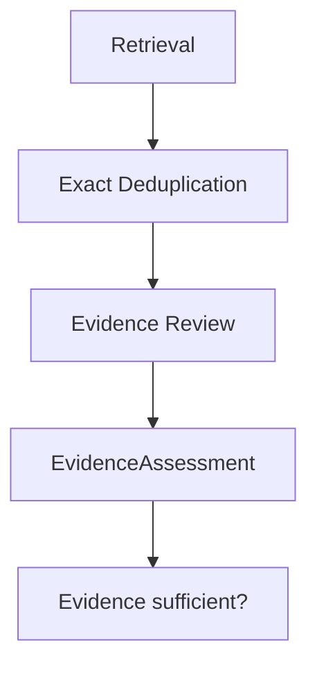
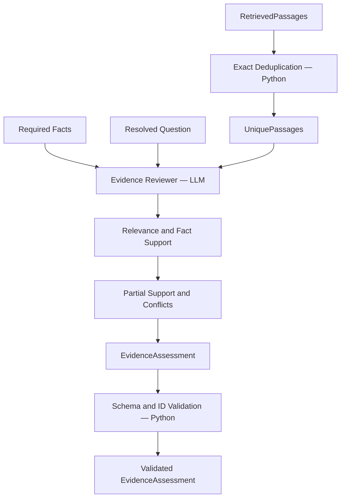

---
tags:
  - rag
  - agentic-rag
  - architecture
  - evidence
status: design-complete
implementation: pending
validation: pending
---

# Dedup and Evidence review

## Purpose

Энэ component нь [[Retrieval]]-ээс ирсэн passages-ийг давхардлаас цэвэрлэж, хэрэглэгчийн асуултад шаардлагатай facts-ийг батлах evidence байгаа эсэхийг үнэлнэ.

**Гол зорилго: RetrievedPassages → UniquePassages → EvidenceAssessment.**

Энэ component хоёр logical operation-той:

1. **Deduplication** — ижил passage давхар ирсэн бол нэгтгэнэ.
2. **Evidence Review** — passage-ууд ямар required fact-ийг баталж байгааг үнэлнэ.

## Architecture Position

Энэ component нь [[Retrieval]] болон дараагийн evidence sufficiency decision-ийн хооронд байрлана.

## Input → Processing → Output

| Stage | Input | Processing | Output |
|---|---|---|---|
| Deduplication | `RetrievedPassages` | Exact duplicate detection | `UniquePassages` |
| Evidence Review | Unique passages + required facts + resolved question + retrieval status | Structured LLM evaluation | `EvidenceAssessment` |
| Validation | `EvidenceAssessment` | Schema, IDs, references | Validated assessment |

## 1. Deduplication

Давхардсан passage-уудыг нэгтгэж, original text, file provenance, query associations болон retrieval scores хадгална.

V1-д:

- Deterministic Python.
- Exact passage deduplication.
- Semantic deduplication хийхгүй.
- Document version deduplication хийхгүй.
- Өөр file/version-ийн passages-ийг автоматаар нэгтгэхгүй.

Дэлгэрэнгүй: [[DE - Deduplication]]

## 2. Evidence Review

Нэг structured LLM call ашиглана.

Үндсэн шалгалтууд:

1. Passage relevance.
2. Required-fact support.
3. Partial болон missing evidence.
4. Evidence conflicts.
5. Evidence selection.
6. Structured output validation.

Fact support:

- `supported`
- `partial`
- `missing`

Contradiction нь тусдаа `conflicts` field-д хадгалагдана.

Дэлгэрэнгүй: [[DE - Evidence review]]

## 3. Important Design Decisions

- Retrieval score нь evidence correctness-ийн баталгаа биш.
- Relevant passage нь required fact-ийг заавал батлахгүй.
- Required fact бүрийг тусад нь үнэлнэ.
- Нэг LLM call ашиглаж relevance болон fact coverage-г шалгана.
- LLM-ийн evidence ID-уудыг Python validate хийнэ.
- Partial evidence-ийг баталгаатай full answer гэж ашиглахгүй.
- Conflicting evidence-ийг чимээгүй нэг талд шийдэхгүй.
- Original passage text болон provenance-г хадгална.
- Additional reranker эсвэл multiple grader agents нэмэхгүй.
- Reviewer final answer үүсгэхгүй.

## 4. V1 Contract and Current Code

Энэ note болон хоёр subnote нь зорилтот V1 design-ийг тодорхойлно. Одоогийн Python behavior бүрэн хэрэгжсэн гэсэн үг биш.

| Behavior | V1 design | Одоогийн код |
|---|---|---|
| Exact deduplication | Нэг file дотор ижил passage identity-г нэгтгэж, provenance хадгална | `rag/retrieval.py::deduplicate_passages` ижил raw `text`-ийг file ID харгалзахгүй нэгтгэж, зөвхөн `file_id`, `filename`, `score`, `origin` provenance хадгална |
| Fact review | Fact бүр `supported / partial / missing` үнэлгээтэй | `rag/generation.py::review_evidence` нийт асуултад `sufficient / partial / insufficient` буцаана; per-fact mapping болон conflict field байхгүй |
| Retrieval status | Evidence Review-д execution status дамжуулна | `rag/pipeline.py` reviewer рүү retrieval status дамжуулахгүй |
| Output validation | Fact, passage, conflict, selected evidence ID-г шалгана | Reviewer-ийн `relevant_ids`-ийг өгсөн E-ID-уудтай шүүн тааруулдаг; бусад V1 contract хэрэгжээгүй |

Иймээс доорх `EvidenceAssessment` нь proposed contract; одоогийн reviewer-ийн яг output schema биш.

## 5. Responsibility Boundaries

### Энэ component хийх зүйлс

- Exact duplicate detection.
- Provenance preservation.
- Relevance assessment.
- Fact-by-fact support assessment.
- Conflict identification.
- Evidence selection.
- Structured output validation.

### Энэ component хийхгүй зүйлс

- User question normalization.
- Intent classification.
- Retrieval strategy selection.
- OpenAI Vector Store search.
- Required facts шинээр төлөвлөх.
- Corrective retry execution.
- Final grounded answer generation.

`Evidence sufficient?` node нь энэ component-ийн output-г ашиглах дараагийн decision юм.

Түүний algorithm-ийг энэ note-д эцэслэхгүй.

## 6. Output

**Validated `EvidenceAssessment`**

Энэ нь:

- Fact бүрийн support status.
- Supporting passage IDs.
- Partial evidence-ийн missing details.
- Selected evidence IDs.
- Conflicting evidence.
- Assessment limitations.

гэсэн мэдээлэлтэй байна.

## 7. Documentation

- [[DE - Deduplication]]
- [[DE - Evidence review]]

## 8. Current Status

| Area | Status |
|---|---|
| Component responsibility | Design Complete |
| Exact deduplication V1 design | Design Complete |
| Per-fact review and conflict representation design | Design Complete |
| EvidenceAssessment contract | Design Complete |
| Current Python behavior alignment | Incomplete |
| V1 Python implementation | Pending |
| LLM runtime validation | Pending |
| Regression testing | Pending |

**DESIGN COMPLETE — IMPLEMENTATION AND VALIDATION PENDING**

## 9. Related

- [[Retrieval]]
- [[Agent Planner]]
- [[DE - Deduplication]]
- [[DE - Evidence review]]
