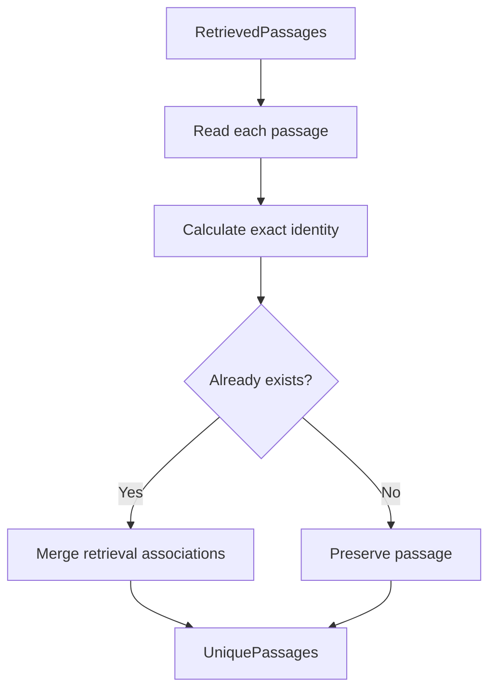

---
tags:
  - rag
  - evidence
  - deduplication
status: design-complete
implementation: partial
validation: partial
---

# DE - Deduplication

Parent: [[Dedup and Evidence review]]

## Purpose

Multi Query retrieval-ээс нэг passage олон удаа ирж болно.

Deduplication-ийн зорилго нь ийм давхардлыг нэгтгэж, Evidence Reviewer-д шаардлагагүй давталт өгөхөөс зайлсхийх юм.

**Input: RetrievedPassages**

**Processing: Exact duplicate detection**

**Output: UniquePassages**

V1-д LLM хэрэглэхгүй.

## Algorithm



## Duplicate Identity

Хэрэв provider тогтвортой passage/chunk identifier болон location metadata өгдөг бол тэр identity-г ашиглаж болно. Боломжтой location нь page, section, chunk эсвэл provider-ийн өгөх тогтвортой offset байна; байхгүй metadata-г зохиож үүсгэхгүй.

Тийм identifier байхгүй үед V1 fallback:

`file_id + normalized passage text fingerprint`

Fallback fingerprint-ийн normalization нь зөвхөн duplicate comparison-д хэрэглэгдэнэ: whitespace-ийг тогтмол хэлбэрт оруулж, fingerprint тооцно. Энэ normalization нь provenance key биш бөгөөд оригинал passage text-д үйлчлэхгүй.

Conceptual deterministic algorithm:

```python
normalized = " ".join(passage_text.split())
fingerprint = sha256(normalized.encode("utf-8")).hexdigest()
identity = (file_id, location_id or fingerprint)
```

Энд `location_id` нь provider-ийн тогтвортой passage/chunk ID эсвэл боломжтой location identity. `sha256` нь стандарт сангийн hash; энэ нь аюулгүй байдлын баталгаа биш, зөвхөн content fingerprint юм.

Original passage text өөрчлөгдөхгүй.

### Comparison Rules

| Condition | Decision |
|---|---|
| Same file + same passage identity | Merge |
| Same file + same text, no location identifier | Merge cautiously |
| Same file + different text | Keep separately |
| Different files + identical text | Keep separately |
| Different document versions | Keep separately |
| Partially overlapping text | Do not exact-dedup |

Ижил файл дотор яг ижил текст өөр байрлалд давтагдсан байж болно. Location metadata байхгүй үед text fingerprint ийм тохиолдлыг ялгаж чадахгүй.

Иймээс V1-д known limitation гэж тэмдэглэнэ. Боломжтой occurrence metadata-г хадгалж, нэгтгэснээр тусдаа provenance алдахгүй байхыг зорино.

## Worked Example

Query 1:

`A, B, C, D, E`

Query 2:

`B, C, F, G, H`

Нийт 10 results.

Deduplication-ийн дараа:

`A, B, C, D, E, F, G, H`

Нийт 8 unique passages.

Гэхдээ B болон C-ийн хоёр search-д олдсон мэдээлэл хадгалагдана.

## Output Contract

Conceptual example:

```json
{
  "passage_id": "P2",
  "file_id": "file_123",
  "filename": "leave_policy.pdf",
  "text": "Чөлөө зөвшөөрөх журам...",
  "retrieval_matches": [
    {
      "query_id": "Q1",
      "rank": 2,
      "score": 0.89,
      "targets": ["F1"]
    },
    {
      "query_id": "Q2",
      "rank": 1,
      "score": 0.91,
      "targets": ["F2"]
    }
  ]
}
```

Жишээн дэх filename, score болон text нь fabricated sample.

Provider score-уудыг нэгтгэж шинэ relevance score зохиохгүй.

## Provenance Preservation

Хадгалах мэдээлэл:

- Original passage text.
- File ID.
- Filename.
- Available source attributes.
- Query IDs.
- Original ranks.
- Original provider scores.
- Target fact associations.
- Available location/identity metadata.

`passage_id` нь reviewer-д ашиглах application-level ID юм. Хадгалсан location metadata байвал тухайн passage identity-ийн хамт хэвээр дамжина.

Query давхардсан гэдэг нь хоёр independent source нэг fact-ийг баталж байна гэсэн үг биш.

## What Deduplication Does Not Do

- Semantic similarity clustering.
- Version suppression.
- Latest document selection.
- Reranking.
- Passage correctness validation.
- Fact support classification.
- Evidence sufficiency decision.

## Edge Cases

| Case | Expected behavior |
|---|---|
| Zero passages | Empty UniquePassages |
| One passage | Unchanged |
| Identical passage from two queries | Merge associations |
| Same text from different files | Preserve both |
| Same file, different passages | Preserve both |
| Missing source identity | Do not invent identity; use only a defensible fallback |
| Overlapping passage boundaries | Keep separately |
| Different document versions | Keep provenance separate |

## Validation

Deterministic tests:

- Duplicate detection.
- Merge consistency.
- Original text preservation.
- Provenance preservation.
- Stable passage IDs within an assessment.
- Query association integrity.
- Empty input.
- Cross-version isolation.

## Design Decisions

1. V1 uses deterministic exact deduplication.
2. No LLM call.
3. No semantic deduplication.
4. No automatic version deduplication.
5. Source provenance must survive merging.
6. Different files are not merged merely because their text is identical.

## Current Code vs V1 Design

`rag/retrieval.py::deduplicate_passages` нь `file_id`, ил байгаа version/location metadata, whitespace-normalized text-ийн SHA-256 fingerprint-ээр identity үүсгэнэ. Одоогийн OpenAI Vector Store adapter chunk/location/version metadata буцаахгүй тул runtime-д `file_id + text fingerprint` fallback хэрэглэгдэнэ. Ялгаатай file ID, version эсвэл location-тай ижил text тусдаа үлдэнэ.

Давхардсан occurrence-уудын `retrieval_matches` (`query_id`, rank, score, fact targets)-г нэгтгэж, source attribute-уудыг `source_provenance`-д хадгална. Хариултад ашиглах passage ID-г pipeline deduplication-ийн дараа тогтвортой `P1...` дарааллаар онооно. Location metadata байхгүй үед ижил file дотор ижил text өөр байрлалд давтагдсаныг ялгах боломжгүй хэвээр.

## Status

## Implementation status (as built)

- Deterministic exact deduplication болон whitespace fingerprint хэрэглэнэ; эх text өөрчлөхгүй, semantic similarity-аар нэгтгэхгүй.
- Ижил passage олон SearchPlan query-ээс ирэхэд бүх query/rank/score/target холбоосыг хадгална. Өөр file, version, мэдэгдэж буй location болон file ID-гүй passage-ийг нэгтгэж устгахгүй.
- **Verified:** `tests.test_retrieval` болон pipeline integration tests; focused DE/QH/ER/AP/SSS/Retrieval suite: 88 passed.
- **Limit:** одоогийн Vector Store adapter location/version metadata гаргахгүй. File дотор ижил text-ийн өөр occurrence-ийг ялгахгүй байж болно; semantic dedup, reranking болон version authority шийдэхгүй.

**PARTIAL — OFFLINE VERIFIED; SOURCE LOCATION METADATA LIMITED**

Related: [[Dedup and Evidence review]], [[DE - Evidence review]], [[Retrieval]]
