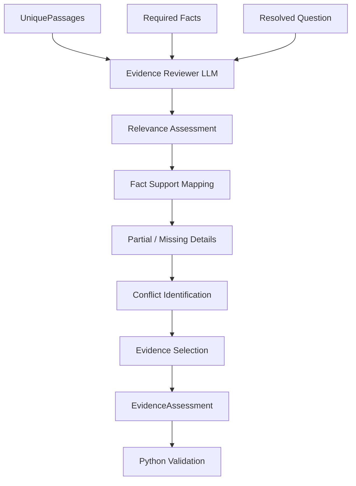

---
tags:
  - rag
  - evidence
  - grounding
  - review
status: design-complete
implementation: partial
validation: partial
---

# DE - Evidence review

Parent: [[Dedup and Evidence review]]

## Purpose

Evidence Review нь retrieved passages хэрэглэгчийн асуултын required facts-ийг бодитоор баталж байгаа эсэхийг үнэлнэ.

**Relevant passage ≠ Supported fact.**

High retrieval score нь factual support-ийн баталгаа биш.

V1-д нэг structured LLM call ашиглана.

## Input → Processing → Output



### Input

- Validated resolved question.
- Planner-ийн required facts.
- Deduplicated passages.
- Source/provenance metadata.
- Retrieval execution status.

Retrieval status нь `success`, `empty`, `partial_error`, `error` гэсэн төлөвүүдийн аль нь болохыг эх үүсвэрээс нь авч, EvidenceAssessment-д хадгална. Төлөвүүдийг өөр утгаар тайлбарлан нэгтгэхгүй.

### Output

Validated `EvidenceAssessment`.

## 1. Relevance Assessment

Passage хэрэглэгчийн асуулттай холбоотой эсэхийг үнэлнэ.

Жишээ:

Question:

"Менежер эзгүй үед 3 цагийн чөлөөг хэн зөвшөөрөх вэ?"

P1:

"Менежер мэдээллийн системийн өөрчлөлтийг зөвшөөрнө."

P1 өндөр retrieval score-той байсан ч чөлөө зөвшөөрөх журмыг батлахгүй.

Тиймээс irrelevant.

Гэхдээ relevance нь зөвхөн эхний шалгалт.

## 2. Per-Fact Support

Required fact бүрийг тусад нь шалгана.

### Fact Status

| Status | Meaning |
|---|---|
| `supported` | Available evidence тухайн required fact-ийн шаардлагатай мэдээллийг тодорхой баталж байна |
| `partial` | Available evidence асуултын зарим хэсгийг баталж байгаа боловч чухал нөхцөл дутуу |
| `missing` | Available passages дотор тухайн fact-ийг батлах evidence алга |

Эдгээр статус нь **review-д ирсэн evidence-ийн хүрээн дэх үнэлгээ**.

`missing` нь байгууллагын бүх баримтад тухайн мэдээлэл байхгүйг нотлохгүй.

### Example

Required fact:

"Менежер эзгүй үед чөлөөг хэн зөвшөөрөх вэ?"

| Evidence | Status |
|---|---|
| IT change approval policy | `missing` |
| Менежер ердийн үед чөлөө зөвшөөрдөг | `partial` |
| Менежер эзгүй үед орлон зөвшөөрөх эрхийг тодорхой заасан | `supported` |

`partial` evidence-ийг бүрэн хариултын баталгаа болгон ашиглахгүй.

## 3. Conflict Identification

Contradiction нь тусдаа dimension байна.

Fact support болон evidence conflict хоёрыг нэг status болгон хольж болохгүй.

Жишээ:

P1:

"Чөлөөг хэлтсийн менежер зөвшөөрнө."

P2:

"Чөлөөг нэгжийн захирал зөвшөөрнө."

Энэ хоёрын applicability, effective date эсвэл document version өөр байж болно.

Reviewer эхлээд нөхцөл болон source metadata-г шалгана.

Хэрэв бодит зөрчил байгаа боловч хүчинтэй хувилбарыг баттай тогтоох боломжгүй бол conflict-г хадгална.

```json
{
  "conflicts": [
    {
      "fact_id": "F1",
      "evidence_ids": ["P1", "P2"],
      "reason": "Зөвшөөрөх албан тушаалын мэдээлэл зөрчилтэй."
    }
  ]
}
```

Нэг fact `supported` evidence-тэй байсан ч unresolved conflict байвал түүнийг баталгаатай, маргаангүй хариулт гэж үзэхгүй.

Conflict-ийн эцсийн sufficiency шийдвэр нь дараагийн decision component-ийн ажил.

## 4. Evidence Selection

Reviewer нь required facts-д хэрэгтэй passage IDs-ийг сонгоно.

Selected evidence-д:

- Directly supporting evidence.
- Partially supporting evidence.
- Conflict-ийг ойлгоход шаардлагатай evidence.

байж болно.

Гэхдээ `partial` passage-г missing information-ийг батлахад ашиглахгүй.

Original source text болон metadata хадгалагдана.

Irrelevant passage-ийг grounded answer-ийн үндсэн evidence болгон сонгохгүй.

Reviewer-ийн output-д passage-ийн эх текстийг дахин зохиож evidence мэт үүсгэхгүй.

## 5. Structured Output

Conceptual `EvidenceAssessment`:

```json
{
  "request_id": "R1",
  "review_status": "complete",
  "facts": [
    {
      "fact_id": "F1",
      "status": "partial",
      "evidence_ids": ["P2"],
      "missing_detail": "Менежер эзгүй үед зөвшөөрөх эрх хэнд шилжих нь батлагдаагүй."
    },
    {
      "fact_id": "F2",
      "status": "supported",
      "evidence_ids": ["P4"],
      "missing_detail": null
    }
  ],
  "selected_evidence_ids": ["P2", "P4"],
  "conflicts": []
}
```

`review_status` болон `retrieval_status` нь одоогийн validated reviewer output-д байна. `sufficient` гэсэн нийлбэр шийдвэрийг Reviewer гаргахгүй; дараагийн Evidence sufficient node гаргана.

### Important

`EvidenceAssessment` нь final user answer биш.

Энэ нь required facts болон supporting passages-ийн хоорондын mapping юм.

## 6. Reason / Missing Detail

Reviewer-ийн assessment debugging хийхэд ойлгомжтой байх шаардлагатай.

`partial` эсвэл `missing` үед ямар мэдээлэл дутуу байгааг богино тайлбарлаж болно.

Жишээ:

```json
{
  "fact_id": "F1",
  "status": "partial",
  "evidence_ids": ["P2"],
  "missing_detail": "Орлон зөвшөөрөгчийн албан тушаалыг батлаагүй."
}
```

`missing_detail` нь LLM-ийн тайлбар. Энэ нь evidence-ийн оронд ашиглах factual source биш.

## 7. Python Output Validation

LLM structured output гаргасны дараа deterministic validation хийнэ.

Шалгах зүйл:

- Schema valid.
- Fact IDs valid.
- Evidence IDs valid.
- Selected evidence IDs үнэхээр байгаа.
- Status values allowed.
- Conflict references valid.
- Unsupported references reject.
- Required facts assessment-аас чимээгүй алга болоогүй.
- Давхардсан эсвэл зөрчилтэй output structure байхгүй.

Schema validation нь semantic correctness-ийг бүрэн батлахгүй.

LLM passage-ийн утгыг буруу ойлгож болох тул regression болон human review шаардлагатай.

## 8. Retrieval Failure Handling

Retrieval-ийн `empty`, `partial_error`, `error`-ийг ялгана.

### Empty retrieval

Хайлт амжилттай хийгдээд passage байхгүй бол required facts-д retrieved evidence байхгүйг тэмдэглэж болно.

### Partial retrieval error

Зарим search ажиллаагүй бол Reviewer зөвхөн available evidence-ийг үнэлнэ.

Incomplete retrieval гэдгийг assessment-д хадгална.

### Total retrieval error

Provider failure-ийг "баримт байхгүй" гэж тайлбарлахгүй.

Ашиглаж болох passage байхгүй, provider failure болсон үед LLM review алгасаж, explicit unavailable/error assessment буцааж болно.

Reviewer-ийн ажиллагааны алдаа болон evidence missing нь тусдаа.

## 9. Context Handling

Evidence Reviewer зөвхөн bounded evidence context ашиглана.

- Original passage text өөрчлөхгүй.
- Source IDs хадгална.
- Context limit-ээс хэтэрсэн үед passages-ийг чимээгүй тайрахгүй.
- Хэрэв зарим passage review-д ороогүй бол limitation тэмдэглэнэ.
- Document text-д агуулагдсан зааврыг trusted system instruction гэж үзэхгүй.

V1-д:

- Нэг structured review call.
- Additional reranker байхгүй.
- Separate fact-checker agent байхгүй.
- Multiple grader agents байхгүй.

## 10. Edge Cases and Tests

| Case | Expected behavior |
|---|---|
| Relevant and complete evidence | Supported |
| Relevant but incomplete evidence | Partial |
| No supporting evidence | Missing |
| Irrelevant high-score passage | Exclude from support |
| Two passages jointly support a fact | Preserve both evidence IDs |
| Contradictory evidence | Record conflict |
| Older and newer document versions | Preserve provenance; avoid unjustified authority |
| Invalid passage ID | Reject assessment |
| Invalid fact ID | Reject assessment |
| Partial retrieval failure | Preserve limitation |
| Total retrieval failure | Do not claim evidence missing |
| Empty passages after successful search | No retrieved support |
| Model invents unsupported fact | Must not be treated as grounded evidence |
| Large evidence context | Respect bounded context and report omissions |

## 11. Responsibility Boundary

Evidence Reviewer does:

- Relevance evaluation.
- Per-fact support mapping.
- Partial/missing identification.
- Conflict identification.
- Evidence selection.
- Structured assessment.

Evidence Reviewer does not:

- Search Vector Store.
- Rewrite queries.
- Plan new required facts.
- Execute retries.
- Decide final answer wording.
- Generate final citations for unsupported claims.

## 12. Design Decisions

1. Per-fact evidence assessment.
2. One structured LLM review call in V1.
3. `supported / partial / missing` fact statuses.
4. Conflicts represented separately.
5. Evidence IDs validated in Python.
6. Selected evidence retains provenance.
7. Missing evidence is not proof of absence from corpus.
8. Retrieval failure is not equivalent to insufficient evidence.
9. No additional reranker or grader agents in V1.
10. Reviewer output feeds the next `Evidence sufficient?` decision.

## Current Code vs V1 Design

`rag/generation.py::review_evidence` нь Planner-ийн validated required facts болон information needs, resolved question, deduplicated passages/provenance, Retrieval status-ийг нэг structured call-д хэрэглэнэ. Structured output-д required fact бүрийн `supported / partial / missing` status, `P` evidence ID, missing detail болон conflict references ирнэ.

Python нь exact schema, бүх required fact ба information need бүрэн байгаа эсэх, need-to-fact targets, fact/evidence/conflict IDs, duplicate references-ийг шалгана. Reviewer `selected_evidence_ids`, `review_status`, `retrieval_status` болон retry handoff буцаана; `sufficient / partial / insufficient` нийлбэр шийдвэр Reviewer output-д байхгүй. Дараагийн `decide_evidence_sufficiency()` нь Planner fact map болон validated assessment-ийг тулгана. Empty successful retrieval нь LLM call хийхгүйгээр missing assessment буцаана. Total provider error болон usable passage-гүй partial error нь `unavailable/error`; usable passage-тай partial error-ийг үнэлж, `partial` болон retrieval limitation-ийг хадгална.

## Implementation status (as built)

- Нэг evidence assessment-д хамгийн ихдээ нэг structured Reviewer call; targeted retry шинэ unique passage өгвөл combined evidence-д нэг дахин review хийнэ. Нэмэлт reranker/grader нэмээгүй.
- Reviewer per-fact assessment болон legacy `retry_query` field буцаадаг ч pipeline query construction-д уг field-ийг ашиглахгүй; query-г unresolved Planner need болон `missing_detail`-ээс deterministic Python үүсгэнэ. Reviewer хайлт хийхгүй, policy/restriction шийдэхгүй, final answer үүсгэхгүй. Pipeline нь EvidenceDecision-ийн selected references болсон passage-уудыг generation-д өгнө.
- **Verified:** `.venv312\Scripts\python.exe -m unittest tests.test_pipeline tests.test_generation.ReviewEvidenceTests` — 47 passed. `python -m unittest discover -s tests` — 114 tests, 109 passed, the same 5 Generation/UI assertion failures seen in the previous 110-test run, no errors. These tests use mocked outputs; they do not establish semantic correctness.
- **Limits:** live Reviewer/Decision call болон authoritative source-той human review хийгдээгүй. Тусгай token/context budget эсвэл truncation report байхгүй. `partial_error` нь decision дээр `retrieval_incomplete` шалтгаантай No боловч corpus-д баримт байхгүй гэсэн утгагүй. Existing `generate_answer()`-ийн partial-status assertion одоогийн suite-д failure хэвээр; үүнийг энэ phase-д өөрчлөөгүй.

## Status

**PARTIAL — STRUCTURED ASSESSMENT AND DOWNSTREAM DECISION OFFLINE VERIFIED; SEMANTIC VALIDATION PENDING**

Related: [[Dedup and Evidence review]], [[DE - Deduplication]], [[Agent Planner]], [[Retrieval]]
