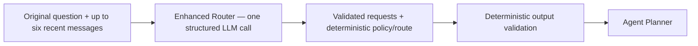

# Enhanced Router

> [!note] Төлөв
> Design finalized; runtime implementation partial. Actual behavior and verification are listed below. Доорх subnote-ууд өмнөх hub-ийн дэлгэрэнгүй агуулгыг хадгална.

## Purpose

Enhanced Router нь эх асуулт, хамгийн ихдээ зургаан recent conversation message, мөн найм хүртэлх older user-question summary-г ашиглаж request-үүдийн relationship, intent, decomposition, `related_turn_ids`, `resolved_question`-ийг нэг structured call-аар гаргана. Policy болон route-ийг Python intent/restriction registry-гээс шийднэ.

## Architecture Position

## Input

UI pipeline-д бүтэн session history өгдөг. QH Router-д original question, хамгийн ихдээ 6 recent user/assistant message (turn ID-тай), recent window-ээс гаднах хамгийн ихдээ 8 older user-question summary-г дамжуулна. Тусдаа `RequestContext` объект байхгүй.

## Processing

1. Mongolian Cyrillic, Latin transliteration, English, mixed-language болон typo-той асуултын утгыг ойлгох.
2. Шинэ/follow-up/clarification relationship тогтоох.
3. Бие даасан request-үүдийг салгаж, request тус бүрийн intent/policy санал болгох.
4. Follow-up-г standalone `resolved_question` болгон contextualize хийх.
5. Follow-up бүрд supplied recent/candidate жагсаалтаас `related_turn_ids` сонгох; Python талд output schema болон ID allowlist-ийг validate хийх.

## Output

Одоогийн `classify_intent()` нь `requests[]` дотор `intent`, `search_query`, `relationship`, `resolved_question`, `related_turn_ids` болон Python-оос гаргасан `policy`, `route` буцаадаг. Python ID-г supplied history allowlist-аар дахин шалгаж, байхгүй/буруу ID бол clarification болгоно. Өргөтгөсөн `RouterResult` болон `RequestContext` class байхгүй.

## Responsibilities and Boundaries

Router нь retrieval strategy сонгохгүй, Vector Store search хийхгүй, evidence review эсвэл final answer үүсгэхгүй. [[Agent Planner]]-т semantic classification давтахгүйгээр хэрэгтэй information needs-ийг төлөвлөх validated request өгнө. LLM-ийн ангилал нь policy/security enforcement-ийг орлохгүй.

## Algorithm Overview

Дэлгэрэнгүй input/output, `RouterResult`, Router/Planner boundary: [[ER - Scope and contracts]].

## Detailed Documentation

- [[ER - Scope and contracts]]
- [[ER - Semantic normalization]]
- [[ER - Relationship and references]]
- [[ER - Intent and policy]]
- [[ER - Validation and edge cases]]

## Implementation status (as built)

- Status: partial
- Last checked: 2026-11-16
- Git revision: `main` @ `7af80a9` (implementation/status updates uncommitted)
- Code owners: `ui/streamlit_ui.py::_ensure_turn_ids`, `rag/routing.py::build_router_history_context`, `rag/routing.py::classify_intent`, `rag/pipeline.py::answer_question`, `rag/pipeline.py::_selected_turn_passages`
- Behavior verified: one structured LLM call handles normalization instructions, relationship, request decomposition, intent, `search_query`, `resolved_question`, and per-request `related_turn_ids` from original question + up to six recent messages + up to eight older question summaries. Python validates IDs against the supplied input allowlist. No usable context or invalid IDs fail closed to clarification. Python derives/enforces policy and route independently.
- Tests executed offline: routing 7 passed; focused pipeline 15 passed; full-history UI ID test 1 passed. `tests.test_pipeline.AnswerQuestionTests` broader run: 33 tests, 11 failures from stale call assertions/fixture noted in QH status; no live API calls.
- Limitations: semantic normalization and referent/intent accuracy remain unverified. Candidate catalogue is chronological, omits turns outside the latest eight, and lacks `session_id` ownership/time validation. Reused passages are raw, turn-level, and do not yet preserve per-request evidence provenance. No `RequestContext` class.
- Next: add or decide request-scoped prior-evidence provenance and session ownership, then evaluate relationship/normalization quality against reviewed cases before claiming full ER completion. Planner + Selector remains a separate phase.

## Related Components

[[Question and history]] · [[Agent Planner]] · [[Select search strategy]] · [[Question taxonomy]]
