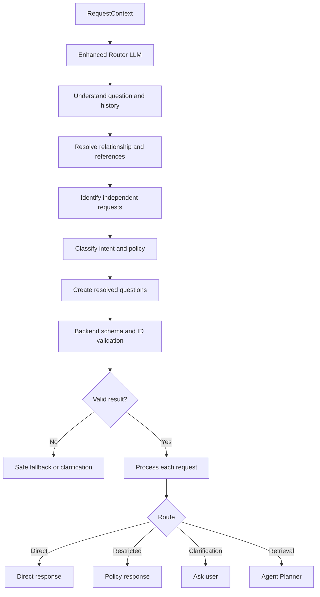

# ER - Scope and contracts

> [!note] Migration
> Доорх хэсгүүдийг өмнөх component hub-ээс бүрэн шилжүүлэв. Source section-ийн тайлбар, жишээ, хүснэгт, diagram болон status-ийг хадгалсан.

## Purpose

Enhanced Router-ийн input/output contract, structured call, component boundary болон implementation төлөв.


## Зорилго ба хариуцлагын зааг

Enhanced Router нь [[Question and history]]-ээс ирсэн `RequestContext`-ийг ойлгож, [[Agent Planner]]-т өгөх `RouterResult` гаргана. [[Question taxonomy]]-ийн A/B/C хэмжээсийг шийднэ:

1. **Question understanding:** original асуултын утга, хэл, нөхцөлийг хадгална.
2. **Conversation relationship:** шинэ асуулт уу, follow-up уу, clarification хэрэгтэй юу гэдгийг шийдэж, proposal загварт холбогдох turn-ийг сонгоно.
3. **Request decomposition:** нэг message доторх бие даасан хүсэлтүүдийг request болгон ялгана.
4. **Intent and policy classification:** хүсэлт бүрийн зорилго болон санал болгож буй policy/route-ийг тусад нь гаргана.
5. **Standalone question resolution:** follow-up-д зөвхөн хүчинтэй context-ийг ашиглан бие даан ойлгогдох асуулт үүсгэнэ.

Router **retrieval strategy сонгохгүй**, Vector Store хайлт хийхгүй, evidence review эсвэл final answer generation хийхгүй. [[Agent Planner]] нь information needs болон capability санал болгож `PlanningProposal` гаргана; strategy implementation болон executable query plan-ийг [[Select search strategy]] сонгоно.

> [!warning] Migration үеийн зөрчил
> Өмнөх hub-д “Retrieval strategy болон хайлтын query төлөвлөлт нь Agent Planner-ийн boundary” гэж бичиж, хүснэгтэд “Single/multi-query strategy сонгох” болон “Search query төлөвлөх” ажлыг Planner-д өгсөн байв. Энэ нь эцэслэсэн capability-based design-тай зөрчилдөнө. Одоогийн boundary: `Agent Planner → capability proposal`, `Select Search Strategy → strategy/query plan`. Хуучин attribution-г migration history болгон энд тэмдэглэж, current contract-ийг шинэчиллээ.

## Input → Processing → Output

| | Design contract |
|---|---|
| **Input** | [[QH - RequestContext contract]]: original current question, сүүлийн 6 мессеж, боломжтой бол хүчинтэй session доторх candidate turn metadata/evidence reference |
| **Processing** | Нэг structured LLM output дотор semantic ойлголт, relationship/reference resolution, independent request ялгалт, intent/policy suggestion, resolved question |
| **Backend validation** | Schema, request count, route/policy утга, question хоосон эсэх, candidate turn ID ба session эрхийг код шалгана |
| **Output** | `RouterResult`: хүсэлт бүрийн relationship, selected turn ID, intent/policy, route, standalone question, clarification төлөв |

Эдгээр таван ойлголтыг тус тусын шат шиг дүрсэлж болох ч **таван тусдаа LLM call гэсэн үг биш**. Эхний загварт нэг `classify_intent()` structured call бүх semantic ангиллыг гаргаж болно; Python тал хатуу нөхцөлийг validate/enforce хийнэ.



## RouterResult contract

Доорх JSON нь **proposed contract**, одоогийн implementation-ийн яг output биш:

```json
{
  "relationship": "follow_up",
  "relation_detail": "older_turn",
  "related_turn_ids": [101, 102],
  "needs_clarification": false,
  "requests": [
    {
      "id": "R1",
      "relationship": "follow_up",
      "related_turn_ids": [101, 102],
      "resolved_question": "3 цагийн чөлөө авахад менежер эзгүй бол хэн орлон зөвшөөрөх вэ?",
      "intent": "approval",
      "policy": "allowed",
      "route": "retrieval"
    }
  ]
}
```

`multi_intent` үед request бүр өөрийн `relationship`, `related_turn_ids`, `intent`, `policy`, `route` агуулж болно. Top-level `relationship` нь compatibility metadata байж болохоос mixed request-үүдийг нэг глобал утгаар шийдэхгүй. `topic_id` шаардлагатай бол backend existing topic-той холбох эсвэл authoritative ID үүсгэнэ; LLM-ийн дурын ID-г шууд итгэмжлэхгүй.

## Router ба Agent Planner-ийн зааг

| Үүрэг | Enhanced Router | Agent Planner |
|---|---|---|
| Original question ойлгох | Тийм | Үгүй |
| Conversation relationship болон follow-up resolve хийх | Тийм | Үгүй |
| Холбогдох turn сонгох | Тийм | Үгүй |
| Intent/policy ангилах | Тийм | Үгүй |
| Independent request салгах | Тийм | Үгүй |
| Standalone question гаргах | Тийм | Үгүй |
| Required facts тодорхойлох | Үгүй | Тийм |
| Strategy implementation сонгох | Үгүй | Үгүй; Selector хариуцна |
| Required facts/capabilities төлөвлөх | Үгүй | Тийм |
| Executable search query төлөвлөх | Үгүй | Үгүй; Selector strategy-аас хамааруулна |
| Retry strategy | Үгүй | Controller-той хамт |
| Evidence review | Үгүй | Үгүй |

Planner Router-ийн semantic classification-ийг дахин эхнээс нь хийхгүй. Router нь Vector Store search, evidence grading, final generation хийхгүй.

## Implementation status

| Одоогийн `refactor` | Enhanced Router design / pending |
|---|---|
| LLM-based `classify_intent()` нэг structured call-аар `requests[]` гаргана | Өргөтгөсөн `RequestContext` ба `RouterResult` contract |
| Relationship: `new / follow_up / clarification` | `related_turn_ids`, older-turn reference selection |
| `resolved_question`, `search_query` | Request-level relationship болон optional `relation_detail` |
| Greeting, restriction, out-of-scope routing; multi-intent processing | Ил тод policy/route output ба stronger backend validation |
| Recent зургаан conversation message | Candidate allowlist дээр тулгуурласан хуучин turn сонголт |
| Нэг мессежид гурав хүртэл request; илүү бол clarification response | Capability plan-ийг [[Agent Planner]], strategy болон executable query-г [[Select search strategy]] хариуцах boundary; compatibility-ийн үед `search_query` хадгалах |

Proposed functionality-г хэрэгжсэн гэж бүү үз. Одоогийн code нь `related_turn_ids`, `relation_detail`, `policy`, `route` field-үүдийг `classify_intent()`-ийн output-д буцаадаггүй.

## Navigation

[[Enhanced Router]] · [[Question and history]] · [[Agent Planner]] · [[ER - Validation and edge cases]]
