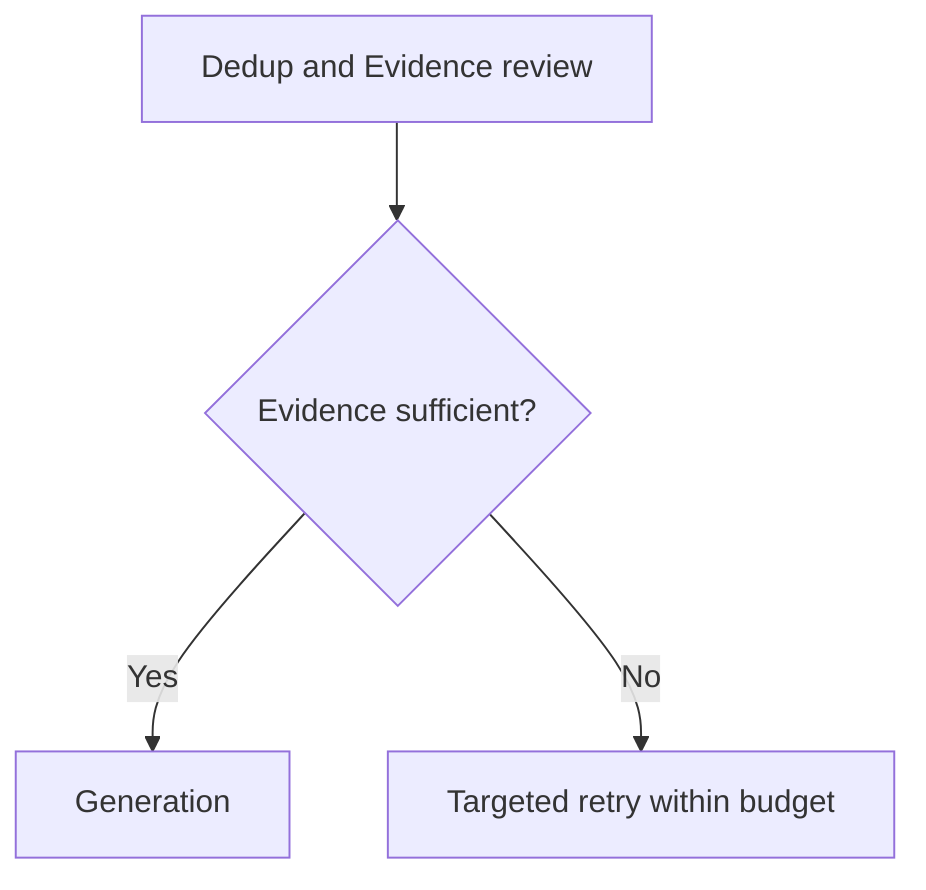
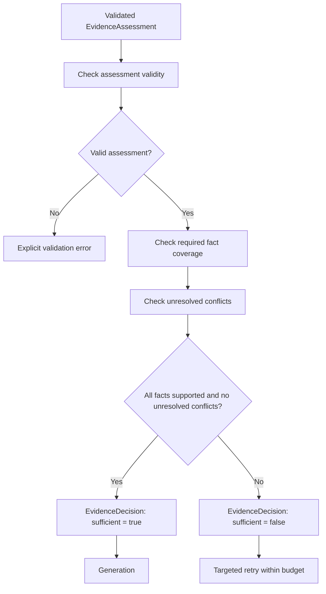

---
tags:
  - rag
  - agentic-rag
  - architecture
  - evidence
  - decision
status: design-complete
implementation: pending
validation: pending
---

# Evidence sufficient

## 1. Purpose

`Evidence sufficient?` нь [[Dedup and Evidence review]]-ийн гаргасан `EvidenceAssessment`-д үндэслэн хэрэглэгчийн асуултад **бүрэн хариулах хангалттай баталгаатай evidence байгаа эсэхийг** шийддэг deterministic decision node юм.

Үндсэн зорилго:

**Validated EvidenceAssessment → EvidenceDecision**

Энэ component нь semantic review дахин хийхгүй.

Зөвхөн өмнөх reviewer-ийн structured assessment-д үндэслэн:

- **Yes → Generation**
- **No → Targeted retry within budget**

гэсэн чиглэл сонгоно.

Output нь boolean шийдвэрээс гадна дараагийн component-д шаардлагатай reference мэдээллийг агуулна.

**Status: DESIGN COMPLETE — IMPLEMENTATION / VALIDATION PENDING**

---

## 2. Architecture Position



Энэ node нь evidence review болон дараагийн execution decision-ийн хооронд байрлана.

Энд шинэ retrieval, LLM evaluation эсвэл answer generation хийгдэхгүй.

---

## 3. Input → Processing → Output



| Stage | Responsibility |
|---|---|
| Input | Validated `EvidenceAssessment` болон original required fact references |
| Processing | Deterministic Python decision rules |
| Output | `EvidenceDecision` |
| LLM calls | 0 |
| Vector Store calls | 0 |

Энэ component нь Evidence Reviewer-ийн ажлыг давтаж хийхгүй.

---

## 4. Input Contract

Үндсэн input нь өмнөх component-ийн баталгаажуулсан `EvidenceAssessment`.

Жишээ:

```json
{
  "request_id": "R1",
  "review_status": "complete",
  "facts": [
    {
      "fact_id": "F1",
      "status": "partial",
      "evidence_ids": ["P2"],
      "missing_detail": "Менежер эзгүй үед зөвшөөрөх эрх хэнд шилжих нь батлагдаагүй."
    },
    {
      "fact_id": "F2",
      "status": "supported",
      "evidence_ids": ["P4"],
      "missing_detail": null
    }
  ],
  "selected_evidence_ids": ["P2", "P4"],
  "conflicts": []
}
```

Энэ бол conceptual contract, одоогийн Python implementation-ийн яг output биш.

### Input Requirements

- Request ID хүчинтэй.
- Assessment schema valid.
- Expected required fact бүр assessment-д байгаа.
- Fact status-ууд зөвшөөрөгдсөн утгатай.
- Evidence ID reference-ууд validated.
- Conflicts structured хэлбэртэй.
- Assessment processing амжилттай дууссан.

Original required fact ID-уудыг Planner-ийн validated context-оос авч coverage-ийг тулгаж шалгана.

Invalid assessment-ийг `sufficient = false` гэж автоматаар тайлбарлахгүй.

---

## 5. Decision Algorithm

### YES Condition

Бүрэн хариулахад evidence хангалттай гэж үзэхийн тулд:

1. EvidenceAssessment valid байх.
2. Required fact бүр `supported` байх.
3. Бүх expected fact ID assessment-д байх.
4. Хариултад нөлөөлөх unresolved conflict байхгүй байх.
5. Review execution амжилттай байх.

Эдгээр нөхцөл бүгд хангагдвал:

`sufficient = true`

### NO Condition

Дараах нөхцөлүүдийн аль нэг тохиолдвол бүрэн хариулах evidence хангалтгүй гэж үзнэ.

- Required fact `partial`.
- Required fact `missing`.
- Хариултад нөлөөлөх unresolved conflict.
- Required fact бүрийг батлах evidence хангалтгүй.

Үр дүн:

`sufficient = false`

### Decision Examples

| F1 | F2 | Unresolved conflict | Decision |
|---|---|---|---|
| Supported | Supported | No | Yes |
| Supported | Partial | No | No |
| Missing | Supported | No | No |
| Partial | Missing | No | No |
| Supported | Supported | Yes | No |

`No` гэдэг нь evidence хангалтгүй гэсэн шийдвэр болохоос байгууллагын бүх баримтад мэдээлэл байхгүй гэсэн баталгаа биш.

---

## 6. Output Contract — EvidenceDecision

Бүх хүчинтэй assessment-д нэг `EvidenceDecision` contract ашиглана.

### Case A — Evidence Sufficient

```json
{
  "request_id": "R1",
  "sufficient": true,
  "supported_fact_ids": ["F1", "F2"],
  "unresolved_fact_ids": [],
  "selected_evidence_ids": ["P1", "P3", "P4"],
  "reason_codes": []
}
```

### Output Meaning

- `sufficient`: Бүрэн хариулах evidence хангалттай.
- `supported_fact_ids`: Батлагдсан required facts.
- `unresolved_fact_ids`: Дутуу эсвэл unresolved facts.
- `selected_evidence_ids`: Generation-д ашиглаж болох validated evidence references.
- `reason_codes`: Хязгаарлалт болон шийдвэрийн шалтгаан, байгаа бол.

### Next Component

**Generation**

Generation-д дараах existing context хэрэгтэй:

- Resolved question.
- Required facts.
- Selected original passage texts.
- Source metadata.
- Citation/provenance references.
- EvidenceAssessment.

EvidenceDecision нь энэ бүх текстийг дахин хуулбарлах шаардлагагүй. IDs-ээр existing validated context-той холбогдоно.

---

## 7. Case B — Evidence Insufficient

Жишээ:

F1 — Менежер эзгүй үед чөлөөг хэн зөвшөөрөх нь батлагдаагүй.

F2 — Хүсэлт гаргах журам батлагдсан.

```json
{
  "request_id": "R1",
  "sufficient": false,
  "supported_fact_ids": ["F2"],
  "unresolved_fact_ids": ["F1"],
  "selected_evidence_ids": ["P2", "P4"],
  "reason_codes": ["partial_support"]
}
```

### Next Component

**[[Targeted retry within budget]]**

Дараагийн component-д:

- Unresolved fact IDs.
- Тэдгээрийн `missing_detail`.
- Өмнө supported болсон facts.
- Existing selected evidence references.
- Current request context.
- EvidenceAssessment.

гэсэн мэдээлэл ашиглах боломжтой байна.

Энэ node өөрөө retry query үүсгэхгүй, budget шалгахгүй, retrieval хийхгүй.

### Important

`sufficient = false` нь retry заавал хийгдэнэ гэсэн баталгаа биш.

Retry боломжтой эсэхийг дараагийн component шийднэ.

Энэ node-ийн үүрэг зөвхөн evidence хангалтгүй гэдгийг тодорхойлж, дутуу мэдээллийн references дамжуулах юм.

---

## 8. Decision Reasons

Дараах reason codes нь V1-д ашиглаж болох conceptual утгууд.

| Reason Code | Meaning |
|---|---|
| `partial_support` | Зарим required fact бүрэн батлагдаагүй |
| `missing_support` | Нэг буюу хэд хэдэн required fact-д support байхгүй |
| `unresolved_conflict` | Evidence хоорондын нөлөө бүхий зөрчил шийдэгдээгүй |

Олон шалтгаан зэрэг байж болох тул `reason_codes` массив ашиглаж болно.

Энэ нь шинэ semantic classification биш.

Reason нь EvidenceAssessment-ийн structured fields-ээс deterministic байдлаар гарна.

---

## 9. Invalid Assessment Handling

Evidence хангалтгүй байх болон assessment боловсруулахад алдаа гарах нь өөр нөхцөл.

### Invalid Assessment Examples

- Schema invalid.
- Required fact алга болсон.
- Fact ID байхгүй.
- Evidence ID invalid.
- Review execution failed.
- Unsupported status value.

Ийм тохиолдолд normal Yes/No шийдвэр гаргахгүй.

Explicit validation/processing error буцааж orchestration layer-д мэдэгдэнэ.

**Invalid assessment ≠ insufficient evidence.**

Энэ зарчим нь API болон LLM processing failure-ийг байгууллагын баримтаас хариулт олдоогүйтэй андуурахаас хамгаална.

### Partial Retrieval Failure

Retrieval-ийн зарим search амжилтгүй болсон ч Evidence Review available passages-ийг үнэлсэн байж болно.

Энэ үед assessment нь зөвхөн боломжтой байсан evidence-д үндэслэсэн гэдгийг хадгална.

Хайлтын алдааны мэдээллийг чимээгүй арилгахгүй.

---

## 10. Multi-Intent Handling

Evidence decision нь independent retrieval request бүрээр гарна.

Жишээ:

| Request | Assessment | Decision |
|---|---|---|
| R1 — Цалин олгох өдөр | Supported | Yes |
| R2 — Чөлөөний зөвшөөрөл | Partial | No |
| R3 — Restricted personal salary | Router дээр restricted | Evidence decision хэрэггүй |

R1-ийн evidence бүрэн байна.

R2-ийн evidence дутуу байна.

R3 Retrieval шатанд ороогүй учраас EvidenceDecision үүсгэхгүй.

Нэг request-ийн evidence insufficiency бусад independent request-ийн supported evidence-г хүчингүй болгохгүй.

---

## 11. Validation and Tests

Энэ component-ийн unit tests нь deterministic байж болно.

| Test Case | Expected Result |
|---|---|
| All facts supported | Yes |
| One partial fact | No |
| One missing fact | No |
| Multiple missing facts | No |
| Unresolved conflict | No |
| No unresolved conflict and all facts supported | Yes |
| Invalid fact ID | Explicit validation error |
| Invalid evidence ID | Explicit validation error |
| Missing required fact assessment | Explicit validation error |
| Invalid structured assessment | Explicit validation error |
| Multiple independent requests | Separate decisions |
| Partial retrieval limitation | Limitation metadata preserved |
| No LLM evidence review result due to failure | Processing error, not ordinary No |

Implementation болон regression validation pending.

---

## 12. Responsibility Boundaries

### This Node Does

- Validate decision prerequisites.
- Check required fact coverage.
- Check unresolved conflicts.
- Produce Yes/No decision for valid assessments.
- Preserve supported/unresolved fact references.
- Preserve selected evidence references.
- Return structured decision data.

### This Node Does Not

- Read passages again using an LLM.
- Perform semantic relevance review.
- Generate new required facts.
- Perform retrieval.
- Generate search queries.
- Select retrieval strategy.
- Check retry budget.
- Execute corrective retry.
- Write grounded answers.
- Invent missing information.

---

## 13. Design Decisions

1. Evidence sufficiency нь deterministic Python decision.
2. Нэмэлт LLM call хийхгүй.
3. Нэг validated EvidenceAssessment дээр шийдвэр гаргана.
4. All required facts supported бол Yes.
5. Unresolved conflict байвал No.
6. Partial/missing evidence байвал No.
7. Invalid assessment-д normal Yes/No шийдвэр гаргахгүй.
8. Output нь boolean болон references агуулсан EvidenceDecision.
9. Yes → Generation.
10. No → Targeted retry within budget.
11. Энэ node retry боломжтой эсэхийг шийдэхгүй.
12. Evidence болон provenance-г дахин хуулбарлахгүй, validated references ашиглана.

---

## 14. Current Status

| Area | Status |
|---|---|
| Component responsibility | Design Complete |
| Input contract | Design Complete |
| Yes/No decision rules | Design Complete |
| EvidenceDecision contract | Design Complete |
| Validation/error distinction | Design Complete |
| Multi-intent behavior | Design Complete |
| Python implementation | Pending |
| Unit/regression tests | Pending |
| Runtime verification | Pending |

**DESIGN COMPLETE — IMPLEMENTATION / VALIDATION PENDING**

---

## 15. Related

- [[Dedup and Evidence review]]
- [[DE - Evidence review]]
- [[Targeted retry within budget]]
- [[Generation]]

Энэ note нь зөвхөн evidence sufficiency decision-ийг тайлбарлана.

Targeted retry, updated evidence review болон Generation-ийн algorithm-ийг энд боловсруулахгүй.