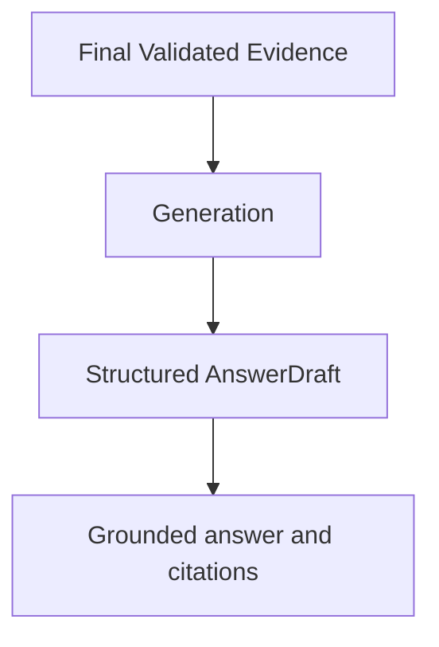
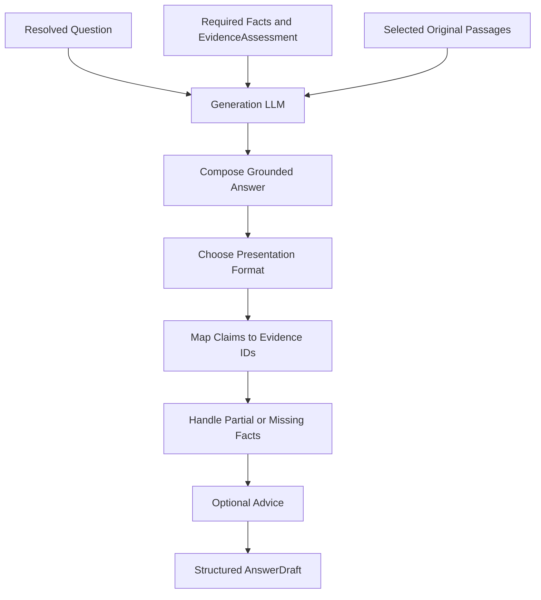

---
tags:
  - rag
  - agentic-rag
  - architecture
  - generation
status: partial
implementation: partial
validation: offline-and-live-smoke-verified
---

# Generation

## 1. Purpose

Generation нь баталгаажуулсан evidence-д тулгуурлан хэрэглэгчийн асуултад ойлгомжтой, natural Mongolian хариулт боловсруулдаг component юм.

**Үндсэн зорилго: Validated Evidence + Question → Structured AnswerDraft**

Generation-ийн гол шаардлага:

- Хэрэглэгчийн асуултад шууд хариулах.
- Монгол хэлээр ойлгомжтой тайлбарлах.
- Supported evidence-д тулгуурлах.
- Олон хэсэгтэй асуултыг аль болох бүрэн хариулах.
- Partial/missing information-ийг нуухгүй.
- Шаардлагатай үед `Зөвлөмж` нэмэх.
- Асуултын төрлөөс хамааран тохирох presentation format сонгох.
- Factual claim бүрийг evidence ID-тай холбох.

Generation нь final citation URL болон source metadata-г зохиохгүй.

Эдгээрийг дараагийн [[Grounded answer and citations]] component шийдвэрлэнэ.

**Status: DESIGN COMPLETE — IMPLEMENTATION PARTIAL; SEMANTIC QUALITY VALIDATION PENDING**

---

## 2. Architecture Position



Generation нь initial эсвэл retry-ийн дараах final validated evidence state-ийг ашиглана. Evidence sufficient эсэх, шаардлагатай retry-г [[Evidence sufficient]] болон [[Targeted retry within budget]] шийдсэн байна.

Энэ component дотор шинэ search эсвэл evidence review хийхгүй.

---

## 3. Input → Processing → Output



Эдгээр нь нэг LLM generation call-ийн logical operations юм.

| Stage | Responsibility |
|---|---|
| Input | Question, required facts, assessment, passages |
| Processing | Grounded answer synthesis |
| Formatting | Suitable presentation structure |
| Grounding | Claims → evidence IDs |
| Advice | Optional next-step recommendation |
| Output | Structured `AnswerDraft` |

**V1: One structured Generation LLM call.**

Тусдаа Formatting Agent, Recommendation Agent, Summarizer Agent хэрэггүй.

---

## 4. Input Contract

Generation дараах validated information-ийг авна.

### Required Inputs

- `request_id`
- `resolved_question`
- `required_facts`
- Final `EvidenceAssessment`
- Supported / unresolved fact references
- Selected original passages
- Available source/provenance metadata
- Retrieval limitations, if any

`EvidenceAssessment` нь initial retrieval эсвэл targeted retry-ийн дараах эцсийн assessment байна.

Generation нь:

- Required facts шинээр зохиохгүй.
- Retrieval results-ийг дахин semantic review хийхгүй.
- Evidence support status-ийг өөрчлөхгүй.
- Restricted request-ийг allowed болгож хувиргахгүй.

---

## 5. Grounded Answer Synthesis

Generation нь баримтын утгыг хадгалж, natural Mongolian хэлээр тайлбарлана.

### Allowed

- Баримтад байгаа мэдээллийг ойлгомжтой тайлбарлах.
- Олон passage-ийн холбоотой мэдээллийг нэгтгэх.
- Хэрэглэгчийн асуусан хэсэгт төвлөрөх.
- Урт тайлбарыг уншихад хялбар болгох.
- Батлагдсан procedural steps-ийг дараалалд оруулах.
- Тодорхой бус нөхцөлийг ил тод тайлбарлах.

### Not Allowed

- Баримтад байхгүй policy зохиох.
- Шинэ зөвшөөрлийн шаардлага нэмэх.
- Хэрэглэгчийн асуугаагүй дүрэм, хугацаа зохиох.
- Батлагдаагүй хүний нэр, албан тушаал, утас, имэйл зохиох.
- Unsupported fact-ийг authoritative statement болгох.
- Conflicting evidence-ээс нэгийг нь таамгаар хүчинтэй гэж сонгох.
- General knowledge ашиглан internal policy-ийн дутуу мэдээллийг нөхөх.

**Natural explanation ≠ Inventing additional facts.**

---

## 6. Answer Outcomes

Generation нь evidence state-д тохируулан хариулна.

| Outcome | Behavior |
|---|---|
| `answered` | Бүх required fact батлагдсан, grounded complete answer |
| `partial` | Батлагдсан мэдээллийг хариулж, missing details-ийг тайлбарлах |
| `insufficient` | Ашиглаж болох factual support хангалтгүйг тодорхой хэлэх |

Эдгээр нь allowed retrieval request-ийн answer outcomes юм.

Technical generation failure нь `insufficient` биш. Schema/model error гарвал тусдаа processing failure хэвээр байна.

### Answered

- Бүрэн grounded answer.
- Асуултад тохирсон формат.
- Evidence mapping.
- Шаардлагагүй disclaimer нэмэхгүй.

### Partial

- Supported facts-ийг хариулна.
- Батлагдаагүй хэсгийг тодорхой хэлнэ.
- Шаардлагатай үед optional advice өгнө.
- Missing fact-ийг таамгаар нөхөхгүй.

### Insufficient

- Source evidence-ийн хүрээнд баталгаатай хариулт гаргах боломжгүйг хэлнэ.
- Байгууллагын бүх баримтад тийм мэдээлэл байхгүй гэж батлахгүй.
- Хэрэгтэй үед дараагийн шалгах арга санал болгож болно.
- Provider failure болон genuine missing evidence-г ялгана.

---

## 7. Adaptive Answer Formatting

Generation нь асуултын агуулга болон зорилгоос хамааран answer format сонгоно.

Formatting decision-д тусдаа classifier эсвэл keyword regex нэмэхгүй.

### V1 Formats

| Format | Usage |
|---|---|
| Short sentence | Нэг тодорхой factual question |
| Paragraph | Тодорхойлолт, тайлбар |
| Multiple paragraphs | Дэлгэрэнгүй explanation |
| Bullet list | Нөхцөл, ангилал, шаардлага |
| Numbered steps | Procedure, how-to, sequence |
| Section headings | Multi-part answer |

### Table Format

Table нь comparison болон structured policy information-д хэрэгтэй байж болно.

Гэхдээ V1-д тусдаа table-generation subsystem хэрэгжүүлэхгүй.

Хэрэв одоогийн LangChain implementation table output-ийг сайн дэмждэг бол behavior-preserving migration хийхдээ тэр боломжийг хадгалж болно.

Шинээр хэрэгжүүлэх шаардлагатай бол table format-ийг optional extension гэж үзнэ.

### Format Selection Principles

- Simple question → Short answer.
- Definition → Paragraph.
- Requirements → Bullet list.
- Procedure → Numbered steps.
- Comparison → Table when useful and supported.
- Multi-part question → Clear sections.

Formatting нь evidence-ийн утгыг өөрчлөхгүй.

Мөн хэрэглэгч тусгай формат хүссэн бол evidence болон supported renderer-ийн хүрээнд тэр хүсэлтийг харгалзан үзнэ.

---

## 8. Optional Advice — Зөвлөмж

Partial эсвэл insufficient answer-ийн дараа хэрэгтэй бол `Зөвлөмж` нэмнэ.

Зөвлөмжийн зорилго нь хэрэглэгчийг дутуу мэдээллээ тодруулах боломжтой дараагийн алхам руу чиглүүлэх.

### Example

Question:

"Менежер эзгүй үед чөлөөг хэн зөвшөөрөх вэ?"

Evidence:

Менежер ердийн үед чөлөө зөвшөөрдөг нь батлагдсан боловч эзгүй үеийн эрх шилжүүлэлт тодорхойгүй.

Expected answer structure:

**Хариулт**

Ердийн нөхцөлд чөлөөний хүсэлтийг менежер зөвшөөрөхөөр заасан байна.

Харин менежер эзгүй үед зөвшөөрөх эрх хэнд шилжих нь сонгосон evidence-д тодорхойгүй.

**Зөвлөмж**

Эрх шилжүүлэх тушаал байгаа эсэхийг холбогдох эрх бүхий ажилтан эсвэл хариуцсан нэгжээс тодруулна уу.

Энэ бол зохиомол жишээ.

### Advice Rules

1. Advice optional байна.
2. Partial/insufficient үед илүү тохиромжтой.
3. Батлагдсан factual answer-ийг орлохгүй.
4. Албан ёсны policy зохиож болохгүй.
5. Хүний нэр, албан тушаалыг зөвхөн verified evidence байгаа үед дурдаж болно.
6. Утас, имэйл зэрэг contact information-ийг зөвхөн verified source/provenance байгаа үед хэрэглэнэ.
7. Хувийн эсвэл restricted information задруулахгүй.
8. Ерөнхий зөвлөмжийг official procedure гэж танилцуулахгүй.
9. Ашигтай зөвлөмж өгөх боломжгүй бол хоосон орхино.

### Advice Types

- `source_grounded` — Баримтад заасан дараагийн алхам.
- `general_guidance` — Албан ёсны журам гэж мэдэгдээгүй, болгоомжтой ерөнхий чиглүүлэг.

Grounded advice нь evidence IDs-тай байна.

General guidance нь зохиомол citation авахгүй.

---

## 9. Claim-Level Evidence Mapping

Generation factual statement бүрийг supporting passage IDs-тай холбоно.

Жишээ:

```json
{
  "fact_id": "F2",
  "text": "Чөлөөний хүсэлтийг дотоод системээр бүртгүүлнэ.",
  "evidence_ids": ["P4"]
}
```

### Rules

- Evidence ID нь input-д орж ирсэн validated passage reference байна.
- Statement өөрөө батлагдсан fact-д хамаарах ёстой.
- Supported evidence-г өөр асуултын fact-д зориулж буруу ашиглахгүй.
- Unsupported claim-д fabricated passage ID өгөхгүй.
- Missing fact-ийг supported claim мэт бичихгүй.
- Source metadata болон final citation rendering-ийг Generation өөрөө хийхгүй.

Claim-level evidence mapping нь final citation validation хийх үндсэн мэдээлэл болно.

**Valid evidence ID ≠ automatic semantic proof.**

Evidence Review, generation constraints болон regression validation хамтдаа grounding reliability-г дэмжинэ.

---

## 10. Output Contract — AnswerDraft

Generation нэг structured `AnswerDraft` буцаана.

Conceptual example:

```json
{
  "request_id": "R2",
  "outcome": "partial",
  "blocks": [
    {
      "type": "paragraph",
      "items": [
        {
          "fact_id": "F2",
          "text": "Чөлөөний хүсэлтийг дотоод системд гаргана.",
          "evidence_ids": ["P4"]
        }
      ]
    }
  ],
  "unresolved_fact_ids": ["F1"],
  "limitation": "Менежер эзгүй үед зөвшөөрөх эрх хэнд шилжих нь батлагдаагүй.",
  "advice": {
    "kind": "general_guidance",
    "text": "Холбогдох эрх бүхий ажилтнаас тодруулна уу.",
    "evidence_ids": []
  }
}
```

Энэ нь proposed application contract бөгөөд одоогийн Python output schema-тай заавал ижил биш.

### Main Fields

| Field | Purpose |
|---|---|
| `request_id` | Independent request identity |
| `outcome` | Answered, partial, insufficient |
| `blocks` | Answer content and presentation structure |
| `type` | Paragraph, bullets, steps |
| `items` | Text units with evidence associations |
| `fact_id` | Supported required fact reference |
| `evidence_ids` | Supporting passages |
| `unresolved_fact_ids` | Missing/partial fact references |
| `limitation` | Дутуу мэдээллийн тайлбар |
| `advice` | Optional recommendation |

### Blocks

V1-д `paragraph`, `bullets`, `steps` гэсэн үндсэн block types ашиглаж болно.

Нэг өгүүлбэртэй хариулт нь богино paragraph block байна.

Олон paragraph хэрэгтэй бол олон block ашиглана.

Table хэрэгтэй бол existing behavior хадгалах эсвэл дараа optional structured extension нэмнэ.

---

## 11. Multi-Intent Generation

Нэг хэрэглэгчийн мессеж хэд хэдэн independent request агуулж болно.

Жишээ:

| Request | Route/Assessment | Generation |
|---|---|---|
| R1 — Цалин олгох өдөр | Allowed, supported | Complete answer |
| R2 — Менежер эзгүй үеийн чөлөө | Allowed, partial | Partial answer + optional advice |
| R3 — Хувийн цалингийн мэдээлэл | Restricted | RAG Generation-д орохгүй |

### Rules

- Allowed request бүр өөрийн fact/evidence context-тай байна.
- Restricted sub-request-ийн мэдээллийг Generation-д дамжуулахгүй.
- Нэг request-ийн evidence-г өөр request-д буруу холбохгүй.
- Request бүрийн outcome-г хадгална.
- Response assembly болон citation rendering-ийг downstream application handling хийнэ.

---

## 12. Generation and Grounded Answer Boundary

### Generation Does

- Grounded content synthesis.
- Natural Mongolian explanation.
- Adaptive answer format selection.
- Required fact coverage in answer.
- Partial/insufficient wording.
- Optional advice.
- Claim-level evidence mapping.
- Structured AnswerDraft production.

### Generation Does Not

- Retrieve documents.
- Rewrite queries.
- Assess evidence sufficiency.
- Override policy restrictions.
- Invent citations.
- Generate unverifiable source URLs.
- Resolve final citation numbering.
- Perform final UI rendering.
- Re-run Evidence Reviewer.
- Introduce another agent.

### Next Component

[[Grounded answer and citations]]

Input:

`AnswerDraft + Validated Evidence Registry`

Responsibilities:

- Validate answer structure.
- Validate fact/evidence references.
- Resolve verified citation metadata.
- Render final answer.
- Handle invalid answer units safely.

Энэ component-ийн нарийвчилсан алгоритмыг тусад нь хэлэлцэнэ.

---

## 13. Validation and Edge Cases

| Case | Expected behavior |
|---|---|
| One supported fact | Short grounded answer |
| Multiple supported facts | Complete answer with suitable format |
| Procedure question | Numbered steps if evidence supports sequence |
| Several conditions | Bullet list |
| Definition | Clear paragraph |
| Multiple paragraphs needed | Separate paragraphs |
| Partial evidence | Supported facts + limitation |
| No supporting evidence | Insufficient response |
| Useful advice available | Optional advice |
| Verified responsible person | Name/role may be used if policy permits |
| Responsible person unknown | No invented contact |
| Unresolved conflict | No unjustified authoritative conclusion |
| Invalid fact ID | Validation failure |
| Invalid evidence ID | Validation failure |
| Unsupported procedural step | Reject as grounded answer |
| Restricted request | Not passed to RAG Generation |
| Generation API/schema failure | Explicit processing error |
| Document includes instructions to model | Treat as untrusted evidence content |

### Regression Validation

Одоогийн refactor болон өмнөх LangChain RAG-ийн behavior-ийг харьцуулж шалгана.

Анхаарах зүйл:

- Natural Mongolian quality.
- Answer completeness.
- Multi-part question handling.
- Partial answer correctness.
- Advice safety.
- Evidence references.
- Conciseness.
- Existing useful formatting behavior.

Шинэ evaluation framework эсвэл том benchmark байгуулахгүй. Өмнөх regression examples-ийг эхэлж ашиглана.

---

## 14. Design Decisions

1. Generation нь нэг structured LLM call ашиглана.
2. Primary language нь Mongolian Cyrillic.
3. Technical terminology шаардлагатай үед English хэвээр байж болно.
4. Answer text нь provided evidence-д тулгуурлана.
5. Fact coverage-г хадгална.
6. Answer outcome: answered / partial / insufficient.
7. Formatting нь semantic context-д үндэслэн сонгогдоно.
8. Paragraph, bullets, numbered steps V1-д дэмжигдэнэ.
9. Table нь optional / existing behavior preservation.
10. Partial/insufficient үед optional advice зөвшөөрөгдөнө.
11. Verified contact/role байхгүй үед зохиохгүй.
12. Claim-level evidence mapping ашиглана.
13. Citation resolution болон final rendering тусдаа component-д байна.
14. Additional formatting/recommendation agents нэмэхгүй.
15. Existing LangChain answer quality-г боломжтой хэмжээнд хадгална.

---

## 15. Current Status

| Area | Status |
|---|---|
| Generation responsibility | Design Complete |
| Grounded synthesis | Design Complete |
| Adaptive formatting | Design Complete |
| Partial/insufficient handling | Design Complete |
| Optional advice | Design Complete |
| Claim-level evidence mapping | Design Complete |
| AnswerDraft conceptual contract | Design Complete |
| Existing code parity assessment | Partial; AnswerDraft is integrated, semantic parity remains unverified |
| Implementation alignment | Partial; pipeline passes final facts/assessment/decision to the one Generation call |
| Regression verification | Offline suite and bounded live smoke verified; human quality review pending |

**DESIGN COMPLETE — IMPLEMENTATION PARTIAL / SEMANTIC VALIDATION PENDING**

### Existing Python Behavior

`rag/generation.py::generate_answer()` нь Router-ийн resolved question, Planner facts, final EvidenceAssessment/Decision болон selected passage-уудыг нэг structured LLM call-д өгч `AnswerDraft` буцаана. Хоосон selected evidence үед Generation LLM call хийхгүй, `insufficient` draft үүсгэнэ. Output schema нь `request_id`, `outcome`, typed blocks, fact/evidence references, unresolved facts, limitation, optional advice агуулна.

Generation өөрөө final citation metadata шийдэхгүй. `rag/answer_output.py::ground_answer()` Python-д AnswerDraft-ийг баталгаажуулж, trusted passage metadata-аас хэрэглэгчид харагдах citations render хийнэ. `answer_question()`-ийн public signature болон дээд түвшний `answer/citations/status` result хадгалагдсан; citation record-д `label` ба `passage_id` нэмэгдсэн.

---

## 16. Related

- [[Evidence sufficient]]
- [[Targeted retry within budget]]
- [[Dedup and Evidence review]]
- [[Agent Planner]]
- [[Grounded answer and citations]]

Generation нь final evidence-ийг хэрэглэгчид ойлгомжтой structured answer болгон хувиргах responsibility-тэй.

Final grounding validation болон citations-ийг дараагийн component хариуцна.

## Implementation status (as built)

- Status: partial — pipeline-integrated, offline-verified, and smoke-tested live; semantic answer quality remains unverified.
- Last checked: 2026-11-16.
- Code owners: `rag/generation.py::generate_answer`; handoff `rag/pipeline.py::_process_request`; rendering `rag/answer_output.py::ground_answer`.
- Input/handoff: `_process_request()` passes the resolved question, validated Planner facts, final post-retry EvidenceAssessment/Decision, and only selected passages. Restricted requests exit before Generation.
- Behavior verified: one structured Generation call when selected evidence is present; no Generation LLM call for an empty selected-evidence set. The model returns `P<n>` references only; Python validates request/fact/passage relationships and resolves labels/metadata from selected passages.
- Call bound: at most one Generation call per allowed retrieval request with selected evidence, zero with no selected evidence; no added Grounding LLM or Vector Store call. The Router currently allows up to three requests per user message.
- Live smoke: C05 completed as `answered`; one supported fact produced one draft block and five evidence references; the final result had five sequential citation labels with passage/file/name metadata, one Generation call, and no retry. This verifies runtime handoff and citation resolution, not whether each cited passage semantically supports the claim. C01 ended `insufficient` with no Generation LLM call after the final assessment marked its fact missing. C21 ended `partially_answered` with zero draft references/citations; its earlier trace did not capture Reviewer status because the runner used an obsolete field name.
- Tests: `.venv312\Scripts\python.exe -m unittest discover -s tests -q` — 130 passed. `.venv312\Scripts\python.exe -m compileall -q rag ui evaluation` and `git diff --check` passed. Offline tests include AnswerDraft validation, citation metadata, multi-request numbering, invalid references, and UI rendering.
- Limitations: semantic truth, evidence relevance, citation appropriateness, and natural Mongolian quality were not human-reviewed. Provider metadata contains file ID/name only; no page, section, or verified URL is fabricated. Invalid/conflicting drafts fail closed. Live C01 had earlier attempts where Generation's `insufficient` draft conflicted with the renderer's stricter outcome rule; the rule was corrected and the final C01 run returned `insufficient` cleanly. A separate Reviewer schema/processing error also occurred on one C01 attempt; no Generation output was produced in that run.
- Next: manually review C05's generated claims and cited passages against their source documents, then run the end-to-end parity phase; do not infer evaluation quality from these smoke cases.
