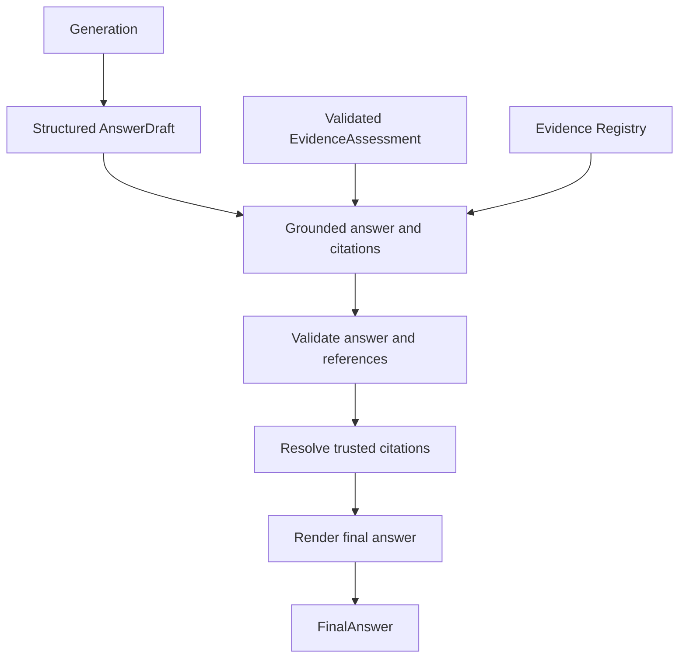
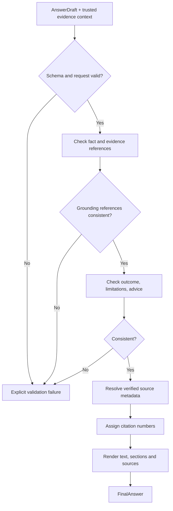

---
tags:
  - rag
  - agentic-rag
  - architecture
  - grounding
  - citations
status: design-complete
implementation: alignment-pending
validation: pending
---

# Grounded answer and citations

## 1. Purpose

`Grounded answer and citations` нь [[Generation]]-ийн гаргасан structured `AnswerDraft`-ийг шалгаж, зөвшөөрөгдсөн evidence references-ийг бодит эх сурвалжтай холбон, хэрэглэгчид үзүүлэх `FinalAnswer` үүсгэнэ.

**Input → Processing → Output:**

`AnswerDraft + Validated EvidenceAssessment + Evidence Registry → Validation + Citation Resolution + Rendering → FinalAnswer`

Энэ component нь шинэ хариулт зохиох, баримт хайх, evidence-г LLM-ээр дахин үнэлэхгүй. **V1-д 0 LLM call, 0 Vector Store search call** ашиглана.

**Status: DESIGN COMPLETE — IMPLEMENTATION ALIGNMENT / VALIDATION PENDING**

## 2. Architecture Position



Холбогдох stage: [[Generation]]. Эндээс хэрэглэгчид харуулах эцсийн output гарна.

## 3. Responsibility Boundary

| Generation | Grounded answer and citations |
|---|---|
| Нэг structured LLM call | Deterministic Python processing |
| Mongolian answer content | Schema болон reference validation |
| Paragraph / bullets / steps сонгох | Сонгосон layout-ийг render хийх |
| Claim → `evidence_ids` санал болгох | Evidence ID-г батлагдсан registry-тай холбох |
| Optional `Зөвлөмж` боловсруулах | Advice kind болон reference шалгаж render хийх |
| `AnswerDraft` | `FinalAnswer` |

**Хийхгүй:** шинэ retrieval, query rewrite, semantic grading, groundedness баталдаг нэмэлт agent, final answer-ийн агуулгыг LLM-ээр дахин бичих, зохиомол citation/link үүсгэх.

## 4. Input Contract

### 4.1 AnswerDraft

[[Generation]]-ийн conceptual schema-тай нийцнэ:

```json
{
  "request_id": "R2",
  "outcome": "partial",
  "blocks": [
    {
      "type": "paragraph",
      "items": [
        {
          "fact_id": "F2",
          "text": "Чөлөөний хүсэлтийг дотоод системд бүртгүүлнэ.",
          "evidence_ids": ["P4"]
        }
      ]
    }
  ],
  "unresolved_fact_ids": ["F1"],
  "limitation": "Менежер эзгүй үед хэн зөвшөөрөх нь сонгосон баримтаар батлагдаагүй.",
  "advice": {
    "kind": "general_guidance",
    "text": "Холбогдох эрх бүхий ажилтнаас тодруулна уу.",
    "evidence_ids": []
  }
}
```

*Энэ нь зохиомол data-тай contract example; бодит компанийн журам биш.*

### 4.2 Validated assessment and context

- `EvidenceAssessment`: per-fact `supported / partial / missing`, selected evidence IDs, unresolved conflicts, review limitations.
- `EvidenceDecision`: sufficient эсэх, supported/unresolved fact references.
- `RequiredFacts`: тухайн request-д хамаарах баталгаажсан fact IDs.
- `Evidence Registry`: request-scoped passage ID → original text, `file_id`, filename, available source attributes, verified locator/preview URL (байгаа бол).
- Request/policy context: зөвхөн allowed retrieval request энэ stage руу орно.

Raw model-ийн filename, URL, page, section-ийг trusted source metadata гэж үзэхгүй.

## 5. Processing Algorithm



Алгоритм нь input-ийн бүтэц, referential integrity, provenance-г шалгана. **Python-ийн ID validation нь өгүүлбэрийн семантик үнэн зөвийг бүрэн батлахгүй.** Тэр хамгаалалт нь өмнөх [[Dedup and Evidence review]], Generation constraints, regression/human review-тай хамт хэрэгжинэ.

## 6. Claim-Level Validation

Factual answer item бүрт:

1. `request_id` зөв байх.
2. `fact_id` тухайн request-ийн `RequiredFacts`-д байх.
3. `evidence_ids` хоосон биш байх, эсвэл тухайн item-ийг factual claim биш explicit limitation/guidance гэж зөв таних.
4. Evidence ID бүр registry-д болон тухайн request-д байх.
5. Evidence IDs нь assessment-ийн тухайн fact-д ашиглаж болох passage mapping-тай нийцэх.
6. `missing` fact-ийг батлагдсан factual claim мэт render хийхгүй.
7. `partial` fact-ийн хязгаарлалтыг нууж, бүрэн батлагдсан мэт танилцуулахгүй; ийм claim-ийн semantic appropriateness-ийг Python дангаараа батлах боломжгүй.
8. Unresolved conflict-ийг баталгаатай нэг талын дүгнэлт болгон харуулахгүй.

**Invalid citation-ийг чимээгүй хасаад factual statement-ийг үлдээхгүй.** V1 fail-closed: тухайн request-ийн draft-ийг rendering-д тэнцээгүй гэж тэмдэглэнэ; аюулгүй fallback/explicit error буцаана. Multi-intent үед бусад хүчинтэй request-ийн хариултыг хэвээр үлдээж болно.

## 7. Outcome Consistency

| AnswerDraft outcome | Minimum consistency condition |
|---|---|
| `answered` | `EvidenceDecision.sufficient = true`; all required facts supported, no unresolved conflict |
| `partial` | Full sufficiency байхгүй; supported/qualified partial information болон limitation ялгагдсан |
| `insufficient` | Баталгаатай хариулт гаргах factual evidence хүрэлцээгүй; баталгаагүй procedure зохиохгүй |

`partial` эсвэл `insufficient` нь API/schema/validation failure-ийн орлуулга биш. Assessment/Generation error-ийг explicit processing error хэвээр хадгална.

## 8. Citation Resolution

Generation зөвхөн passage IDs өгнө. Application нь trusted `Evidence Registry`-ээс эх сурвалжийг шийдвэрлэнэ.

Conceptual registry entry:

```json
{
  "request_id": "R2",
  "passage_id": "P4",
  "file_id": "file_456",
  "filename": "leave_policy.pdf",
  "section": null,
  "page": null,
  "source_url": null
}
```

- `[1]`, `[2]` зэрэг citation label-ийг deterministic байдлаар **эхний ашиглалтын дарааллаар** онооно.
- Давтан ашиглагдсан ижил passage reference ижил citation label авна.
- Passage-level evidence association хадгалагдана; UI-д source list давтагдахгүй байж болно.
- Баталгаажсан filename/section/page/URL байгаа хэмжээнд л харуулна.
- `file_id` дангаараа хэрэглэгч нээх URL гэсэн үг биш.
- Preview URL байхгүй бол filename-г plain text-ээр харуулна, зохиомол линк үүсгэхгүй.
- Хүчингүй, хугацаа нь дууссан, эсвэл хэрэглэгчид үзүүлэх эрхгүй URL-г render хийхгүй.
- Document version/source provenance-г хадгална; зөрчилтэй эх сурвалжийн аль нь хүчинтэйг энэ stage таамгаар шийдэхгүй.

## 9. Rendering Formats

Generation-ээс сонгосон block order болон агуулгыг хадгална.

| Format | Rendering |
|---|---|
| Short answer | Богино paragraph |
| Paragraph(s) | Нэг буюу хэд хэдэн догол мөр |
| Bullets | Жагсаалт |
| Steps | Дугаарласан алхмууд |
| Section headings | Multi-part answer sections |
| Table | Зөвхөн application үнэхээр дэмжиж байвал; эс бөгөөс утга алдагдуулахгүй safe fallback |
| Advice | `Зөвлөмж` гэсэн optional section |

Claim-level citations-ийг холбогдох statement/item-ийн дэргэд байрлуулна. Орхигдсон fact эсвэл limitation-ийг formatting-ээр нуухгүй. Markdown/HTML output-ийг safe escaping/sanitization-тай render хийж, source text болон model output-ийг trusted HTML гэж үзэхгүй.

## 10. Optional Advice

`advice` нь `null` байж болно.

- `source_grounded`: evidence IDs шаардлагатай; бодит эх сурвалжийн citation холбоно.
- `general_guidance`: албан ёсны policy/mandatory procedure мэт харуулахгүй; citation зохиохгүй.
- Verified name/role/contact байхгүй бол хүний нэр, утас, имэйл зохиож харуулахгүй.
- Restricted information-ийг advice-аар дамжуулж задруулахгүй.
- Advice нь supported factual answer-ийг орлохгүй.

## 11. Multi-Intent Isolation and Assembly

Нэг user message-д independent requests байвал request тус бүрийн validated output-ийг тусад нь боловсруулна.

| Request | State | Output |
|---|---|---|
| R1 | Allowed, supported | Complete grounded answer + citations |
| R2 | Allowed, partial | Partial grounded answer + limitation/advice + citations |
| R3 | Restricted | Router/policy response; RAG Generation болон citation pipeline-д орохгүй |

- Evidence references request-scoped байна (`request_id + passage_id`).
- Нэг request-ийн citation нөгөө request-ийн answer item-д холбогдохгүй.
- Final presentation-д sections-ийг нэгтгэж болно; citation numbering нь aggregated response-д давхцахгүй deterministic байна.
- Зөвхөн invalid болсон request-ийн response-г fail-closed болгож, бусад valid request-ийн хариултыг хадгална.
- Restricted request-д fabricated document citation нэмэхгүй.

## 12. Output Contract — FinalAnswer

Conceptual application result:

```json
{
  "request_id": "R2",
  "outcome": "partial",
  "content_markdown": "Чөлөөний хүсэлтийг дотоод системд бүртгүүлнэ. [1]\n\nМенежер эзгүй үеийн зөвшөөрөгч тодорхойгүй.\n\n**Зөвлөмж:** Холбогдох ажилтнаас тодруулна уу.",
  "citations": [
    {
      "label": "1",
      "passage_id": "P4",
      "file_id": "file_456",
      "filename": "leave_policy.pdf",
      "source_url": null
    }
  ],
  "unresolved_fact_ids": ["F1"]
}
```

Энэ output contract conceptual. Existing UI/API schema-тай implementation үед нийцүүлж, давхар response model үүсгэхээс зайлсхий.

## 13. Errors and Edge Cases

| Scenario | Expected behavior |
|---|---|
| Unknown `P99` evidence ID | Reject affected request draft |
| Passage belongs to another request | Reject cross-request citation |
| Evidence ID exists but fact mapping invalid | Reject affected factual item/draft |
| Missing filename/section/page | Зохиохгүй; зөвхөн байгаа metadata харуулах |
| No verified clickable URL | Plain-text source reference |
| Duplicate references | Stable citation number, no redundant entries |
| `answered` conflicts with insufficient assessment | Reject inconsistent outcome |
| Partial answer with missing fact | Limitation-г хадгалах |
| Unresolved source conflict | Нэг талыг authoritative гэж render хийхгүй |
| `general_guidance` | Citation зохиохгүй, official policy гэж үзүүлэхгүй |
| Invalid grounded advice reference | Reject invalid advice/draft safely |
| Unsupported table block | Safe, lossless fallback эсвэл explicit rendering error |
| Raw HTML or document-borne instructions | Escape/sanitize, execute хийхгүй |
| Invalid schema | Explicit validation error; `insufficient` гэж масклахгүй |
| Multi-intent нэг request invalid | Бусад valid request-ийг хадгалах |

## 14. Design Decisions

1. [[Generation]] болон Grounded Answer нь тусдаа logical component.
2. V1-д 0 additional LLM call, 0 Vector Store call.
3. Structured `AnswerDraft` → validated `FinalAnswer`.
4. Claim-level evidence IDs ашиглана.
5. Source metadata-г model-оор биш trusted registry-ээр resolve хийнэ.
6. Citation ID болон fact/request references-ийг Python validate хийнэ.
7. Semantic factual correctness-ийг ID validation дангаараа батлахгүй.
8. Invalid citation-ийг чимээгүй устгаад claim-ийг үлдээхгүй.
9. Formatting нь answer content-ийг өөрчлөхгүй.
10. Optional advice-г type-ийн дагуу ялгана.
11. Missing URL/page/section зохиохгүй.
12. Multi-intent isolation болон restricted route-г хадгална.
13. Шинэ agent, grader, citation-generation model нэмэхгүй.
14. Одоогийн refactor/old LangChain-ийн сайн behavior-ийг боломжтой хэмжээнд хадгална.

## 15. Status and Validation Plan

| Area | Status |
|---|---|
| Component responsibility | Design Complete |
| AnswerDraft validation | Design Complete |
| Claim-to-evidence mapping | Design Complete |
| Citation metadata resolution | Design Complete |
| Output formatting and advice | Design Complete |
| Multi-intent isolation | Design Complete |
| Existing code/schema alignment | Pending |
| Unit/regression verification | Pending |
| Runtime citation/preview-link verification | Pending |

Verification хийхдээ existing small regression questions-ийг ашиглаж, шинэ benchmark/framework байгуулахгүй.

**DESIGN COMPLETE — IMPLEMENTATION ALIGNMENT / VALIDATION PENDING**

## 16. Related

- [[Generation]]
- [[Dedup and Evidence review]]
- [[Evidence sufficient]]
- [[Targeted retry within budget]]

Энэ нь pipeline-ийн final presentation/grounding component. Дараа нь шинэ review agent эсвэл generation step нэмэхгүй.
