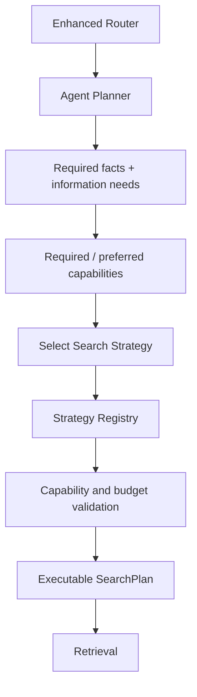
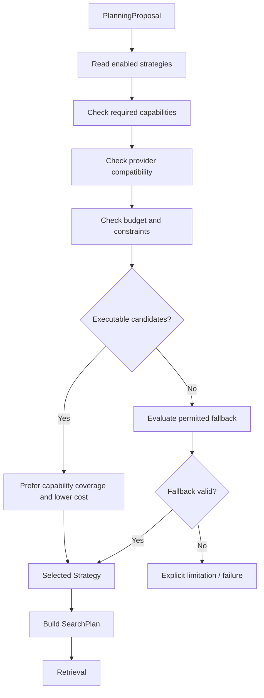

---
tags:
  - rag
  - agentic-rag
  - architecture
  - retrieval
status: design-proposed
---

# Retrieval capabilities

## 1. Зорилго

Энэ note нь Bounded Adaptive Agentic RAG-ийн **Agent Planner болон Select Search Strategy-ийн хооронд ашиглах retrieval capability contract**-ийг тодорхойлно.

Үндсэн зарчим:

> Agent Planner нь strategy implementation-ийн нэрийг шууд сонгохын оронд асуултад ямар retrieval чадвар шаардлагатайг тодорхойлно. Strategy Selector нь тухайн шаардлагыг биелүүлэх бүртгэлтэй strategy-г сонгоно.

Ингэснээр:

- Agent Planner strategy implementation-аас бага хамаарна.
- Шинэ strategy нэмэхэд үндсэн pipeline-ийг өөрчлөх шаардлага багасна.
- Strategy бүрийн боломжийг тодорхой contract-аар илэрхийлнэ.
- Backend budget, availability болон fallback-ийг хянах боломжтой.
- Шаардлагатай evidence-ийг олох зорилго нь strategy-ийн нэрээс илүү чухал болно.

**Төлөв:** Architecture design. Одоогийн `refactor`-т энэ capability-based contract бүрэн хэрэгжсэн гэж үзэхгүй.

## 2. Архитектур дахь байрлал



**Agent Planner**

- Ямар мэдээлэл хэрэгтэйг тодорхойлно.
- Required facts гаргана.
- Information needs тодорхойлно.
- Required / preferred retrieval capabilities санал болгоно.
- Хайлтын зорилго буюу search intents бэлдэнэ.

**Strategy Selector**

- Registry-д бүртгэлтэй strategy-уудыг шалгана.
- Шаардлагатай capability-г хангах strategy сонгоно.
- Provider болон budget constraint шалгана.
- Сонгосон strategy-ийн executable SearchPlan гаргана.

**Retrieval**

- SearchPlan-ийн дагуу OpenAI Vector Store search ажиллуулна.
- Retrieved passages болон provenance буцаана.

## 3. Capability гэж юу вэ?

Capability нь **retrieval хийхэд шаардлагатай чадвар** юм.

Strategy нь тухайн чадварыг хэрэгжүүлдэг алгоритм эсвэл execution pattern.

Жишээ:

| Capability | Strategy implementation |
|---|---|
| Нэг тодорхой мэдээлэл хайх | Single Query |
| Нэг асуултыг олон өнцгөөс хайх | Multi Query |
| Тодорхой заалтын дугаарт төвлөрөх | Exact Reference-oriented Retrieval |
| Хоёр журмыг харьцуулах evidence бүрдүүлэх | Comparison-oriented Retrieval |
| Эхний хайлтын үр дүнгээр дараагийн хайлтыг төлөвлөх | Stepwise Retrieval |

Эдгээр нь боломжит mapping. Capability бүр заавал тусдаа strategy шаардахгүй.

Нэг strategy олон capability дэмжиж болно. Нэг capability-г хэд хэдэн strategy хэрэгжүүлж болно.

## 4. Capability Catalog

Эхний conceptual catalog:

| Capability ID | Үндсэн зорилго | Жишээ |
|---|---|---|
| `focused_lookup` | Нэг тодорхой мэдээллийг олох | Цалин хэдний өдөр буудаг вэ? |
| `multi_angle_coverage` | Өөр өөр хайлтын өнцөг ашиглах | Чөлөөний зөвшөөрөгч болон хүсэлт гаргах систем |
| `exact_reference_focus` | Тодорхой заалт, дугаар, нэршилд төвлөрөх | 10.4.6-д юу заасан бэ? |
| `comparison_coverage` | Харьцуулах объект бүрийн evidence олох | 3 болон 4 цагийн чөлөөний ялгаа |
| `dependency_aware_search` | Эхний evidence-ээс хамааруулан дараагийн хайлтыг төлөвлөх | Орлон гүйцэтгэгчийг тогтоогоод эрхийг нь шалгах |
| `metadata_scoping` | Боломжтой үед хайлтыг metadata-аар хязгаарлах | Тодорхой document/version-д хайх |

Энэ нь нэмж судалж болох capability catalog бөгөөд бүгд implementation-д байгаа гэсэн үг биш.

### 4.1 Focused lookup

Нэг тодорхой information need-д төвлөрөх чадвар.

Жишээ:

"Цалин хэдний өдөр буудаг вэ?"

Information need:

"Цалин олгох өдөр болон холбогдох нөхцөл."

Боломжит implementation: `single_query`.

### 4.2 Multi-angle coverage

Нэг асуултад хариулахын тулд өөр өөр search angle шаардлагатай үед хэрэглэнэ.

Жишээ:

"3 цагийн чөлөө авахад менежер эзгүй бол хэн зөвшөөрөх, хүсэлтээ хаана гаргах вэ?"

Information needs:

- Менежер эзгүй үеийн зөвшөөрөх эрх.
- Чөлөөний хүсэлт бүртгэх журам.

Боломжит implementation: `multi_query`.

Олон required fact байгаа нь заавал multi-query хийх шаардлагатай гэсэн үг биш. Нэг passage бүх мэдээллийг агуулж болно.

### 4.3 Exact reference focus

Тодорхой заалт, дугаар, document identifier, acronym зэрэгт төвлөрсөн хайлт.

Жишээ:

"10.4.6-д юу заасан бэ?"

Энд `10.4.6`-г өөрчилж болохгүй.

OpenAI Vector Store-ийн search result энэ заалтыг яг олно гэсэн баталгаа байхгүй. Exact reference focus нь retrieval objective болохоос guaranteed exact match биш.

### 4.4 Comparison coverage

Харьцуулах тал бүрд шаардлагатай evidence бүрдүүлэх чадвар.

Жишээ:

"3 цагийн болон 4 цагийн цалинтай чөлөөний ялгаа юу вэ?"

Planner дараахыг тодорхойлж болно:

- F1: 3 цагийн чөлөөнд үйлчлэх журам.
- F2: 4 цагийн цалинтай чөлөөний журам.
- F3: Хоёр журмын ялгааг батлах нөхцөлүүд.

Strategy нь аль нэг талын evidence-ийг орхихгүй байх зорилготой.

### 4.5 Dependency-aware search

Эхний хайлтын үр дүнгээс дараагийн хайлтын зорилго хамаарах нөхцөл.

Жишээ:

1. Менежер эзгүй үед эрхийг хэн хэрэгжүүлдэг болохыг олох.
2. Олдсон албан тушаалтны чөлөө зөвшөөрөх эрхийг шалгах.

Энэ нь stepwise retrieval хэрэгтэй байж болох жишээ.

**Одоохондоо future capability** гэж үзнэ. Шаардлагатай нь бодитоор тогтоогдоогүй байхад implementation хийхгүй.

### 4.6 Metadata scoping

Vector Store provider-ийн дэмждэг metadata эсвэл file attributes ашиглан хайлтын хүрээг хязгаарлах.

Жишээ:

"2025 оны батлагдсан ёс зүйн журмаас хай."

Энэ capability-ийн хэрэгжих боломж OpenAI API болон index-д хадгалсан metadata-гаас хамаарна.

Metadata байхгүй бол system ийм filtering хийсэн гэж мэдэгдэх ёсгүй.

## 5. Required vs Preferred Capabilities

Бүх capability-г заавал хангах шаардлагатай гэж үзэж болохгүй.

### Required

Асуултыг төлөвлөсөн хэлбэрээр боловсруулахад зайлшгүй хэрэгтэй чадвар.

### Preferred

Хэрэглэвэл retrieval coverage эсвэл үр ашгийг сайжруулж болох боловч өөр арга ашиглах боломжтой чадвар.

Жишээ:

```json
{
  "required_capabilities": ["focused_lookup"],
  "preferred_capabilities": ["multi_angle_coverage"]
}
```

Энэ нь:

- Ядаж focused retrieval шаардлагатай.
- Хоёр өөр search angle ашиглах боломжтой бол давуу.
- Гэхдээ multi-query заавал хийх албагүй.

гэсэн утгатай.

**Required capability боломжгүй бол** Selector үүнийг чимээгүй орхихгүй. Capability дутсаныг тэмдэглэж, зөвшөөрөгдсөн fallback байгаа эсэхийг шалгана.

## 6. Agent Planner Output — PlanningProposal

Жишээ:

```json
{
  "request_id": "R1",
  "required_facts": [
    {
      "id": "F1",
      "description": "Менежер эзгүй үед чөлөөг хэн зөвшөөрөх вэ?"
    },
    {
      "id": "F2",
      "description": "3 цагийн чөлөөний хүсэлтийг хаана гаргах вэ?"
    }
  ],
  "information_needs": [
    {
      "id": "N1",
      "focus": "Менежер эзгүй үеийн чөлөө зөвшөөрөх эрх",
      "targets": ["F1"]
    },
    {
      "id": "N2",
      "focus": "Богино хугацааны чөлөөний хүсэлт бүртгэх журам",
      "targets": ["F2"]
    }
  ],
  "required_capabilities": [
    "focused_lookup"
  ],
  "preferred_capabilities": [
    "multi_angle_coverage"
  ]
}
```

Энэ бол conceptual contract.

Planner:

- Баримтын хариултыг урьдчилан зохиохгүй.
- Strategy implementation-ийг шууд ажиллуулахгүй.
- Search budget өөрчлөхгүй.
- Vector Store API дуудахгүй.
- Evidence sufficient эсэхийг шийдэхгүй.

## 7. Strategy Registry

Strategy Selector нь бүртгэлтэй, идэвхтэй strategy-уудын capability-г мэддэг байна.

Жишээ conceptual `StrategySpec`:

```json
{
  "id": "multi_query",
  "enabled": true,
  "capabilities": [
    "focused_lookup",
    "multi_angle_coverage"
  ],
  "max_initial_queries": 2,
  "execution_mode": "parallel_independent"
}
```

Энэ бол registry contract-ийн жишээ, одоогийн бодит тохиргоо биш.

Strategy бүр дараах мэдээлэлтэй байж болно:

- Strategy ID.
- Enabled/disabled status.
- Supported capabilities.
- Required input fields.
- Execution mode.
- Search cost/budget requirements.
- Provider requirements.
- Fallback eligibility.

Шинэ strategy нэмэхэд:

1. Strategy implementation нэмнэ.
2. Registry-д бүртгэнэ.
3. Capability-уудыг тодорхойлно.
4. SearchPlan contract-д нийцүүлнэ.
5. Шаардлагатай regression test ажиллуулна.

Planner-ийн үндсэн logic-ийг strategy бүрд зориулж шинээр бичих шаардлагагүй.

## 8. Capability Matching Algorithm



### Decision priority

1. Required capabilities.
2. Policy болон backend constraints.
3. Provider compatibility.
4. Search budget.
5. Preferred capability coverage.
6. Cost/latency efficiency.

Энэ нь conceptual priority order. Бодит implementation-д deterministic selection rule тодорхойлох шаардлагатай.

## 9. Fallback Rules

Жишээ:

Planner:

`focused_lookup + preferred multi_angle_coverage`

Registry:

- `single_query` — enabled.
- `multi_query` — disabled.

Selector нь `single_query` сонгож болно.

Учир нь `multi_angle_coverage` preferred байсан.

Харин `dependency_aware_search` зайлшгүй required байхад зөвхөн `single_query` байгаа бол бүх шаардлагыг биелүүлсэн мэт үзэж болохгүй.

Fallback хийсэн бол execution trace-д тэмдэглэнэ.

## 10. SearchPlan Contract

Strategy Selector-ийн output нь Planner-ийн санал биш, **бодитоор ажиллуулж болох төлөвлөгөө** байна.

Жишээ:

```json
{
  "request_id": "R1",
  "strategy_id": "multi_query",
  "queries": [
    {
      "id": "Q1",
      "text": "Богино хугацааны чөлөө зөвшөөрөх эрх, орлон гүйцэтгэх журам",
      "targets": ["F1"]
    },
    {
      "id": "Q2",
      "text": "3 цагийн чөлөөний хүсэлт гаргах, бүртгүүлэх журам",
      "targets": ["F2"]
    }
  ],
  "limit_per_query": 5,
  "fallback_applied": false
}
```

Strategy implementation нь information needs-ээс final query үүсгэж болно.

Ирээдүйн stepwise strategy-д эхний хайлтын дараа үргэлжлэх төлөвлөгөө шаардлагатай байж болно. Тийм үед SearchPlan contract-ийг өргөтгөнө; одоохондоо бүх боломжийг урьдчилан хэрэгжүүлэхгүй.

## 11. Чухал хязгаарлалт

- Retrieval capability нь evidence quality-ийн баталгаа биш.
- Strategy Registry зөвхөн бодитоор хэрэгжсэн capability-г enabled гэж зарлана.
- Planner-д боломжгүй capability-г боломжтой мэт танилцуулахгүй.
- Strategy сонголт нь security policy-г өөрчлөх эрхгүй.
- Budget-ийг backend controller мөрдүүлнэ.
- Evidence grading болон corrective retry нь энэ component-ийн дараагийн үе шат.
- Exact match, multi-hop болон metadata filtering-ийг provider capability баталгаагүй үед implemented гэж тэмдэглэхгүй.
- Strategy ID болон capability ID нь хоорондоо өөр ойлголт.

## 12. Related

- [[Question taxonomy]]
- [[Enhanced Router]]
- [[Agent Planner]]
- [[Select search strategy]]
- [[Retrieval]]
- [[Dedup and Evidence review]]
- [[Targeted retry within budget]]

## 13. Status

| Хэсэг | Төлөв |
|---|---|
| Capability-based architecture | Design selected |
| Capability catalog | Proposed |
| PlanningProposal contract | Proposed |
| Strategy Registry contract | Proposed |
| Capability matching algorithm | Proposed |
| Planner capability vocabulary and proposal validation | Implemented; offline tests and synthetic live smoke passed in `rag/planning.py` |
| Strategy Registry and capability matching | Pending; catalog entries are not runtime availability claims |
| Selector handoff/runtime validation | Pending |

Энэ note нь архитектурын шийдвэрүүдийг тайлбарлана. Бодит код хэрэгжсэн гэсэн баталгаа биш.
