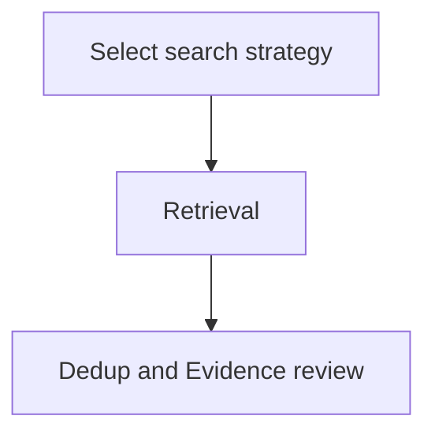
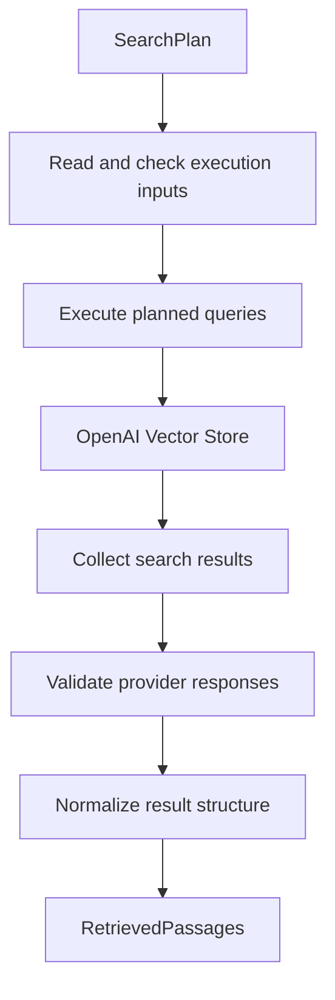
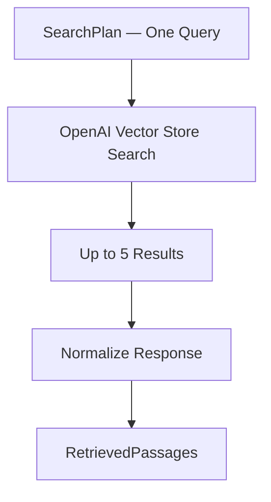
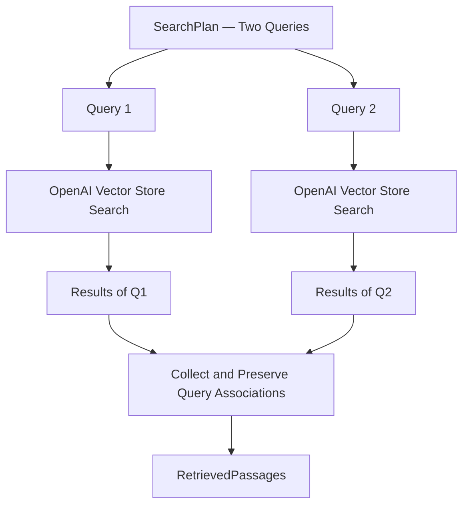

---
tags:
  - rag
  - agentic-rag
  - architecture
  - retrieval
status: design-complete
implementation: pending
validation: pending
---

# Retrieval

## 1. Purpose

Retrieval нь [[Select search strategy]] component-оос ирсэн `SearchPlan`-ийг гүйцэтгэж, OpenAI Vector Store-оос холбогдох document passages хайж авах component юм.

**Үндсэн зорилго: SearchPlan → OpenAI Vector Store → RetrievedPassages.**

Манай систем OpenAI-hosted Vector Store ашиглаж байгаа тул parsing, chunking, embedding, vector indexing болон vector search engine-ийг application дотор дахин хэрэгжүүлэхгүй.

Retrieval нь баримтын хариултыг мэдэх эсвэл evidence хангалттай эсэхийг шийдэхгүй. Зөвхөн хайлтын үр дүнг цуглуулж, стандартчилан дараагийн component-д дамжуулна.

**Status: DESIGN COMPLETE — IMPLEMENTATION / VALIDATION PENDING**

---

## 2. Architecture Position



- Өмнөх component: [[Select search strategy]]
- Одоогийн component: Retrieval
- Дараагийн component: [[Dedup and Evidence review]]

Retrieval нь strategy selection болон evidence evaluation хоёрын хооронд байрлана.

## 3. Input → Processing → Output



| Stage | Data | Responsibility |
|---|---|---|
| Input | `SearchPlan` | Ажиллуулах query-ууд болон хязгаарыг авах |
| Processing | OpenAI Vector Store Search | Төлөвлөсөн query бүрээр бодит хайлт хийх |
| Processing | Response validation | API success, empty, error-ийг ялгах |
| Processing | Result normalization | Provider response-ийг application-ийн нэг хэлбэрт оруулах |
| Output | `RetrievedPassages` | Passages, metadata, query association, execution status |

Энэ шатанд LLM-based semantic processing хийхгүй.

---

## 4. Input Contract — SearchPlan

Retrieval нь Strategy Selector-ийн баталгаажуулсан `SearchPlan` хүлээн авна.

Conceptual example:

```json
{
  "request_id": "R1",
  "strategy_id": "multi_query",
  "queries": [
    {
      "id": "Q1",
      "text": "Менежер эзгүй үед чөлөө зөвшөөрөх эрх",
      "targets": ["F1"]
    },
    {
      "id": "Q2",
      "text": "3 цагийн чөлөөний хүсэлт гаргах журам",
      "targets": ["F2"]
    }
  ],
  "limit_per_query": 5
}
```

### Input fields

| Field | Purpose |
|---|---|
| `request_id` | Хэрэглэгчийн independent request-ийг таних |
| `strategy_id` | Ямар strategy сонгогдсоныг тэмдэглэх |
| `queries` | Гүйцэтгэх хайлтын query-ууд |
| `queries[].id` | Search result-ийг үүсгэсэн query-тай холбох |
| `queries[].text` | OpenAI Vector Store-д дамжуулах текст |
| `queries[].targets` | Тухайн query ямар required fact-д чиглэж байгааг хадгалах |
| `limit_per_query` | Нэг хайлтаас авах үр дүнгийн дээд хэмжээ |

Энэ нь proposed application contract бөгөөд OpenAI-ийн raw API schema биш.

### Input boundary

Retrieval:

- Strategy-г дахин сонгохгүй.
- Query-г semantic байдлаар rewrite хийхгүй.
- Required facts-ийг дахин тодорхойлохгүй.
- SearchPlan-ийн query-г үндэслэлгүй өөрчлөхгүй.

Strategy Selector аль хэдийн plan validation хийсэн байна. Retrieval нь provider call хийхийн өмнө хоосон query, invalid limit зэрэг үндсэн хамгаалалтын шалгалтыг давхар хийж болно.

---

## 5. Processing Algorithm

### Step 1 — Read SearchPlan

`SearchPlan.queries`-ээс query-уудыг авна.

Initial V1:

- `single_query`: нэг query.
- `multi_query`: хоёр query.
- Per-query result limit: Top 5.

Эдгээр нь V1-ийн тохиргоо бөгөөд хожим өөрчлөгдөж болно.

### Step 2 — Execute Vector Store Search

Query бүрийг OpenAI Vector Store Search API-д дамжуулна.

Conceptual operation:

```python
results = client.vector_stores.search(
    vector_store_id=vector_store_id,
    query=query_text,
    max_num_results=5,
)
```

Энэ бол API usage-ийн жишээ. Бодит SDK version болон response handling-ийг implementation үед шалгана.

Application өөрөө query embedding тооцоолох, vector similarity engine ажиллуулах шаардлагагүй.

### Step 3 — Collect Results

Search result бүрээс боломжтой metadata-г хадгална.

Үүнд:

- Passage text.
- File ID.
- Filename.
- Provider relevance score.
- File attributes, байгаа бол.
- Query ID.
- Target fact IDs.
- Search result-ийн дараалал.

Provider score-г хадгалах боловч түүнийг evidence correctness гэж тайлбарлахгүй.

Өөр өөр query-ийн score-уудыг шууд хооронд нь харьцуулж global relevance ranking гэж үзэхгүй.

### Step 4 — Validate Provider Response

Query тус бүрийн API response-г шалгана.

- Search амжилттай болсон эсэх.
- Result байхгүй эсэх.
- Provider error гарсан эсэх.
- Response бүтэц боловсруулах боломжтой эсэх.
- Passage text болон source metadata байгаа эсэх.

### Step 5 — Return RetrievedPassages

Query бүрийн үр дүнг нэг application-level contract-д оруулж буцаана.

Энэ шатанд duplicate passages-ийг арилгахгүй.

---

## 6. Single Query Execution



Жишээ асуулт:

"Цалин хэдний өдөр олгогддог вэ?"

Query:

`Цалин олгох өдөр, хугацааны журам`

Retrieval нэг search operation гүйцэтгэнэ.

Үр дүн нь 0–5 passage байж болно.

---

## 7. Multi Query Execution



Жишээ асуулт:

"Менежер эзгүй үед 3 цагийн чөлөөг хэн зөвшөөрөх, хүсэлтээ хаана гаргах вэ?"

**Q1:** Менежер эзгүй үеийн зөвшөөрөх эрх.

**Q2:** Чөлөөний хүсэлт бүртгүүлэх журам.

Тус бүр Top-5 хайвал нийт 10 хүртэл search result ирж болно.

Эдгээрийн зарим нь ижил passage байх боломжтой.

Retrieval нь Q1, Q2-ын үр дүнг цуглуулж, query association-ийг хадгална.

**Deduplication нь дараагийн component-ийн ажил.**

V1-д query бүр тусдаа logical search operation байна. Sequential эсвэл parallel execution сонгох нь implementation detail бөгөөд output contract-ийг өөрчлөх ёсгүй.

---

## 8. Output Contract — RetrievedPassages

Conceptual example:

```json
{
  "request_id": "R1",
  "status": "success",
  "searches": [
    {
      "query_id": "Q1",
      "status": "success",
      "result_count": 2
    },
    {
      "query_id": "Q2",
      "status": "success",
      "result_count": 1
    }
  ],
  "passages": [
    {
      "passage_id": "P1",
      "query_id": "Q1",
      "targets": ["F1"],
      "file_id": "file_123",
      "filename": "leave_policy.pdf",
      "text": "Чөлөө зөвшөөрөх эрх бүхий албан тушаал...",
      "score": 0.91
    },
    {
      "passage_id": "P2",
      "query_id": "Q2",
      "targets": ["F2"],
      "file_id": "file_456",
      "filename": "hr_procedure.pdf",
      "text": "Ажилтан чөлөөний хүсэлтээ...",
      "score": 0.87
    }
  ]
}
```

Жишээн дэх passages, filename болон score нь зохиомол test data юм.

`passage_id` нь application-ийн тухайн retrieval result-д оноосон internal reference байж болно. OpenAI Search API тогтвортой chunk ID заавал буцаадаг гэж үзэхгүй.

### Output requirements

- Query association алдагдахгүй.
- Source metadata хадгалагдана.
- Text content хадгалагдана.
- Search execution status тодорхой байна.
- Provider score хадгалагдана.
- Partial failure ил тод байна.
- Duplicate passages энэ шатанд үлдэж болно.

---

## 9. Retrieval Status and Error Handling

| Status | Meaning |
|---|---|
| `success` | Бүх төлөвлөсөн search амжилттай, дор хаяж нэг passage ирсэн |
| `empty` | Бүх search амжилттай, ямар ч passage ирээгүй |
| `partial_error` | Зарим search амжилттай, зарим нь алдаатай |
| `error` | Төлөвлөсөн бүх search амжилтгүй |

### Important distinctions

**Empty result ≠ Provider error**

API амжилттай ажилласан ч passage олдохгүй байж болно.

**Provider error ≠ Evidence missing**

API timeout эсвэл service error нь баримтад хариулт байхгүй гэсэн үг биш.

**Partial error ≠ Full success**

Хоёр query-ийн зөвхөн нэг нь амжилттай бол мэдээлэл дутуу байж болзошгүйг дараагийн component-д мэдэгдэнэ.

Retrieval нь API failure-ийг чимээгүй `[]` болгон хувиргаж, баримт олдоогүй мэт дүр эсгэхгүй.

---

## 10. Budget Boundary

Retrieval нь execution-wide budget limit-ийг өөрөө тогтоохгүй.

Энэ component-д validated SearchPlan болон зөвшөөрөгдсөн execution constraints ирсэн байна.

V1-ийн initial budget assumptions:

| Setting | Initial candidate |
|---|---|
| Message-level search budget | Max 4 search operations |
| Single Query | 1 operation |
| Multi Query | 2 operations |
| Results per query | Top 5 |

Actual search operations-ийн хэрэглээг shared execution state/controller бүртгэнэ.

Retrieval нь зөвшөөрөгдсөн operation-уудаас илүү хайлт хийхгүй.

Budget дууссан үед Retrieval өөрөө шинэ strategy эсвэл query үүсгэхгүй.

Энд дурдсан search budget нь LLM token budget биш.

---

## 11. Responsibility Boundaries

### Retrieval хийдэг

- SearchPlan унших.
- Query-уудыг API-д дамжуулах.
- Provider responses авах.
- Response structure шалгах.
- Search result-ийг стандартчилах.
- Source болон query metadata хадгалах.
- Execution status буцаах.

### Retrieval хийхгүй

- Question normalization.
- Intent/policy classification.
- Conversation relationship resolution.
- Required fact planning.
- Strategy selection.
- Query rewriting.
- Deduplication.
- Semantic reranking.
- Evidence sufficiency assessment.
- Corrective retry decision.
- Grounded answer generation.

Эдгээр хариуцлагыг Retrieval дотор давхар хэрэгжүүлэхгүй.

---

## 12. Connection to Dedup and Evidence Review

Retrieval-ийн output:

`RetrievedPassages`

Дараагийн component энэ output-ийг хүлээн авна.

### Deduplication

Олон query-аас ирсэн identical passage-уудыг нэгтгэнэ.

Query provenance болон source metadata-г хадгална.

### Evidence Review

Unique passages-ийг Planner-ийн `required_facts`-тай харьцуулна.

Тухайн passage хэрэглэгчийн асуултад бодитоор хариулж чадах эсэхийг шалгана.

**Retrieval score өндөр байх нь evidence зөв гэсэн баталгаа биш.**

Энэ хоёр ажиллагааны algorithm-ийг Retrieval note-д нарийвчлан хэрэгжүүлэхгүй.

See: [[Dedup and Evidence review]].

---

## 13. Edge Cases and Validation Plan

| Scenario | Expected behavior |
|---|---|
| Valid single-query plan | Нэг search гүйцэтгэнэ |
| Valid multi-query plan | Хоёр search гүйцэтгэнэ |
| Search returns no matches | `empty` |
| All provider calls fail | `error` |
| One of two calls fails | `partial_error` |
| Invalid query text | Provider call хийхээс өмнө reject |
| API response missing optional metadata | Боломжтой metadata-г хадгалж, хоосон талбарыг зохих ёсоор боловсруулах |
| Same passage returned by two queries | Retrieval-д хоёуланг нь хадгална |
| Search results fewer than Top-5 | Ирсэн үр дүнг хадгална |
| Provider score missing | Зохиомол score үүсгэхгүй |
| Search budget exhausted | Нэмэлт search эхлүүлэхгүй |
| Provider timeout | Error гэж ялган тэмдэглэнэ |

### Future execution strategies

Future stepwise retrieval эхний result-ээс дараагийн query-г хамааруулж ажиллуулах шаардлага гаргаж болно. Тэр үед статик query жагсаалтаас гадна execution state/result handoff хэрэгтэй болж `SearchPlan` эсвэл executor contract өөрчлөгдөж магадгүй. Энэ нь ирээдүйн extension; одоохондоо хэрэгжсэн гэж үзэхгүй.

### Implementation validation

- Offline mock tests.
- Single-query execution test.
- Multi-query execution test.
- API error handling test.
- Partial failure test.
- Metadata preservation test.
- Query-to-result mapping test.
- Existing regression questions.

Эдгээрийг test completed гэж тэмдэглэхгүй.

---

## 14. Design Decisions

1. Retrieval нь OpenAI Vector Store ашиглана.
2. Existing `search_documents(query, limit=5)` wrapper-ийн санааг хадгална.
3. Strategy Selection-ийг Retrieval дотор хийхгүй.
4. V1-д Single Query, Multi Query-г гүйцэтгэнэ.
5. Multi Query-ийн query бүр тусдаа logical search operation байна.
6. Result provenance-г хадгална.
7. Provider response болон application response-ийг ялгана.
8. `success`, `empty`, `partial_error`, `error` status-уудыг ялгана.
9. Deduplication Retrieval-ийн дараа хийгдэнэ.
10. Evidence Review Retrieval-ийн дараа хийгдэнэ.
11. Шинэ LLM retrieval call, local vector database, embedding pipeline нэмэхгүй.
12. Component-ийг энгийн, provider-wrapper-oriented байдлаар хадгална.

---

## 15. Current Status

| Area | Status |
|---|---|
| Component responsibility | Design Complete |
| SearchPlan input contract | Design Complete |
| Single Query flow | Design Complete |
| Multi Query flow | Design Complete |
| RetrievedPassages output contract | Design Complete |
| Error/status model | Design Complete |
| Responsibility boundaries | Design Complete |
| Python implementation alignment | Pending |
| OpenAI API runtime validation | Pending |
| Regression verification | Pending |

**DESIGN COMPLETE ≠ IMPLEMENTATION COMPLETE**

Энэ note нь бидний шийдсэн V1 architecture-ийн зорилтот contract-ийг тодорхойлж байна.

Одоогийн кодыг өөрчлөлгүйгээр бүх proposed field, status хэрэгжсэн гэж үзэхгүй.

Одоогийн `refactor` implementation-ийн `search_documents(query, limit=5)` нь нэг query-г OpenAI Vector Store-д ажиллуулдаг. Agent Planner/Strategy Selector-оос ирсэн `SearchPlan`-ийг нэг request-д batch-аар гүйцэтгэх V1 orchestration одоогоор implemented биш; энэ note-ийн `multi_query`, per-query status болон нийлмэл `RetrievedPassages` contract-ийг runtime/API verification-оор баталгаажуулаагүй.

---

## 16. Related Components

- [[Select search strategy]]
- [[Retrieval capabilities]]
- [[Dedup and Evidence review]]
- [[Targeted retry within budget]]
- [[Agent Planner]]

Дараагийн component-ийн дэлгэрэнгүй алгоритм Retrieval-ийн responsibility-д хамаарахгүй.
