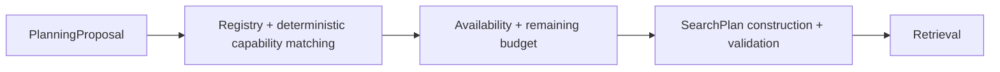
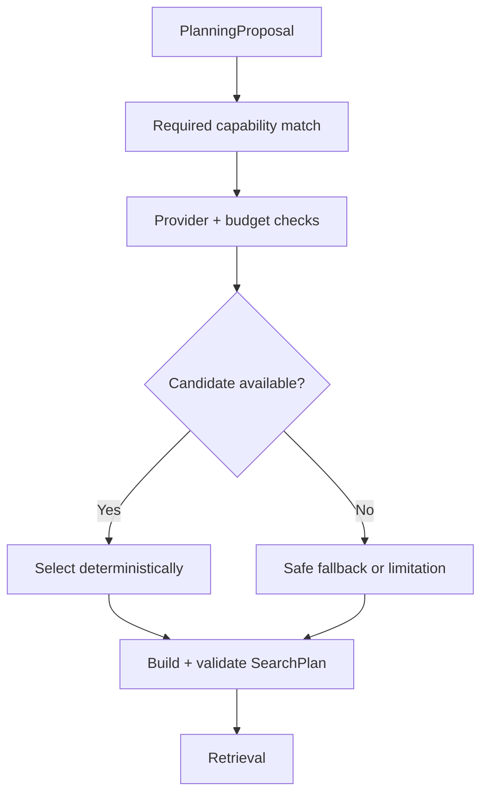

# Select Search Strategy

> [!note] Төлөв
> **DESIGN COMPLETE / IMPLEMENTATION PARTIAL.** Hub нь component-ийн ажлыг нэгтгэнэ; V1-ийн дэлгэрэнгүй algorithm, budget, validation болон жишээнүүдийг subnote-уудад хадгалсан.

## Purpose

Agent Planner-ийн capability шаардлагад тохирох enabled strategy-г deterministic Python logic-оор сонгож, validate хийсэн executable `SearchPlan` гаргана. Бодит retrieval хийхгүй.

## Architecture Position

[[Agent Planner]] болон [[Retrieval]]-ийн хооронд:

## Input

Validated `PlanningProposal`, `resolved_question` (query construction-д шаардлагатай үед), canonical capability definitions, provider/backend constraints болон available shared message-level search budget.

## Processing

1. Registry-ийн enabled strategy-г шалгах.
2. Required capability-г бүрэн хангах candidate сонгох.
3. Provider/execution compatibility болон available budget шалгах.
4. Preferred capability coverage-аар сонголт хийх; tie үед call цөөн, дараа нь stable ordering.
5. Зөвшөөрөгдсөн fallback сонгох эсвэл limitation буцаах.
6. `SearchPlan` байгуулах, validate хийх.

## Output

Validated `SearchPlan` (`strategy_id`, executable query-ууд, fact targets, limits, fallback details) эсвэл required capability-г хангах боломжгүй explicit `planning_limitation`.

## Responsibilities and Boundaries

- V1 strategy: `single_query` (1 search), `multi_query` (2 search).
- Shared provider: OpenAI Vector Store; per-query result limit Top 5.
- User-message search cap-ийн initial candidate: 4 call, corrective search-уудыг хамруулна.
- Selector үлдсэн budget-ээр plan feasibility шалгана; shared Controller нийт хэрэглээг record/enforce хийнэ.
- Fallback нь retrieval-ээс өмнөх strategy decision. Evidence-review-ийн дараах corrective retry нь тусдаа stage.
- Token budget нь энэ search-call budget-ээс тусдаа.

## Algorithm Overview

## Detailed Documentation

- [[SS - Registry and matching]]
- [[SS - Single and Multi Query]]
- [[SS - Budget and fallback]]
- [[SS - SearchPlan and validation]]

## Current Status

`answer_question()` одоо Router → нэг batch Planner → нэг batch deterministic Selector → төлөвлөгөөт Retrieval дарааллаар ажиллана. Router-ийн normalized `search_query` байвал Selector initial query-ийн үндэс болгоно; байхгүй/хоосон үед validated `resolved_question`-д fallback хийнэ. Follow-up context-тэй `resolved_question` нь Planner, review, generation-д хэвээр ашиглагдана. Retrieval-ийн дараа одоогийн Evidence Review болон нэг targeted retry ажиллаж болох бөгөөд retry нь initial query-үүдтэй shared budget хэрэглэнэ.

[[Question taxonomy]]-ийн D хэмжээсийн summary хүснэгтэд Agent Planner-ийг retrieval strategy owner гэж заасан хуучин мөр үлдсэн. Энэ migration-д shared canonical note-ийг өөрчлөхгүй; final capability-based boundary нь Planner capability санал болгож, энэ Selector strategy implementation сонгох юм.

## Architecture Decisions and Status

| Area | Status |
|---|---|
| Component responsibility | Design Complete |
| `PlanningProposal` input contract | Design Complete |
| Strategy Registry architecture | Design Complete |
| Capability matching | Design Complete |
| `single_query` design | Design Complete |
| `multi_query` design | Design Complete |
| Budget and fallback rules | Design Complete |
| `SearchPlan` contract and validation | Design Complete |
| Python implementation | Partial; pipeline-integrated Selector |
| Offline regression validation | Partial; focused contract tests pass |
| Runtime quality verification | Pending |

Design Complete гэдэг нь implementation эсвэл quality verification дууссан гэсэн үг биш. Implementation үед budget-ийн exact configuration, deterministic query construction-ийн effectiveness, multi-query coverage, allocation болон fallback behavior-ийг regression validation-аар батална. Эдгээр нь design-ийг дахин нээх асуудал биш, баталгаажуулах pending зүйлс.

## Implementation status (as built)

- Status: partial (pipeline integrated; offline and two-case live smoke verified)
- Code owner: `rag/selection.py::select_search_plans`
- Input: validated `PlanningProposal[]`, `request_id`-гаар тааруулсан `resolved_questions` mapping, caller-аас өгсөн `remaining_search_budget`.
- Behavior verified: `single_query` нэг operation; `multi_query` хоёр operation. Required capability-г бүрэн хангадаг strategy-г сонгож, request дарааллаар minimum plan болон дараа нь боломжтой preferred multi-query upgrade хуваарилна. Бүх fact query target-д орсон эсэх, query ID/text/duplicate, strategy count, per-query limit болон өгсөн budget-ийг шалгана.
- Output contract: request бүр `planned` + `search_plan` эсвэл `planning_limitation` result болно. SearchPlan-н query ID нь тухайн plan дотор Q1/Q2.
- Query source: Pipeline нь nonblank Router `search_query`-г request ID-аар mapping хийнэ; байхгүй/blank үед `resolved_question`-ийг өгнө. Selector-д mapping өгсөн бол бүрэн, nonblank байхыг validate хийнэ; standalone callable-д mapping орхивол `resolved_question` query base болно. Query-г дахин LLM-ээр normalize хийхгүй.
- Budget owner: `answer_question()` нь allowed Planner proposal бүрд `3` operation буюу `2` хүртэл planned query + `1` targeted retry-ийг тооцно. Нэг shared mutable counter нь Selector-д initial budget өгч, planned болон retry provider call бүрийн өмнө хасагдана. Энэ нь fixed four-call cap биш; 1–3 allowed proposal-д дээд тал нь 3–9 operation, нэг `answer_question()` invocation хүрээнд.
- Tests: 86 focused offline tests passed, үүнд pipeline batch Planner/Selector/Retrieval, normalized-query fallback, restriction exclusion, multi-query + нэг retry, partial retrieval error шалгалтууд орно. C01/C21 live smoke normalized-query mapping нэмэхийн өмнө ажилласан бөгөөд хоёр case-д Router `search_query == resolved_question` байсан. C07 smoke шинэ mapping-ийн дараа ажиллаж, утга ялгаатай үед initial query Router `search_query`-тай яг таарсныг баталсан. Гурван case `single_query` сонгож, 5/5/4 initial passages авч, нэг нэг retry хийгээд `partially_answered` болсон.
- Limitations: Live run зөвхөн single-query шалгасан; multi-query зөвхөн offline integration test-ээр шалгагдсан. Query semantic relevance, evidence support, citations-ийг хүнээр шалгаагүй. Provider availability-г Selector динамикаар шалгахгүй.
- Architecture deviation: multi-query текстэд resolved question-ийг яг хэвээр нь оруулаад need focus-ийг залгана; ингэснээр query өмнөх numeric/actor/negation constraints-ийг хасахгүй. Энэ нь design example-үүдээс урт query үүсгэж болох ба relevance нь unverified.
- Next: Query/fact association ба retrieval error state-ийг Dedup and Evidence Review рүү аюулгүй дамжуулахыг хэрэгжүүлж, шалгах.

## Related Components

[[Agent Planner]] · [[Retrieval]] · [[Retrieval capabilities]] · [[Question taxonomy]] · [[Dedup and Evidence review]] · [[Targeted retry within budget]]
