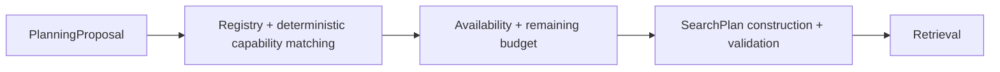
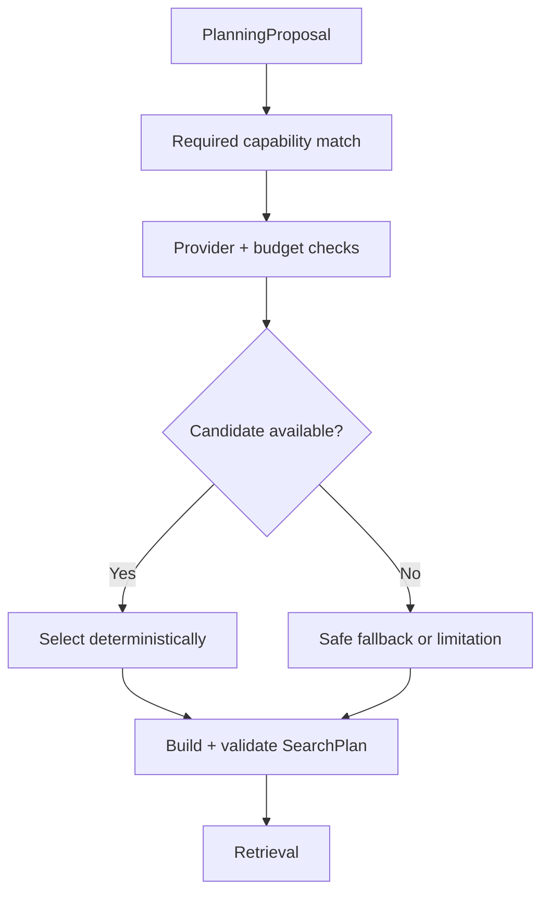

# Select Search Strategy

> [!note] Төлөв
> **DESIGN COMPLETE / IMPLEMENTATION PENDING.** Энэ hub нь component-ийн ажлыг нэгтгэнэ; V1-ийн дэлгэрэнгүй algorithm, budget, validation болон жишээнүүдийг subnote-уудад бүрэн шилжүүлсэн.

## Purpose

Agent Planner-ийн capability шаардлагад тохирох enabled strategy-г deterministic Python logic-оор сонгож, validate хийсэн executable `SearchPlan` гаргана. Бодит retrieval хийхгүй.

## Architecture Position

[[Agent Planner]] болон [[Retrieval]]-ийн хооронд:

## Input

Validated `PlanningProposal`, `resolved_question` (query construction-д шаардлагатай үед), canonical capability definitions, provider/backend constraints болон available shared message-level search budget.

## Processing

1. Registry-ийн enabled strategy-г шалгах.
2. Required capability-г бүрэн хангах candidate сонгох.
3. Provider/execution compatibility болон available budget шалгах.
4. Preferred capability coverage-аар сонголт хийх; tie үед call цөөн, дараа нь stable ordering.
5. Зөвшөөрөгдсөн fallback сонгох эсвэл limitation буцаах.
6. `SearchPlan` байгуулах, validate хийх.

## Output

Validated `SearchPlan` (`strategy_id`, executable query-ууд, fact targets, limits, fallback details) эсвэл required capability-г хангах боломжгүй explicit `planning_limitation`.

## Responsibilities and Boundaries

- V1 strategy: `single_query` (1 search), `multi_query` (2 search).
- Shared provider: OpenAI Vector Store; per-query result limit Top 5.
- User-message search cap-ийн initial candidate: 4 call, corrective search-уудыг хамруулна.
- Selector үлдсэн budget-ээр plan feasibility шалгана; shared Controller нийт хэрэглээг record/enforce хийнэ.
- Fallback нь retrieval-ээс өмнөх strategy decision. Evidence-review-ийн дараах corrective retry нь тусдаа stage.
- Token budget нь энэ search-call budget-ээс тусдаа.

## Algorithm Overview

## Detailed Documentation

- [[SS - Registry and matching]]
- [[SS - Single and Multi Query]]
- [[SS - Budget and fallback]]
- [[SS - SearchPlan and validation]]

## Current Status

Одоогийн runtime-д Agent Planner, capability registry/matching болон `SearchPlan` байхгүй. Pipeline router-ийн `search_query`-г OpenAI Vector Store-д ашиглаж, evidence review дараа нэг targeted retry хийж болно.

[[Question taxonomy]]-ийн D хэмжээсийн summary хүснэгтэд Agent Planner-ийг retrieval strategy owner гэж заасан хуучин мөр үлдсэн. Энэ migration-д shared canonical note-ийг өөрчлөхгүй; final capability-based boundary нь Planner capability санал болгож, энэ Selector strategy implementation сонгох юм.

## Architecture Decisions and Status

| Area | Status |
|---|---|
| Component responsibility | Design Complete |
| `PlanningProposal` input contract | Design Complete |
| Strategy Registry architecture | Design Complete |
| Capability matching | Design Complete |
| `single_query` design | Design Complete |
| `multi_query` design | Design Complete |
| Budget and fallback rules | Design Complete |
| `SearchPlan` contract and validation | Design Complete |
| Python implementation | Pending |
| Regression validation | Pending |
| Runtime quality verification | Pending |

Design Complete гэдэг нь implementation эсвэл quality verification дууссан гэсэн үг биш. Implementation үед budget-ийн exact configuration, deterministic query construction-ийн effectiveness, multi-query coverage, allocation болон fallback behavior-ийг regression validation-аар батална. Эдгээр нь design-ийг дахин нээх асуудал биш, баталгаажуулах pending зүйлс.

## Related Components

[[Agent Planner]] · [[Retrieval]] · [[Retrieval capabilities]] · [[Question taxonomy]] · [[Dedup and Evidence review]] · [[Targeted retry within budget]]
