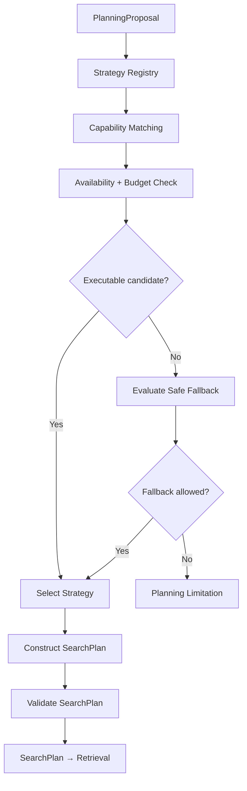

# SS - Registry and matching

> [!note] Migration
> Доорх хэсгүүдийг өмнөх component hub-ээс бүрэн шилжүүлэв. Source section-ийн тайлбар, жишээ, хүснэгт, diagram болон status-ийг хадгалсан.

## Purpose

Strategy Registry, capability matching, deterministic selection болон V1 strategy catalog.


## Архитектур дахь байрлал

`Select Search Strategy` нь [[Agent Planner]] болон [[Retrieval]]-ийн хооронд ажиллана. Энэ component executable query plan үүсгэдэг боловч бодит Vector Store retrieval хийхгүй.



Энэ дотоод diagram нь үндсэн pipeline-ийн дарааллыг солихгүй: `Agent Planner → Select Search Strategy → Retrieval`.

## Хариуцлага

Энэ component deterministic Python logic-оор:

1. Registry-д enabled strategy байгаа эсэхийг шалгана.
2. `PlanningProposal`-ийн capability шаардлагатай таарах strategy-г шүүнэ.
3. Provider, backend, execution constraint болон үлдсэн search budget шалгана.
4. Зөвшөөрөгдсөн fallback байгаа бол сонгоно.
5. Executable `SearchPlan` байгуулж validate хийнэ.

Тусдаа LLM call хэрэггүй.

**Энэ component хийхгүй:** semantic normalization, intent/follow-up/policy classification, required facts шинээр тодорхойлох, Vector Store search, passage processing, deduplication, evidence review/sufficiency, corrective retry decision, final answer generation.

## Input — `PlanningProposal`

Input нь [[Agent Planner]]-аас ирсэн validated `PlanningProposal`; нэг independent allowed retrieval request-д нэг proposal байна.

```json
{
  "request_id": "R1",
  "required_facts": [
    {"id": "F1", "description": "Менежер эзгүй үед чөлөөг хэн зөвшөөрөх вэ?"},
    {"id": "F2", "description": "3 цагийн чөлөөний хүсэлтийг хаана гаргах вэ?"}
  ],
  "information_needs": [
    {"id": "N1", "focus": "Менежер эзгүй үеийн зөвшөөрөх эрх", "targets": ["F1"]},
    {"id": "N2", "focus": "Богино хугацааны чөлөөний хүсэлт гаргах журам", "targets": ["F2"]}
  ],
  "required_capabilities": ["focused_lookup"],
  "preferred_capabilities": ["multi_angle_coverage"]
}
```

`resolved_question` нь query construction-д хэрэгтэй үед validated request context-оос хамт дамжина. Planner capability болон information needs-ийг тодорхойлно; strategy ID сонгохгүй. Capability definition-ийн canonical эх сурвалж: [[Retrieval capabilities]].

## Strategy Registry — V1

V1-д хоёр strategy-г дэмжихээр төлөвлөнө:

| Strategy ID | Дэмжих capability | Initial search operation |
|---|---|---:|
| `single_query` | `focused_lookup` | 1 |
| `multi_query` | `focused_lookup`, `multi_angle_coverage` | 2 |

Эхний configuration candidate:

| Setting | Initial value |
|---|---:|
| Results per search operation | Top 5 |
| Нэг user message-ийн нийт search call cap | 4 |
| Provider | OpenAI Vector Store |
| Strategy availability | `enabled` / disabled |

Эдгээр тоо нь **initial configuration candidates**; regression validation-аар өөрчлөгдөж болно. 4 call cap-д initial болон дараа нь зөвшөөрөгдөх corrective searches хамрагдана. Энэ нь token budget биш.

Conceptual registry:

```python
STRATEGIES = {
    "single_query": {
        "enabled": True,
        "capabilities": {"focused_lookup"},
        "search_calls": 1,
        "provider_requirements": {"openai_vector_store"},
    },
    "multi_query": {
        "enabled": True,
        "capabilities": {"focused_lookup", "multi_angle_coverage"},
        "search_calls": 2,
        "provider_requirements": {"openai_vector_store"},
    },
}
```

Энэ бол contract-ийг тайлбарлах жишээ, production code биш. Registry нь энгийн Python dictionary байж болно; plugin framework, dynamic loader эсвэл database шаардлагагүй. Ирээдүйн exact-reference, comparison, stepwise strategy V1-д хамаарахгүй.

## Deterministic capability matching

1. Enabled strategy-уудыг Registry-ээс авна.
2. Required capability-уудыг **бүгдийг** хангах candidate-уудыг үлдээнэ.
3. OpenAI Vector Store provider болон backend/execution constraint-тай нийцэхийг шалгана.
4. Candidate-ийн call count available message budget-д багтахыг шалгана.
5. Үлдсэн candidate-уудаас preferred capability-г хамгийн олныг хангахыг сонгоно.
6. Оноо тэнцвэл цөөн search call шаардахыг сонгоно.
7. Бүх шалгуур тэнцүү бол `strategy_id`-ийн lexical order-оор тогтвортой tie-break хийнэ.
8. Сонгосон strategy-д query байгуулж, `SearchPlan` validate хийнэ.

Priority: **required capability → provider/backend compatibility → budget → preferred coverage → call efficiency → stable tie-break**.

### Шийдвэрийн жишээ

| Тохиолдол | Requirement / боломж | Сонголт эсвэл үр дүн | Шалтгаан |
|---|---|---|---|
| Энгийн асуулт | Required `focused_lookup`, preferred байхгүй | `single_query` | Required хангаж, 1 call хэрэглэнэ |
| Олон өнцөгтэй асуулт | `multi_angle_coverage` preferred, 2 call available | `multi_query` | Preferred capability-г хангана |
| Budget хязгаар | Multi-angle preferred, 1 call available | `single_query` + limitation trace | Required хангана; preferred дутуу |
| Дэмжигдээгүй requirement | Required `dependency_aware_search`; registry-д хоёр V1 strategy л байна | `planning_limitation` | Required capability-г худал хангахгүй |

## Navigation

[[Select search strategy]] · [[Retrieval capabilities]] · [[AP - Capability planning]]
