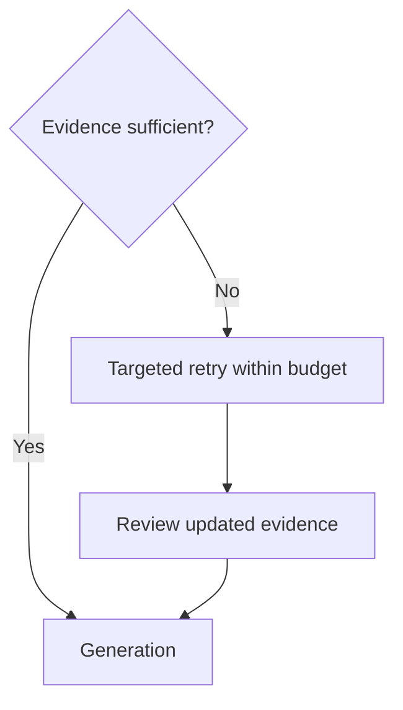
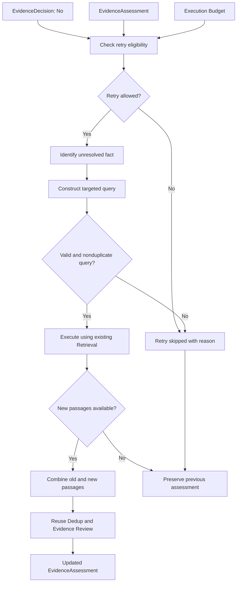
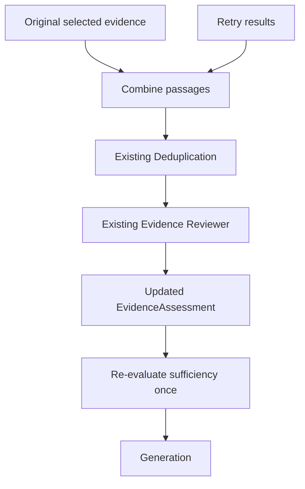

---
tags:
  - rag
  - agentic-rag
  - architecture
  - retrieval
  - retry
status: design-complete
implementation: partial
validation: partial
---

# Targeted retry within budget

## 1. Purpose

`Targeted retry within budget` нь анхны retrieval болон evidence review-ийн дараа шаардлагатай мэдээлэл дутуу байвал **зөвхөн unresolved required fact-д чиглэсэн нэмэлт хайлт хийх** ажиллагаа юм.

Үндсэн зорилго:

**EvidenceDecision (No) → Targeted Search → Updated EvidenceAssessment**

Энэ component нь бүх асуултыг дахин эхнээс нь боловсруулахгүй.

- Өмнө supported болсон evidence-г хадгална.
- Дутуу мэдээлэлд төвлөрнө.
- Existing Retrieval component-ийг дахин ашиглана.
- Existing Dedup and Evidence Review component-ийг дахин ашиглана.
- Нийт search budget-ийг хэтрүүлэхгүй.
- Нэмэлт evidence олдохгүй бол таамгаар хариулт зохиохгүй.

**Status: DESIGN COMPLETE — TARGETED PYTHON PATH AND ONE LIVE RETRY/REVIEW SMOKE VERIFIED; SEMANTIC VALIDATION PENDING**

---

## 2. Architecture Position

Үндсэн pipeline-ийн энэ хэсэг:



`Review updated evidence` нь тусдаа шинэ component биш.

Энэ нь existing [[Dedup and Evidence review]]-ийг дахин ашиглах logical operation юм.

Budget дууссан, valid retry query үүсэхгүй, эсвэл retry хийх боломжгүй бол existing validated assessment-ийг хадгалж Generation-д дамжуулна.

Энэ нь үндсэн architecture diagram-ийг өөрчлөхгүй, харин component-ийн дотоод execution behavior-ийг тодруулж байгаа хэрэг.

---

## 3. Input → Processing → Output



### Input

- `EvidenceDecision`
- `EvidenceAssessment`
- `resolved_question`
- `PlanningProposal` information needs
- Previous SearchPlan / executed queries
- Existing evidence references
- Remaining search-call budget
- Retry attempt count

### Processing

1. Retry eligibility шалгана.
2. Unresolved fact тодорхойлно.
3. Өмнөх search-ээс ялгаатай targeted query бэлдэнэ.
4. Query болон remaining budget-ийг шалгана.
5. Existing Retrieval-ээр нэг search гүйцэтгэнэ.
6. New passages-ийг existing passages-тай нэгтгэнэ.
7. Existing Dedup and Evidence Review-ийг дахин ашиглана.

### Output

- `RetryOutcome`
- New `RetrievedPassages`, байвал
- Updated `EvidenceAssessment`, шинэ passages үнэлэгдсэн бол
- Retry хийгдээгүй эсвэл амжилтгүй болсон шалтгаан

---

## 4. Retry Eligibility

Retry нь `EvidenceDecision.sufficient = false` үед л авч үзэгдэх боломжтой.

Гэхдээ `false` гэдэг нь retry заавал хийнэ гэсэн үг биш.

### Retry хийх нөхцөл

1. Request нь allowed retrieval request байх.
2. EvidenceDecision хүчинтэй байх.
3. Нэг буюу хэд хэдэн required fact `partial` эсвэл `missing` байх.
4. Тэдгээрт чиглэсэн meaningful search target байгаа байх.
5. Тухайн request-ийн retry limit дуусаагүй байх.
6. Shared search budget-д slot үлдсэн байх.
7. Өмнөх retrieval-ийн API failure-г evidence missing гэж андуураагүй байх.

### Retry хийхгүй нөхцөл

| Condition | Behavior |
|---|---|
| Evidence sufficient | Retry шаардлагагүй |
| Restricted request | Retry хийхгүй |
| Retry limit reached | Skip |
| No search budget | Skip |
| No unresolved fact | Skip |
| No meaningful alternative query | Skip |
| Retry query duplicates previous query | Skip |
| Invalid assessment | Processing error |
| Provider failure only | Evidence-missing retry гэж үзэхгүй |
| Only unresolved conflict | V1-д dedicated conflict-resolution search хийхгүй |

Зөвхөн unresolved conflict байгаа үед specialized conflict-resolution strategy-г ирээдүйд нэмж болно. V1-д таамгаар шинэ хайлт эхлүүлэхгүй.

Retry skip болсон нь хариулт үүсгэх бүх ажиллагаа зогсоно гэсэн үг биш.

Existing supported evidence болон limitation-ийг хадгална.

---

## 5. Targeted Query Construction

Targeted Retry-ийн хамгийн чухал зорилго нь өмнө олдоогүй мэдээлэлд төвлөрөх.

### Example

Original question:

"3 цагийн чөлөө авахад менежер эзгүй бол хэн зөвшөөрөх, хүсэлтээ хаана гаргах вэ?"

Required facts:

| Fact | Evidence |
|---|---|
| F1 — Орлон зөвшөөрөх эрх | Partial |
| F2 — Хүсэлт гаргах журам | Supported |

Initial query:

`3 цагийн чөлөө авах журам`

Missing detail:

`Менежер эзгүй үед чөлөө зөвшөөрөх эрх хэнд шилжих нь батлагдаагүй.`

Targeted query:

`Менежер эзгүй үед богино хугацааны чөлөө зөвшөөрөх эрх, орлон гүйцэтгэх журам`

### Query Construction Priority

1. Unresolved fact-ийн information need-ийг ашиглах.
2. Evidence Review-ийн `missing_detail`-ээр хайх ёстой нөхцөлийг тодруулах.
3. `resolved_question`-ийн шаардлагатай subject, entity, constraint-ийг хадгалах.
4. Өмнөх query-тай exact normalized comparison хийх.
5. Өөр, meaningful query байгаа бол retry хийх.

V1-д query construction-д заавал шинэ LLM call нэмэхгүй.

Agent Planner-ийн бэлтгэсэн information needs болон existing context-ийг ашиглана.

Хэрэв эдгээрээс meaningful alternative query гаргах боломжгүй бол retry-г алгасна.

### Meaning Preservation

Retry query үүсгэхдээ:

- Тоо өөрчлөхгүй.
- Огноо өөрчлөхгүй.
- Үгүйсгэл алдахгүй.
- Acronym болон document code зохиомлоор солихгүй.
- Хэрэглэгчийн хэлээгүй нөхцөл нэмэхгүй.
- Restricted sub-request-ийн мэдээллийг ашиглахгүй.

Retry query нь өмнөх query-ийн exact duplicate байж болохгүй.

Semantic duplication-ийг бүрэн шийдэх нэмэлт LLM validator V1-д байхгүй.

---

## 6. Retry Budget

V1-д search-call budget ашиглана.

Энэ нь LLM token budget биш.

### Initial Configuration Candidates

| Limit | Initial value |
|---|---|
| Message-level search budget | Maximum 4 search operations |
| Retry per independent request | Maximum 1 |
| Retry search | 1 query |
| Results per retry query | Top 5 |

Эдгээр нь туршилтаар өөрчилж болох initial configuration values.

### Budget Rules

- Initial searches болон targeted retries нэг shared budget ашиглана.
- Retry нь үлдсэн search budget-ээс slot хэрэглэнэ.
- Budget дууссан бол шинэ search эхлүүлэхгүй.
- Retry request бүрийн хэмжээнд тусдаа тоологдоно.
- Нэг request-ийн retry бусад request-ийн evidence-г өөрчлөхгүй.
- Retry хийхийн тулд search budget-ийн hard cap-ийг хэтрүүлэхгүй.

Search budget-ийн actual usage-ийг shared execution controller бүртгэнэ.

### Future Tuning

Дараа нь бодит туршилтаас хамааран:

- Time budget.
- Token budget.
- Retry count.
- Search latency.
- API cost.
- Retry success rate.
- Evidence coverage improvement.

зэрэг мэдээллээр retry policy-г сайжруулж болно.

**V1-д dynamic time/token-based retry optimization хэрэгжүүлэхгүй.**

Одоо эдгээрийг урьдчилан том framework болгож хөгжүүлэх шаардлагагүй.

---

## 7. Multi-Intent Isolation

Нэг user message дотор хэд хэдэн independent request байж болно.

Жишээ:

"Цалин хэзээ буудаг вэ? Менежер эзгүй үед чөлөөг хэн зөвшөөрөх вэ? Миний хувийн цалин хэд вэ?"

| Request | Status | Retry |
|---|---|---|
| R1 — Цалин олгох өдөр | Sufficient | No |
| R2 — Орлон зөвшөөрөх эрх | Partial | Yes, if eligible |
| R3 — Хувийн цалин | Restricted | No |

Зөвхөн R2 retry-д eligible байна.

R1-ийн supported evidence хэвээр хадгалагдана.

R3 нь Router-ийн restriction-д хамаарах тул Retrieval болон Retry-д орохгүй.

### Important

- Request бүр өөрийн `request_id`-тай.
- Retry query нь зөвхөн тухайн request-ийн context-ийг ашиглана.
- Нэг request-ийн missing fact бусад request-ийн fact-тай холилдохгүй.
- Нийт message-level budget shared байна.
- Retry хийх боломжгүй болсон нэг request бусдын supported evidence-г хүчингүй болгохгүй.

---

## 8. Retry Execution

Valid targeted query гарсан үед existing [[Retrieval]] component-ийг ашиглана.

Conceptual Retry SearchPlan:

```json
{
  "request_id": "R2",
  "retry_for_fact_ids": ["F1"],
  "query": {
    "id": "RQ1",
    "text": "Менежер эзгүй үед чөлөө зөвшөөрөх эрх, орлон гүйцэтгэх журам",
    "targets": ["F1"]
  },
  "limit": 5
}
```

Энэ бол conceptual retry plan.

Actual Retrieval wrapper болон existing SearchPlan contract-тай implementation үед нийцүүлнэ.

### Execution Rules

- Шинэ Vector Store client бичихгүй.
- Existing OpenAI Vector Store search wrapper ашиглана.
- Нэг logical search operation гүйцэтгэнэ.
- Actual usage-г shared budget state-д бүртгэнэ.
- New passages-ийн source metadata болон query association-г хадгална.
- Provider error-ийг evidence missing гэж андуурахгүй.

---

## 9. Review Updated Evidence

**Энэ нь тусдаа шинэ component биш.**

Existing [[Dedup and Evidence review]]-ийн ажиллагааг дахин ашиглана.

### Updated Evidence Flow



Original selected evidence нь retry-ийн өмнө supported болсон facts-ийн passage-ууд болон source provenance-г агуулна. Retry results-ийг түүнтэй нэгтгэхдээ эх текст, file/document identity, version/effective-date metadata, citation provenance-г хадгална. Давхардлыг existing exact Deduplication арилгана.

### Why Review Together?

Өмнө сонгосон болон шинэ passage-ууд хамтдаа нэг fact-ийг баталж болно.

Мөн шинэ passage өмнө supported байсан evidence-тэй, эсвэл өөр document version-той зөрчилдөх боломжтой. Зөрчлийг нуухгүй, existing reviewer-д хамтад нь өгнө. Source metadata-д version/effective date болон аль журам хүчинтэйг тогтооход хүрэлцэх мэдээлэл байхгүй бол аль баримт хүчинтэйг таамгаар сонгохгүй; conflict шийдэгдээгүй хэвээр үлдэнэ.

Иймээс зөвхөн шинэ passage-ийг тусад нь үнэлэхгүй. Хуучин supported fact-ийн evidence-г хадгалж, original required facts-ийн coverage-г бүх relevant passage-аар дахин үнэлнэ. Өмнөх support status-ийг шинэ evidence шалгалгүйгээр автоматаар хадгалахгүй.

### Reuse Rules

1. Previous relevant evidence-г хадгална.
2. New retry passages-ийг нэмнэ.
3. Existing Deduplication-г дахин ашиглана.
4. Existing Evidence Reviewer-г дахин ашиглана.
5. Original required facts-ийг ашиглана.
6. Updated fact support болон conflict information гаргана.
7. Validated updated assessment-ийг дараагийн sufficiency decision-д өгнө.

Context budget-ийг хэтрүүлэхгүйн тулд previous selected evidence болон шаардлагатай candidate-уудыг ашиглана.

Хэрэв review-д боломжит evidence-ийн зарим хэсэг ороогүй бол limitation-ийг тэмдэглэнэ.

### No New Passages

Retry амжилттай ажилласан боловч шинэ passage олдоогүй, эсвэл ирсэн бүх passage deduplication-аар өмнөхтэй ижил болсон бол шинэ unique passage байхгүй гэж үзнэ. Өмнөх assessment-ийг хэвээр хадгалж, ижил evidence дээр unnecessary LLM review хийхгүй.

Ийм үед ижил evidence дээр нэмэлт LLM review call заавал хийх шаардлагагүй.

### No Second Retry Loop

V1-д updated assessment-ийн дараа sufficiency decision-г дахин үнэлж болох боловч тэр нь хоёр дахь targeted retry эхлүүлэхгүй.

Энэ нь bounded execution-ийн чухал дүрэм.

Нэг allowed retry-ийн дараа evidence хангалтгүй хэвээр байвал existing assessment-ийн дэмжсэн хэсгийг ашиглаж partial answer гаргах эсвэл supported evidence байхгүй бол insufficient outcome-д шилжинэ. Final answer нь supported evidence-ийн хүрээнээс хэтрэхгүй; энэ node өөрөө answer wording зохиохгүй.

---

## 10. Output Contract — RetryOutcome

Retry ажиллагааны status болон шинэ evidence-г тусдаа ойлголт гэж үзнэ.

Conceptual example:

```json
{
  "request_id": "R2",
  "status": "performed",
  "target_fact_ids": ["F1"],
  "retry_query_id": "RQ1",
  "new_passage_ids": ["P6", "P7"],
  "search_calls_used": 1,
  "reason": null
}
```

### Status Values

| Status | Meaning |
|---|---|
| `performed` | Retry search гүйцэтгэсэн |
| `skipped` | Retry eligibility хангагдаагүй |
| `failed` | Retry search execution амжилтгүй болсон |

`performed` гэдэг нь хангалттай evidence олдсон гэсэн үг биш.

Retry-ийн шинэ evidence-г Evidence Reviewer үнэлнэ.

### Skipped Example

```json
{
  "request_id": "R2",
  "status": "skipped",
  "target_fact_ids": ["F1"],
  "retry_query_id": null,
  "new_passage_ids": [],
  "search_calls_used": 0,
  "reason": "search_budget_exhausted"
}
```

### Output Separation

`RetryOutcome` нь retry ажилласан эсэхийг илэрхийлнэ.

`RetrievedPassages` нь шинэ search result-уудыг агуулна.

`EvidenceAssessment` нь шинэ болон хуучин evidence-ийн semantic support-ийг илэрхийлнэ.

Эдгээр contract-ийг нэг зүйл болгон хольж болохгүй.

---

## 11. Completion Behavior

Targeted Retry-ийн дараа гурван үндсэн нөхцөл үүсч болно.

| Outcome | Next behavior |
|---|---|
| New evidence supports all facts | Generation-д full grounded answer бэлтгэх |
| Some facts remain unsupported | Supported facts-д тулгуурласан partial answer |
| No supported facts / retry skipped or failed | Баталгаагүй мэдээлэл зохиохгүй; insufficient/error limitation-г хадгалах |

Generation-ийн өөрийн prompt, citation болон answer formatting algorithm-ийг энэ note-д тодорхойлохгүй.

Энэ component зөвхөн validated evidence болон retry status-ийг дамжуулна.

---

## 12. Validation and Edge Cases

| Scenario | Expected behavior |
|---|---|
| Sufficient evidence | No retry |
| One missing fact | Targeted retry if eligible |
| One partial fact | Targeted retry if eligible |
| Multiple unresolved facts | V1 budget дотор нэг target focus сонгох |
| Restricted request | No retry |
| Search budget exhausted | Skip |
| Retry already used | Skip |
| Duplicate retry query | Skip |
| No meaningful retry focus | Skip |
| Invalid EvidenceDecision | Processing error |
| Provider error | Explicit execution failure |
| Retry returns empty | Preserve existing assessment |
| New passage supports missing fact | Re-review combined evidence |
| New passage contradicts old evidence | Preserve conflict in updated assessment |
| Multiple requests | Retry only eligible request |
| Updated evidence still insufficient | No second retry |
| Partial evidence only | Do not invent complete answer |

### Deterministic Validation

Python validates:

- Request ID.
- Allowed route.
- Fact references.
- Retry attempt count.
- Remaining search budget.
- Query non-emptiness.
- Exact duplicate query.
- Search limit.
- Retry output status.

Semantic evidence correctness нь existing Evidence Reviewer-ийн responsibility хэвээр байна.

---

## 13. Responsibility Boundaries

### Targeted Retry Does

- Retry eligibility validation.
- Unresolved fact selection.
- Targeted query construction.
- Retry budget check.
- Existing Retrieval executor reuse.
- Retry status tracking.
- Updated evidence review orchestration.

### Targeted Retry Does Not

- Reclassify user intent.
- Override restrictions.
- Restart original question routing.
- Recreate required facts.
- Introduce an additional retrieval provider.
- Implement another Evidence Reviewer.
- Determine factual support without evidence review.
- Generate final user answers.
- Execute unbounded retries.

---

## 14. Design Decisions

1. Retry нь зөвхөн insufficient allowed retrieval request-д хэрэглэгдэнэ.
2. Independent request бүр өөрийн retry eligibility-тэй.
3. Already supported fact-д зориуд дахин хайлт хийхгүй.
4. Retry нь missing/partial fact-д чиглэнэ.
5. V1-д нэг request-д maximum one retry.
6. Retry нь existing Retrieval executor ашиглана.
7. Updated Evidence Review нь existing Dedup and Evidence Review-г дахин ашиглана.
8. Previous relevant evidence-г хадгална.
9. New evidence-г previous evidence-тэй хамтад нь шалгана.
10. Updated sufficiency check нь second retry loop эхлүүлэхгүй.
11. Search budget shared байна.
12. Retry failure болон missing evidence-г ялгана.
13. Time/token-based dynamic optimization-г дараагийн experiments-д үлдээнэ.
14. Нэмэлт reviewer agent, retriever эсвэл framework хэрэглэхгүй.

---

## 15. Current Status

| Area | Status |
|---|---|
| Retry responsibility | Design Complete |
| Eligibility rules | Design Complete |
| One targeted retry policy | Design Complete |
| Existing Retrieval reuse | Design Complete |
| Updated evidence review reuse | Design Complete |
| Multi-intent isolation | Design Complete |
| RetryOutcome contract | Design Complete |
| Search budget architecture | Design Complete |
| Exact budget tuning | Experiment Pending |
| Dynamic time/token budget | Future |
| Python implementation | Partial — deterministic unresolved-fact/need targeting, query provenance, shared budget, and RetryOutcome are integrated |
| Regression validation | Offline and runtime-smoke verified — focused suite: 97 passed; C21 exercised one targeted retry and second review; full suite: 119 tests, 114 passed, five Generation/UI assertion failures; semantic quality pending |

## Implementation status (as built)

- Status: partial — pipeline-integrated, offline verified, and one live retry/re-review smoke passed; semantic validation pending.
- Code owners: `rag.pipeline::_targeted_retry`, `rag.pipeline::_process_request`, and `rag.pipeline::_search_passages`.
- Eligibility and targeting: a No decision retries only `partial`/`missing` fact assessments listed as unresolved. The pipeline chooses the first Planner information need that targets those facts; supported facts and conflict-only facts are excluded. A `partial_error` with no unresolved fact target skips retry and retains the retrieval limitation.
- Query: Python joins the selected need focus, each targeted fact's `missing_detail`, and the `resolved_question`, removing only duplicate whole segments and normalizing whitespace. It preserves numbers, dates, negation, and other wording; the Evidence Reviewer's `retry_query` is not used to authorize or construct retrieval. A case-folded whitespace-normalized exact duplicate check compares against initial query text.
- Execution and metadata: at most one query with ID `RQ1` is run per request through the existing `_search_passages`/`search_documents` wrapper, with the existing eligible-file filter and Top-5 limit. New results carry `RQ1`, rank, and only the selected unresolved fact IDs; existing dedup merges query associations and source provenance.
- Outcome: each processed retrieval request returns an additive `retry_outcome` object with request ID, `performed`/`skipped`/`failed`, target fact IDs, retry query ID, new unique passage IDs, calls used, and a reason. `answer_question()`'s public signature is unchanged.
- Updated review: if at least one new unique passage arrives, the existing reviewer receives the deduplicated initial + retry evidence once, then EvidenceDecision is recomputed once. Duplicate-only and empty retry results keep the prior assessment and do not trigger another Reviewer call. No second retry loop is present.
- Budget: `answer_question()` creates one message-level counter at `3 × allowed proposal count` for up to two initial queries plus one retry per allowed request. Every planned and retry provider attempt consumes it; this is not a fixed four-call or cross-message cap. Budget exhaustion is an explicit skipped outcome.
- Failure behavior: empty retry results are `performed` with `empty_results`, and keep the existing retrieval status. Retry provider failures are `failed`, preserve initial passages, set `retrieval_status=partial_error` and `retry_error_type`, and are not treated as missing evidence. Initial Retrieval `error` or `partial_error` without passages still stops before review/generation. Initial `partial_error` remains visible after a successful retry because the earlier provider failure is unresolved.
- Verification: focused offline suite `.venv312\Scripts\python.exe -m unittest tests.test_pipeline tests.test_routing tests.test_planning tests.test_selection tests.test_retrieval tests.test_generation.ReviewEvidenceTests` — 97 passed. Full suite: 119 tests, 114 passed, 5 Generation/UI assertion failures, no errors; the same five were recorded in the prior 114-test run, but there is no clean pre-change baseline. Live C21 follow-up smoke on 2026-11-16: route/action checks passed; 1 initial Vector Store search returned 5 results, then one `RQ1` retry targeting `F1` returned 5 results, of which 4 became new unique passages (`P6`–`P9`). Reviewer ran twice; the second review selected initial evidence IDs `P2`,`P5` together with retry evidence `P7`–`P9`. Generation ran once and returned `partially_answered` with 2 citations. Totals: 1 Router, 1 Planner, 2 Reviewer, 1 Generation, 2 Vector Store calls; 34.459 seconds; recorded spend upper-bound `$0.002904220`; no uncaught error. This verifies runtime call flow, not evidence correctness or answer quality.
- Limits/deviations: retry uses `_search_passages` rather than `execute_search_plan()` because the executor accepts planned `Q1`/`Q2` IDs while retry uses `RQ1`; the existing provider wrapper and budget are reused. The live trace records the combined selected evidence IDs but does not record each review input passage's query/fact associations. Its Reviewer `status` field is `null` because the runner reads `status` instead of `review_status`. Query-target semantics, live Reviewer quality, source relevance, and citation correctness remain unverified.
- Next: inspect the C21 sources/citations against authoritative documents; optionally smoke one known-sufficient case to confirm live retry skip, then proceed to Generation without treating this smoke as a quality result.

**DESIGN COMPLETE — IMPLEMENTATION PARTIAL; SEMANTIC VALIDATION PENDING**

---

## 16. Related

- [[Evidence sufficient]]
- [[Dedup and Evidence review]]
- [[DE - Evidence review]]
- [[Retrieval]]
- [[Select search strategy]]
- [[Generation]]

Энэ note нь bounded targeted retry болон updated evidence review orchestration-ийг тайлбарлана.

Шинэ retrieval strategy, reranker, agent эсвэл generation algorithm нэмэхгүй.
